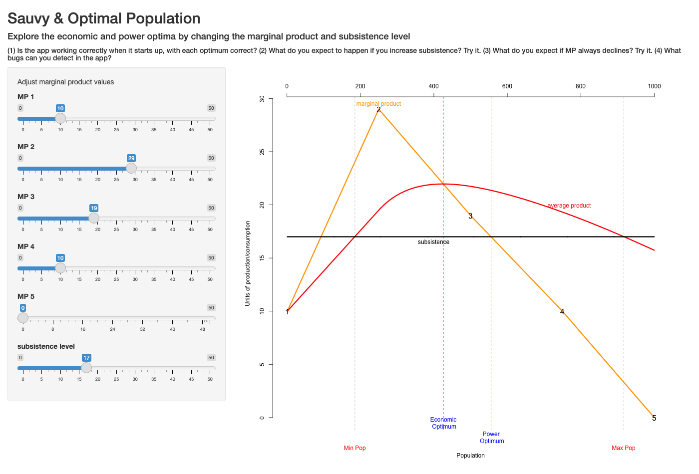

# The Optimum Population {#sec-optimum}

```{r}
#| label: setup-ch2
#| include: false
col_grey <- "grey45"; col_mp <- "#e08a00"; col_ap <- "#d62728"
```

::: {.callout-warning appearance="simple"}
## Draft: provenance notes (for review)
Margin tags mark material that is **not in the course slides or lab**.
[Added · from readings]{.tag-reading} comes from the assigned readings (Sauvy, Livi-Bacci).
[Added · new]{.tag-new} is from outside the course materials (my framing, general knowledge, or my own analysis) and needs the closest check.
Untagged material follows the 2025 slides (01–04) and Lab 1.
:::

::: {.callout-note appearance="minimal"}
**In this chapter.** A first economic model of population size: Alfred Sauvy's
theory of the *optimum population*. We define total, average, and marginal
product, find the economic and power optima, and see why the "best" population
depends on whose point of view we take.

**Readings this chapter draws on.** Sauvy (1966), *General Theory of
Population*, pp. 36–52; Livi-Bacci (2017), *A Concise History of World
Population*, Chapter 1 (a few passages).
:::

::: {.column-margin}
[Added · new]{.tag-new} Bridge text written for the chapter split.
:::

@sec-history described how human numbers have changed: near-zero growth for
millennia, an explosion in the last two centuries, and the slowdown of the
demographic transition. This chapter asks a different kind of question: what size
of population is *optimal*, and for whom? The tools it introduces, the total,
average, and marginal product, come back in the chapters on Malthus
(@sec-malthus), Solow (@sec-solow), and migration (@sec-immigration).

## Not too big, not too small

> "If there is such a thing as over-population and such a thing as
> under-population, it follows that between the two there must be such a thing as
> just the right population." (H. P. Fairchild, quoted by Sauvy)

What size population is best? It is a slippery question, because the answer
depends on **who is asking** (a peasant, a worker, a voter, a king, a president, a
capitalist, "society") and **what they want to maximize** (average welfare,
longevity, cultural power, military power, the sum of everyone's welfare).

::: {.column-margin}
[Added · from readings]{.tag-reading} Sauvy's list of aims, the assumptions held
constant, the India example, and Sismondi's king of England are from Sauvy 1966,
pp. 36–40.
:::

The French demographer Alfred Sauvy, whose *General Theory of Population* is our
guide here, insisted that "optimum" is an innocent word, a synonym for "best." "The
most violent opponents can agree on such a premise, even if they disagree on what
they hold to be 'best'." He listed nine possible aims: individual welfare; the
fastest increase of wealth; employment; power; long life and health; culture and
knowledge; total welfare; the "sum of life" (population times average lifespan);
and sheer numbers, where the optimum is the same as the maximum. Different aims
give different optima. So we should really speak of **optima**, plural.

Sauvy also pointed out a contradiction in phrases like "the population arrived at
its greatest strength and comfort." Strength and comfort are generally maximized at
different sizes. The same problem afflicts Jeremy Bentham's "greatest amount of good
for the greatest number." There is usually a trade-off.

To isolate the effect of numbers alone, Sauvy held everything else constant:
natural resources and past investment, technology, the age structure and the
productivity of individuals, the distribution of income, working hours, and trade
and migration. This is an abstraction, he admitted, since in practice "numbers
rarely vary without changing (or being changed by) some other factor." But it lets
us think clearly.

Two more warnings from Sauvy. First, an optimum is a **pointer, not a target**. In
his example, to say that India's 500 million people "would be more at ease if there
were only 300 million" is not to say "that 200 million should be shot." Second,
choosing an aim is an ethical matter, not a scientific one. Sauvy recounts the
economist Sismondi's challenge. Suppose technology allowed the king of England to live
alone on his island, with machines doing all the work, at an extremely high standard
of living. Would that be an optimum? Most people find the idea distasteful. Still,
Sauvy observed, in Western societies the aim of individual welfare had come to
dominate. So he concentrated on two optima: the **economic optimum** and the
**power optimum**.

## Total, average, and marginal product

We need three concepts that will reappear throughout the course.

- The **total product**, $TP(N)$, is the output of a population of $N$ people.
- The **average product**, $AP(N) = TP(N)/N$, is output per person. With equal
  sharing, it is the **standard of living**.
- The **marginal product**, $MP(N)$, is the *additional* output from adding the
  $N$th person. Total product is the sum of the marginal products of everyone so far:
  $TP(N) = MP(1) + MP(2) + \dots + MP(N)$.

@fig-tp-ap-mp shows how the three fit together, following Sauvy's own
diagrams.

```{r}
#| label: fig-tp-ap-mp
#| fig-cap: "Total, average, and marginal product (after Sauvy's Figures 13–14). Top: total product. The marginal product is the slope of the TP curve; the average product is the slope of a ray from the origin to the curve. The steepest ray just touches TP at the economic optimum. Bottom: the marginal product peaks where TP is steepest (K), and crosses the average product at its maximum (the economic optimum)."
#| fig-height: 6.5
#| echo: false
n <- seq(0.01, 12, 0.01)
mp <- 4 * (n / 3)^2 * exp(2 * (1 - n / 3))
tp <- cumsum(mp) * 0.01
ap <- tp / n
k <- n[which.max(mp)]                 # inflection of TP, peak of MP
o <- n[which.max(ap)]                 # economic optimum, max AP
tp_o <- approx(n, tp, o)$y; tp_k <- approx(n, tp, k)$y
op <- par(mfrow = c(2, 1), mar = c(1.5, 4.5, 1, 1), oma = c(2.5, 0, 0, 0))
## top panel: total product
plot(n, tp, type = "l", lwd = 2.5, xaxt = "n", yaxt = "n", xlab = "",
     ylab = "Total product", ylim = c(0, max(tp) * 1.08), xlim = c(0, 12))
abline(0, tp_o / o, lty = 2, col = col_ap)                   # tangent ray = max AP
segments(0, 0, 9, approx(n, tp, 9)$y, lty = 3, col = col_grey) # a flatter ray
points(c(k, o), c(tp_k, tp_o), pch = 19)
ymax <- max(tp)
arrows(2.6, 0.8 * ymax, o - 0.15, tp_o + 0.02 * ymax, length = 0.07, col = col_ap)
text(2.6, 0.8 * ymax, "steepest ray:\nmaximum AP", pos = 2, col = col_ap, cex = 0.85)
arrows(6.2, 0.22 * ymax, k + 0.15, tp_k - 0.02 * ymax, length = 0.07)
text(6.2, 0.22 * ymax, "steepest point of TP:\nmaximum MP", pos = 4, cex = 0.85)
text(9.6, 0.42 * ymax, "a flatter ray:\nlower AP", col = col_grey, cex = 0.85)
segments(c(k, o), 0, c(k, o), c(tp_k, tp_o), lty = 3)
text(11.8, max(tp), "TP", pos = 3, xpd = NA)
## bottom panel: marginal and average product
plot(n, mp, type = "l", lwd = 2.5, col = col_mp, xaxt = "n", yaxt = "n",
     xlab = "", ylab = "Output per person", ylim = c(0, 4.4), xlim = c(0, 12))
lines(n, ap, lwd = 2.5, col = col_ap)
segments(c(k, o), 0, c(k, o), c(max(mp), max(ap)), lty = 3)
text(k, max(mp), "MP", pos = 3, col = col_mp, xpd = NA)
text(10.5, approx(n, ap, 10.5)$y, "AP", pos = 3, col = col_ap)
axis(1, at = c(k, o), labels = c("K", expression(O[econ])))
mtext("Population size", side = 1, outer = TRUE, line = 1)
par(op)
```

Three facts to read off the figure:

- **Marginal product is the slope of total product.** Where TP rises steeply,
  each extra person adds a lot. Where it flattens, they add little. The marginal
  product peaks at K, where total output grows fastest.
- **Average product is the slope of a ray from the origin.** The ray to any point
  on the TP curve rises $TP(N)$ over a run of $N$, so its slope is $TP(N)/N$.
- **At the economic optimum, the two slopes are equal.** The steepest possible ray
  just touches the TP curve, so there the ray's slope (AP) equals the curve's slope
  (MP). In the bottom panel, this is where the MP curve crosses the AP curve at the
  top of the AP curve.

## The economic optimum

Sauvy's **economic optimum** is the population that maximizes the average standard
of living, $AP$. It takes an individual perspective. Size benefits not "society" but
each person through their standard of living, and inequality is not part of the
objective.

Why is there an optimum at all? Sauvy's illustration: imagine England with only 50
to 100 people. Even with advanced technology, they could not run railways or steel
foundries, and would live as craftsmen or shepherds. Now imagine 200 to 500 million
people on the same island, cultivating even the poorest soils by hand. In both cases
the standard of living would be very low. Somewhere in between lies the best size.
(A smaller example from lecture: what is the optimum size for a freshman English
seminar?)

### Why a population can be too small: increasing returns

The lecture lists three reasons a population can be too small:

- **No specialization.** Adam Smith's pin factory: dividing tasks among workers
  multiplies their output.
- **No complementarity.** Some tasks need more than one person, like holding a
  ladder while someone changes a light bulb.
- **Fixed costs.** Roads, machines, and teachers are only worthwhile if enough
  people share them.

::: {.column-margin}
[Added · from readings]{.tag-reading} The examples in the next three paragraphs
are from Sauvy 1966, pp. 45–46 and 48–49, and Livi-Bacci 2017, pp. 1 and 21.
:::

Sauvy fills these out with examples. Specialization, he stresses, is not a matter
of new technology. It lets a population use tools it already knows about but
couldn't use without enough people to specialize. "For ten readers one uses a
typewriter, for one thousand a printing press." Even without machines, much work
gets cheaper per unit as it is shared: "it does not, for instance, take ten times as
long to wash ten plates as to wash one." Increasing returns of this kind, he notes,
show up mostly in activities that transform uniform materials, such as manufacturing.

His second source of increasing returns is **communal expenses**, or "overheads."
Some costs barely depend on the number of people who share them: the upkeep of a
bridge that isn't crowded, the ruler's house, a radio programme. The more people
there are, the smaller each person's share. Sauvy is careful to give the objection.
Sooner or later one more user *will* make the bridge too crowded and it will have
to be widened, so these costs are only fixed up to a point. But, he concludes,
"the fact remains that returns are increased by a rise in the number of men."

Size matters for settlement too. Sauvy observes that the first Europeans in
America "would have been ill-advised to spread out too much." They needed each
other, and trade required people concentrated at a few coastal points. Livi-Bacci
adds two more reasons from the deep past. A very small group cannot survive at all:
groups must be large enough "to ensure a reasonable choice of partners and to
survive catastrophic events." And only a large population can mobilize the labor
to build houses, cities, roads, bridges, ports, and canals. That is why, for most
of history, a densely settled landscape was read as a sign of prosperity, and
deserted land as a sign of decline.

### Why a population can be too big: diminishing returns

The lecture's reasons a population can be too big:

- **Diminishing marginal returns.** Adding workers to a fixed amount of land adds
  less and less output.
- **Variable quality of inputs.** The best land is farmed first, so later acres are
  less productive.
- **The neoclassical version.** Each additional unit of capital, even if identical,
  adds less to productivity than the one before.

::: {.column-margin}
[Added · from readings]{.tag-reading} Sauvy 1966, pp. 44–46.
:::

Sauvy's examples come from **natural resources**. "The reserves in mines vary; game
does not increase proportionally to the number of hunters; fishing grounds have to
be moved." The same holds for hydroelectric dams, forests, and tidal energy. In
each case the resource is limited, and more people means less for each.

Sauvy also answers a common objection: isn't *every* activity subject to increasing
and then decreasing returns? A factory, after all, first becomes more productive as
workers are added, and then less so once they get in each other's way. His answer
turns on whether the fixed input can be **copied**. When a factory is full, you can
build a second or third one at about the same cost. But "a mine, a farm, a fishing
ground may have decreasing returns because it is difficult to build or find a second
similar to the first." Manufacturing can be replicated, but land and natural
resources cannot. That is why diminishing returns bite hardest in agriculture, and
why they are central to Malthus, the subject of the next chapter.

### Finding the optimum

The relationship between the curves is the key to finding the optimum. When the
marginal product is above the average, adding a person pulls the average *up*. When
it is below, adding a person pulls the average *down*. So the average product is at
its maximum exactly where the marginal product crosses it. Sauvy put it as "when
the marginal output equals the average output, the latter is not changing."

## The power optimum

::: {.column-margin}
[Added · from readings]{.tag-reading} Cathedrals and interplanetary travel are from
Sauvy 1966, p. 59. The variable subsistence level (below) is from pp. 55–56.
:::

Now take the point of view of the ruler, or of society as a whole ("La France").
Sauvy defines **power** as total production beyond what is needed for subsistence.
It is the surplus available for pyramids, armies, cathedrals, or space programs.
Power need not be military. Sauvy's examples include national prestige and culture.
"In building cathedrals collectively," he writes, "the Middle Ages were seeking the
power optimum rather than the economic optimum. The same applies to interplanetary
travel."
Each person adds their marginal product to output but must be fed, so

$$
\text{power}(N) = TP(N) - N \times \text{subsistence} = \sum_{i=1}^{N} \left[ MP(i) - \text{subsistence} \right].
$$

Do more people always mean more power? No. A person whose marginal product exceeds
subsistence adds to the surplus. A person whose marginal product falls short of
subsistence is a net cost, and must be fed from others' output. So power is
maximized at the population where **the marginal product equals subsistence**.

What counts as "subsistence"? Sauvy first treats it as fixed, the bare minimum to
keep people alive and working. Then he loosens the assumption. People produce more
when better fed, and they get used to a way of life. He reports that commanders
claimed soldiers or workers deprived of tobacco would produce less. So the
subsistence level that maximizes power depends on the country and the times. In
wartime, Sauvy notes, it was higher in the United States than in Germany, and higher
in Germany than in the Soviet Union.

## Ordering the optima

@fig-sauvy puts these together with two more reference points: the **minimum**
population (the smallest that can feed itself, where the average product first
reaches subsistence) and the **maximum** population (the largest that can feed
itself, where the average product falls back to subsistence).

```{r}
#| label: fig-sauvy
#| fig-cap: "Sauvy's optima. The marginal product (orange) rises and then falls. The average product (red) peaks where the marginal product crosses it: the economic optimum. The power optimum is where the marginal product falls to subsistence. The minimum and maximum populations are where the average product equals subsistence."
#| fig-height: 4.6
#| echo: false
n <- seq(0.01, 14, 0.01)
mp <- 4 * (n / 3)^2 * exp(2 * (1 - n / 3))       # rises, peaks at n = 3, falls
tp <- cumsum(mp) * 0.01
ap <- tp / n
subs <- 1.4
o_econ <- n[which.max(ap)]
o_pow <- n[which(n > 3 & mp < subs)[1]]
o_min <- n[which(ap > subs)[1]]
o_max <- n[max(which(ap > subs))]
op <- par(mar = c(4.5, 4.2, 1, 1))
plot(n, mp, type = "n", ylim = c(0, 4.4), xlim = c(0, 14), xaxt = "n", yaxt = "n",
     xlab = "", ylab = "Output per person")
abline(h = subs, lty = 2, col = col_grey)
text(12.3, subs, "subsistence", pos = 1, col = col_grey, cex = 0.9)
lines(n, mp, col = col_mp, lwd = 2.5)
lines(n, ap, col = col_ap, lwd = 2.5)
text(3, 4.2, "marginal product", col = col_mp, cex = 0.9)
text(o_econ + 1.5, max(ap) + 0.25, "average product", col = col_ap, cex = 0.9)
for (o in c(o_min, o_econ, o_pow, o_max))
  segments(o, 0, o, approx(n, ap, o)$y * (o == o_econ) + subs * (o != o_econ), lty = 3)
axis(1, at = c(o_min, o_econ, o_pow, o_max),
     labels = c(expression(O[min]), expression(O[econ]),
                expression(O[pow]), expression(O[max])))
mtext("Population size", side = 1, line = 3)
par(op)
```

Sauvy shows that, in general,

$$
O_{\min} < O_{\text{econ}} < O_{\text{pow}} < O_{\max}.
$$

The power optimum is larger than the economic optimum, because past the economic
optimum each extra person still produces more than they need to subsist, adding to
the ruler's surplus while lowering everyone's average. The power optimum is smaller
than the maximum, because between the two each extra person produces less than
subsistence and must be fed by others.

How can people survive when their marginal product is below subsistence? Because
output is shared. As long as the *average* product is above subsistence, the group
as a whole can feed everyone.

## A worked example

Here is the example from lecture. Suppose the marginal products of the first six
people are 0, 4, 3, 2, 1, 0, and subsistence is 2 units per person.

```{r}
#| label: tbl-sauvy-example
#| tbl-cap: "A worked example of Sauvy's optima (lecture example). Subsistence = 2."
#| echo: false
N <- 1:6; MP <- c(0, 4, 3, 2, 1, 0); TP <- cumsum(MP); AP <- TP / N
power <- TP - 2 * N
knitr::kable(rbind(`Population (N)` = N, `Marginal product` = MP,
                   `Total product` = TP, `Average product` = round(AP, 2),
                   `Power = TP − 2N` = power), col.names = NULL)
```

The average product is highest at $N = 3$ (2.33), so that is the economic optimum.
Power is highest at $N = 3$ or $N = 4$ (both give 1). The fourth person's marginal
product, 2, exactly equals subsistence, so adding them leaves power unchanged. The
largest population whose average product still covers subsistence is $N = 5$, the
maximum.

## Try it: the Sauvy app

::: {.column-margin}
[Added · new]{.tag-new} The app is the course's own Sauvy app
(`ShinyApps/sauvy` in the 2025 course repo), exported with Shinylive so it runs in the
browser, in its own tab. The three questions are mine; they change only the marginal products of individual workers, to stay clear of the in-class questions printed on the app itself (slide 04-05) and of the Lab 1 graded questions on the definitions of the optima.
:::

The app draws the marginal product (orange), average product (red), and subsistence level (black) for a population of up to 1,000 people, and marks the four reference points: minimum population, economic optimum, power optimum, and maximum population. The five "MP" sliders set the marginal product at five points along the way (numbered 1 to 5 on the graph); the app connects them with straight lines. It opens in a new tab, so you can make it full screen and keep this page open
alongside it. (The first load can take a few seconds while R starts up in your browser.)

[{width="85%" fig-alt="Screenshot of the Sauvy optimal-population Shiny app: sliders for five marginal products and subsistence on the left, and a plot of marginal product, average product, and subsistence with the four optima marked on the right."}](apps/sauvy/index.html){target="_blank" rel="noopener"}

[Open the Sauvy app in a new tab ↗](apps/sauvy/index.html){.btn .btn-primary target="_blank" rel="noopener"}

Before you move each slider, write down what you expect to happen. Then check.

1. **More productive middle workers.** Raise "MP 3" from 19 to 29. Which way will the
   economic optimum move? What happens to the highest standard of living the population
   can reach?
2. **A sharper peak.** Return MP 3 to 19, and raise "MP 2" from 29 to 45. Productivity is
   now higher than before. Does the economic optimum move toward a larger or a smaller
   population? (Remember where the average product reaches its maximum.)
3. **More productive late workers.** Return MP 2 to 29, and raise "MP 4" from 10 to 20.
   Which of the four reference points move, and which stay put? Why does the economic
   optimum care about some workers' productivity but not others'?

In class we use the app to check the ordering of the optima; Lab 1 asks you to compute the optima by hand for a small island.

## Extensions from Sauvy

::: {.column-margin}
[Added · from readings]{.tag-reading} Overheads and military power are from Sauvy
1966, pp. 47–48 and 53–55 (the military discussion is just past the assigned
pages).
:::

**Overheads raise the optimum.** Suppose a population suddenly has to pay a fixed
cost, such as tribute to a foreign power or a long-postponed public work. Total
output available for consumption falls by a fixed amount at every population size.
Because the burden can be shared, more people now help. In Sauvy's words: "The
greater the load men have to bear, the greater their advantage is in being numerous
to bear it; so that when a country gets into debt with the outside world, its wealth
decreases but its optimum population rises."

**Military power raises the power optimum further.** Soldiers produce nothing but
must be fed. A state that wants an army as well as weapons needs a population even
larger than the power optimum, to feed the soldiers out of the surplus.

::: {.column-margin}
[Added · from readings]{.tag-reading} Quotes in the next three paragraphs are from
Sauvy 1966, pp. 62–63, which are past the assigned pages. The "French intellectual
tradition" framing follows lecture.
:::

**Rulers and the economic optimum.** Why did it take so long for anyone to ask
which population makes the *average* person best off? Sauvy's answer is that the
people whose views counted generally preferred the power optimum. "As a general
rule," he writes, "whoever holds or seeks power wishes to increase numbers." The
patriarch welcomes every birth in his tribe, because his power "is almost identical
with his wealth." The absolute monarch wants more subjects, and his wealth too
"coincides with his power because it is separate from the rest of the population."
Under a dominant class with absolute power, "the more slaves, labourers, or workers,
the more stable its power." Then comes the passage quoted in lecture:

> "Before the nineteenth century this desire for power used to be so predominant
> that it hampered for a long time the understanding of the economic optimum. At
> about the time when this was understood, regal authority began to decline."
> (p. 62)

Notice the order in that second sentence: first an *idea* is understood, and then
authority declines. This fits a long French intellectual tradition that treats ideas
as real forces in history, so that how people understand their situation shapes what
they do next. Once people could see that a larger population might serve the king's
power at the expense of their own standard of living, the case for royal authority
weakened.

But Sauvy's own examples show that the causation can run the other way too. The
same contrast between power and welfare appears inside the family. "As long as
children remained under the narrow and direct authority of the father, power was by
far the main objective. With the emancipation of children the birth rate has
decreased because economic considerations have taken the upper hand." Here a change
in conditions, the father's weakening authority, comes first, and the economic way
of thinking follows. Sauvy finds the same pattern in organizations. Senior civil
servants want bigger staffs, because staff is power. A private firm, or an
efficiency-minded public agency, wants as few people as possible on each task.
Which optimum you favour depends on where you stand.

So did the idea of the economic optimum bring down kings, or did the decline of kings
make the idea thinkable? Most likely both. New ideas made the old order look less
legitimate, and a changing world made the new ideas more persuasive. It is hard to
say which was cause and which was effect. Keep that question in mind throughout the
course: when behaviour and ideas about behaviour change together, which one is
driving?

## Population "evolution"

If technology and everything else stayed constant (a big "if"), a *growing*
population would pass through these stages in order:

1. the minimum (viable) population;
2. maximum marginal productivity, where total output grows fastest;
3. the maximum standard of living, the economic optimum;
4. maximum power, the power optimum;
5. the maximum (viable) population.

## Critiques, and why the framework is still useful

::: {.column-margin}
[Added · from readings]{.tag-reading} The camel-shaped curve and Gini are from
Sauvy 1966, p. 42. Gini's first name is from general knowledge.
:::

The optimum population has obvious limits:

1. **It assumes fixed technology.** Perhaps each population density has its own
   appropriate technology. We'll read Ester Boserup on this (@sec-boserup).
2. **The optimum may not be a single point.** The objective could have many peaks,
   or a wide, flat top, so that a broad range of sizes is about equally good. Sauvy
   himself mentions a "camel-shaped curve with two humps." The Italian statistician
   Corrado Gini argued for two optima, one at the agricultural stage of development
   and one at the industrial stage. That example also shows how closely this critique
   is tied to the first one, about technology.
3. **It ignores feedback** between population size and technological level.

And the optimum is a theoretical idea, not a requirement. It doesn't mean we should
get rid of people if we are above it.

Still, the framework is very useful. It shows how the optima are ordered in general,
and it shows that the "best" population depends on the objective, which means on
whose perspective we take. The tools will also come back. The total product
picture will be useful for the Solow growth model, and the marginal product picture
for Malthus (next chapter) and for migration.

## Key ideas

- Sauvy's **optima** depend on the objective, and so on whose perspective we take.
- The economic optimum maximizes the average product, and the power optimum
  maximizes the surplus over subsistence.
- In general, $O_{\min} < O_{\text{econ}} < O_{\text{pow}} < O_{\max}$.

## Check your understanding

::: {.column-margin}
[Added · new]{.tag-new} Q1 comes from your slide 03-22. The rest
are new and avoid the Lab 1 graded questions.
:::

1. **Does the ordering always hold?** Suppose the marginal product *falls* from the
   very first person. What is the economic optimum? Is the power optimum still larger
   than the economic optimum?

2. **A higher subsistence requirement.** In @fig-sauvy, what happens to each of the
   four reference points if subsistence rises? Which of them doesn't move?

3. **Soldiers.** Sauvy argues that a state wanting military power needs a population
   even larger than the power optimum. Explain why in one or two sentences, using the
   idea of the surplus over subsistence.

## Further reading

- Sauvy, Alfred. 1966. *General Theory of Population.* Basic Books. Pages 36–41 for
  an overview, 42–48 on the economic optimum, and 51–52 on the power optimum.
