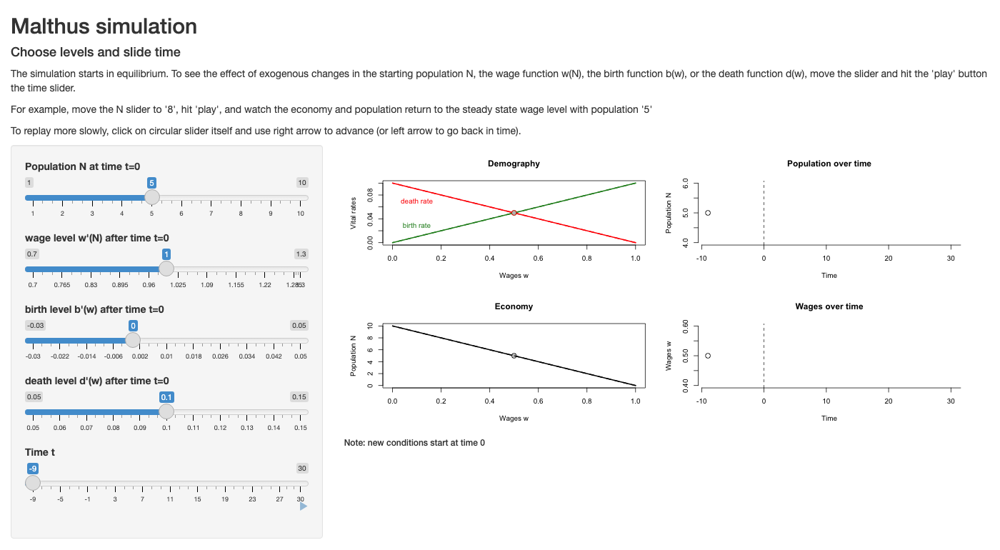

# The World According to Malthus {#sec-malthus}

```{r}
#| label: setup
#| include: false

## ---- The model used in every diagram in this chapter -------------------
## Functional forms are illustrative: chosen only to have the right shapes.
## Birth rate rises with the wage (concave); death rate falls (convex);
## wage falls with population (diminishing returns to labor on fixed land).
b_fun <- function(w, shift = 0) 0.030 + 0.010 * log(w) + shift
d_fun <- function(w, scale = 1) scale * 0.030 * w^(-0.6)
w_of_N <- function(N, A = 1) A * N^(-0.5)       # wage as a function of population
N_of_w <- function(w, A = 1) (A / w)^2           # same curve, solved for N

w_star <- function(b_shift = 0, d_scale = 1)
  uniroot(function(w) b_fun(w, b_shift) - d_fun(w, d_scale), c(0.2, 5))$root

col_b <- "#1b9e3a"; col_d <- "#d62728"; col_w <- "black"; col_grey <- "grey45"

## Two-panel Malthus diagram (birth/death rates on top, population on bottom,
## common wage axis), with an optional "new" set of curves drawn dashed.
malthus_diagram <- function(b_shift = 0, d_scale = 1, A = 1,
                            new_b_shift = NULL, new_d_scale = NULL, new_A = NULL,
                            labels = c("w*", "N*"), new_labels = c("w'", "N'"),
                            main = "") {
  w <- seq(0.55, 1.9, length.out = 200)
  xl <- c(0.55, 2.25)                   # extra room on the right for labels
  op <- par(mfrow = c(2, 1), mar = c(2.2, 6, 1.6, 1), mgp = c(3.2, 0.4, 0),
            oma = c(1.5, 0, 0, 0))
  on.exit(par(op))
  ## top panel
  plot(w, b_fun(w, b_shift), type = "n", ylim = c(0.014, 0.042), xlim = xl,
       xaxt = "n", yaxt = "n", xlab = "", ylab = "Birth and\ndeath rates",
       main = main, cex.main = 1, font.main = 1)
  lines(w, b_fun(w, b_shift), col = col_b, lwd = 2.5)
  lines(w, d_fun(w, d_scale), col = col_d, lwd = 2.5)
  text(1.9, b_fun(1.9, b_shift), "b(w)", col = col_b, pos = 4)
  text(1.9, d_fun(1.9, d_scale), "d(w)", col = col_d, pos = 4)
  ws <- w_star(b_shift, d_scale)
  segments(ws, 0, ws, b_fun(ws, b_shift), lty = 3)
  axis(1, at = ws, labels = labels[1], tick = TRUE)
  has_new <- !is.null(new_b_shift) || !is.null(new_d_scale)
  if (has_new) {
    nb <- if (is.null(new_b_shift)) b_shift else new_b_shift
    nd <- if (is.null(new_d_scale)) d_scale else new_d_scale
    if (!is.null(new_b_shift)) {
      lines(w, b_fun(w, nb), col = col_b, lwd = 2, lty = 2)
      text(1.9, b_fun(1.9, nb), "new b(w)", col = col_b, pos = 4)
    }
    if (!is.null(new_d_scale)) {
      lines(w, d_fun(w, nd), col = col_d, lwd = 2, lty = 2)
      text(1.9, d_fun(1.9, nd), "new d(w)", col = col_d, pos = 4)
    }
    ws2 <- w_star(nb, nd)
    segments(ws2, 0, ws2, b_fun(ws2, nb), lty = 3, col = col_grey)
    axis(1, at = ws2, labels = new_labels[1], col.axis = col_grey)
  }
  ## bottom panel
  plot(w, N_of_w(w, A), type = "n", ylim = c(0, 2.6), xlim = xl,
       xaxt = "n", yaxt = "n", xlab = "", ylab = "Population\nsize (N)")
  lines(w, N_of_w(w, A), col = col_w, lwd = 2.5)
  text(1.9, N_of_w(1.9, A), "w(N)", pos = 4)
  ws_bottom <- if (has_new) w_star(if (is.null(new_b_shift)) b_shift else new_b_shift,
                                   if (is.null(new_d_scale)) d_scale else new_d_scale) else ws
  segments(ws, 3, ws, N_of_w(ws, A), lty = 3)
  segments(0, N_of_w(ws, A), ws, N_of_w(ws, A), lty = 3)
  axis(2, at = N_of_w(ws, A), labels = labels[2], las = 1)
  axis(1, at = ws, labels = labels[1])
  if (!is.null(new_A)) {
    lines(w, N_of_w(w, new_A), lwd = 2, lty = 2)
    text(1.15, N_of_w(1.15, new_A) + 0.22, "new w(N)", adj = 0)
    segments(0, N_of_w(ws, new_A), ws, N_of_w(ws, new_A), lty = 3, col = col_grey)
    axis(2, at = N_of_w(ws, new_A), labels = new_labels[2], las = 1, col.axis = col_grey)
  } else if (has_new) {
    segments(ws_bottom, 3, ws_bottom, N_of_w(ws_bottom, A), lty = 3, col = col_grey)
    segments(0, N_of_w(ws_bottom, A), ws_bottom, N_of_w(ws_bottom, A), lty = 3, col = col_grey)
    axis(2, at = N_of_w(ws_bottom, A), labels = new_labels[2], las = 1, col.axis = col_grey)
    axis(1, at = ws_bottom, labels = new_labels[1], col.axis = col_grey)
  }
  mtext("Wage (w)", side = 1, outer = TRUE, line = 0.3)
}

## Simulate the model year by year: N grows at rate b(w) - d(w), where w = w(N).
simulate_malthus <- function(N0, years = 300, b_shift = 0, d_scale = 1, A = 1) {
  N <- numeric(years + 1); N[1] <- N0
  for (t in 1:years) {
    w <- w_of_N(N[t], A)
    N[t + 1] <- N[t] * exp(b_fun(w, b_shift) - d_fun(w, d_scale))
  }
  w <- w_of_N(N, A)
  data.frame(t = 0:years, N = N, w = w,
             b = b_fun(w, b_shift), d = d_fun(w, d_scale))
}

## Swedish data (Human Mortality Database, present-day borders)
swe <- read.table("data/SWE_pop_birth_death.txt", header = TRUE)
swe$year <- as.numeric(rownames(swe))
swe$cbr <- 1000 * swe$B / swe$N     # crude birth rate, per 1,000
swe$cdr <- 1000 * swe$D / swe$N     # crude death rate, per 1,000
```

::: {.callout-warning appearance="simple"}
## Draft: provenance notes (for review)
Margin tags mark material that is **not in the course slides or lab**.
[Added · from readings]{.tag-reading} comes from the assigned or related readings (Malthus, Lee).
[Added · new]{.tag-new} is from outside the course materials (my framing, general knowledge, or my own analysis) and needs the closest check.
Untagged material follows the 2025 slides (05, 06) and Lab 2.
:::

::: {.callout-note appearance="minimal"}
**In this chapter.** Why was human population nearly stationary for most of
history? Thomas Malthus answered with a feedback loop linking population,
wages, births, and deaths. We read Malthus in his own words, turn his argument
into a simple two-panel diagram, draw out its "dismal" conclusions, and then
look at the Swedish data that Malthus himself used.

**Readings this chapter draws on.** Malthus (1798), *An Essay on the Principle
of Population*, Preface and Chapters 1–2 (assigned); Malthus's later editions,
Book II, Chapters 1–2, on Norway and Sweden (for the lab); Lee (1980),
pp. 517–520 and 541–546 (recommended).
:::

## The puzzle of stationarity


::: {.column-margin}
[Added · new]{.tag-new} Your slide 05-03 poses the 1.10-daughters question. The 29-year generation and the worked numbers are mine.
:::

Here is a puzzle to start. For almost all of human history, the world's
population grew so slowly that it was very nearly stationary. Over long
stretches, the average woman left behind about one surviving daughter, who
replaced her. How did we manage that?

It is harder than it sounds. Suppose instead that each woman had raised, on
average, 1.10 surviving daughters instead of 1.00. That seems like a small
difference. But with a generation length of about 29 years, it implies a growth
rate of about `r round(100 * log(1.1) / 29, 2)` percent per year. Sustained for
10,000 years, the time since the beginning of agriculture, that growth would
multiply a population by roughly
`r format(signif(exp(10000 * log(1.1) / 29), 1), big.mark = ",", scientific = FALSE)`.
Start with a few million people and you end up with far more humans than there
are grains of sand on Earth. Go the other way, to 0.90 daughters, and humanity
goes extinct.

So the near-stationarity of the past calls for an explanation. There are two
kinds of answer:

1. **Accident.** The population of, say, England in 1801 (about 9 million) was
   the cumulative result of a long string of chance events: plagues, good
   harvests, wars, invasions. Growth and decline happened to cancel out.
2. **System.** Something pushed population back toward a particular level
   whenever it drifted away. On this view, the population of 1801 was an
   *equilibrium*, the outcome of a self-correcting system.

The accident story has a problem. Random ups and downs don't cancel out on
their own. Left alone, a population whose growth rate wanders randomly will
eventually either explode or die out. The near-stationarity of human numbers
over millennia suggests a system. Malthus's great contribution was to describe
what that system might be.

A good theory of the pre-industrial world needs to explain three things:

I. Why populations were roughly stationary, neither exploding nor going
   extinct.
II. Why there were nonetheless **oscillations**, periods of growth followed by
    periods of decline.
III. Why the standard of living of ordinary people didn't improve much over the
     long run, even as technology slowly advanced.

Keep these three in mind. We'll come back to see how well Malthus does on
each.

## A pamphlet against optimism

### Context


::: {.column-margin}
[Added · new]{.tag-new} Dates, anonymous publication, and the 1803 edition are from general knowledge. Slide 05-12 has only the short biography.
:::

Thomas Robert Malthus (1766–1834) was a young English clergyman when, in 1798,
he anonymously published *An Essay on the Principle of Population, as it
Affects the Future Improvement of Society*. He later became one of the first
professors of political economy, at the East India Company's college, and
spent the rest of his life revising and expanding the *Essay*. The second
edition (1803) was nearly a new book, packed with data from around the world.


::: {.column-margin}
[Added · new]{.tag-new} The Godwin/Condorcet context comes from Malthus 1798 (Preface; Chs. 8–15). That the "friend" was his father is from general knowledge.
:::

The first edition was not written as a dispassionate study of demography. It
was a reply to an argument. The 1790s were years of revolutionary optimism. The
French Revolution, the spread of printing, and the discoveries of science had
convinced writers like William Godwin in England and the Marquis de Condorcet in
France that humanity was on the verge of limitless improvement. Godwin imagined
a society of equality and reason, in which property would be shared, crime
would vanish, and each person would need to work only half an hour a day.
Malthus's Preface says the *Essay* began in a conversation with "a friend"
about one of Godwin's essays (the friend was his own father, an admirer of
Godwin).

Malthus's answer was that no reform of institutions, however wise, could
overcome a more basic problem: the tendency of population to outrun food. He
didn't enjoy this conclusion, or at least he said he didn't:

::: {.callout-tip appearance="simple"}
## In his own words
"The view which he has given of human life has a melancholy hue, but he feels
conscious that he has drawn these dark tints from a conviction that they are
really in the picture, and not from a jaundiced eye or an inherent spleen of
disposition." (Preface, 1798)
:::


::: {.column-margin}
[Added · from readings]{.tag-reading} Ostrich passage: Malthus 1798, Ch. 1 (assigned). The comment about the irony is mine.
:::

Malthus also insisted on a rule of evidence that is still a good one. He
refused to argue with predictions that had no basis in past experience:

> "A writer may tell me that he thinks man will ultimately become an ostrich. I
> cannot properly contradict him. But before he can expect to bring any
> reasonable person over to his opinion, he ought to shew that the necks of
> mankind have been gradually elongating…" (Chapter 1)

In other words: if you claim the future will be different, show me a trend.
Keep this rule in mind. It is ironic, because the trend that would overturn
Malthus's own predictions, the industrial revolution, was getting under way in
England as he wrote.


::: {.column-margin}
[Added · from readings]{.tag-reading} Postulates and the geometric vs. arithmetic ratios come from Malthus 1798, Chs. 1–2 (assigned). They are not in your slides or lab. The table and the commentary on it are mine.
:::

### The argument in two postulates

Malthus builds his case on two assumptions, which he calls *postulata*:

> "First, That food is necessary to the existence of man.
> Secondly, That the passion between the sexes is necessary and will remain
> nearly in its present state." (Chapter 1)

From these he draws his famous contrast:

> "Population, when unchecked, increases in a geometrical ratio. Subsistence
> increases only in an arithmetical ratio. A slight acquaintance with numbers
> will shew the immensity of the first power in comparison of the second."
> (Chapter 1)

"Geometrical" means growth by multiplication: 1, 2, 4, 8, 16. "Arithmetical"
means growth by addition: 1, 2, 3, 4, 5. Malthus took the doubling time of
population from the American colonies, where land was plentiful and the
population doubled about every 25 years. For food, he made what he considered
an extremely generous assumption: Britain's food supply could be *increased*
every 25 years by an amount equal to the entire current harvest.
@tbl-ratios reproduces his worked example for Britain.

```{r}
#| label: tbl-ratios
#| tbl-cap: "Malthus's illustration for Britain (Chapter 2). Figures are millions of people."
#| echo: false
yrs <- seq(0, 100, 25)
pop <- 7 * 2^(0:4)
food <- 7 * (1:5)
knitr::kable(data.frame(`Years from now` = yrs,
                        `Population, if unchecked` = pop,
                        `Population the food could support` = food,
                        `"Totally unprovided for"` = pop - food,
                        check.names = FALSE))
```

Two things about this table. First, the numbers aren't a forecast. Malthus
didn't think Britain would ever have 77 million starving people. His point was
that this gap *could never actually open up*. Something has to stop population
growth long before it does. The interesting question is *what*.


::: {.column-margin}
[Added · from readings]{.tag-reading} Reservoir metaphor: Malthus 1798, Ch. 6 (not assigned). Calling the ratios rhetorical is my framing.
:::

Second, the specific "ratios" are rhetorical. Modern readers often fixate on
whether food really grows arithmetically (it doesn't, exactly). But nothing in
Malthus's argument depends on the exact form. What matters is that land is
fixed, so each additional worker adds less food than the one before. Malthus
put this more vividly in Chapter 6. A country with abundant empty land is like
"a great reservoir of water, supplied by a moderate stream." A growing
population can draw on the reservoir for a while, "but the sooner, undoubtedly,
will the reservoir be exhausted, and the streams only remain."

### Checks: preventive and positive

If population can't actually grow geometrically for long, something must be
checking it. Malthus identifies two kinds of check:

::: {.callout-tip appearance="simple"}
## In his own words
"…a foresight of the difficulties attending the rearing of a family acts as a
**preventive check**, and the actual distresses of some of the lower classes, by
which they are disabled from giving the proper food and attention to their
children, act as a **positive check** to the natural increase of population."
(Chapter 4)
:::


::: {.column-margin}
[Added · new]{.tag-new} The point about late marriage (women in their mid-twenties) as the main fertility lever is from general knowledge. Slide 05-13 makes the marriage link.
:::

In modern terms:

- The **preventive check** works through **fertility**. People foresee the cost
  of supporting a family and delay marriage, or don't marry at all. In
  pre-industrial Europe, where nearly all births happened within marriage and
  people married late (mid-twenties for women) or not at all, the age at
  marriage was the main lever controlling the birth rate.
- The **positive check** works through **mortality**. When food is scarce,
  more people die, especially infants and children of the poor.


::: {.column-margin}
[Added · from readings]{.tag-reading} Slide 05-11 poses the "vice" question. This answer is mine, drawn from Malthus 1798, Chs. 1 and 5.
:::

Malthus summed up all the checks with a phrase that shocks modern readers:
"All these checks may be fairly resolved into misery and vice" (Chapter 5).
**Misery** is the positive check: hunger, disease, early death. **Vice** is
harder for us to interpret. For Malthus, a clergyman, it included prostitution,
sex outside marriage, and what he called "vicious customs with respect to
women." That category takes in contraception and abortion, which he regarded as
immoral. It also included war. (The list in Chapter 5 is "vicious customs with
respect to women, great cities, unwholesome manufactures, luxury, pestilence,
and war.") So when Malthus writes about "even the most vicious societies," he
doesn't mean societies where people are cruel. He means societies where the
birth rate is held down by practices he disapproved of.


::: {.column-margin}
[Added · new]{.tag-new} Moral restraint (added in 1803) is from general knowledge, not the assigned texts.
:::

In the second edition, Malthus softened his position a little. He added a third
category, **moral restraint**: delaying marriage *without* vice. This was the
preventive check he approved of, and as we'll see, it is the one hope he held
out for improving the lot of the poor.


::: {.column-margin}
[Added · new]{.tag-new} My caveat. The claim that Chinese families controlled fertility is from general knowledge, not your materials.
:::

A note on reading Malthus. He wrote with the assumptions of an English
gentleman of the 1790s. His descriptions of "savages," of China, and of the
English poor draw on travelers' tales and the prejudices of his class.
Historians have since overturned many of his specific claims. For example,
later research has found that pre-industrial Chinese families controlled their
fertility in ways Malthus didn't recognize. Read him for the structure of the
argument, which has proven remarkably durable, not for his ethnography.

### Oscillation

Malthus didn't think population sat quietly at its limit. He described a cycle,
and this passage from Chapter 2 is the heart of the model:

::: {.callout-tip appearance="simple"}
## In his own words
"The constant effort towards population, which is found to act even in the most
vicious societies, increases the number of people before the means of
subsistence are increased. The food therefore which before supported seven
millions must now be divided among seven millions and a half or eight millions.
The poor consequently must live much worse, and many of them be reduced to
severe distress. The number of labourers also being above the proportion of the
work in the market, the price of labour must tend toward a decrease, while the
price of provisions would at the same time tend to rise. … During this season
of distress, the discouragements to marriage, and the difficulty of rearing a
family are so great that population is at a stand. In the mean time the
cheapness of labour, the plenty of labourers, and the necessity of an increased
industry amongst them, encourage cultivators to employ more labour upon their
land, to turn up fresh soil, and to manure and improve more completely what is
already in tillage, till ultimately the means of subsistence become in the same
proportion to the population as at the period from which we set out. The
situation of the labourer being then again tolerably comfortable, the restraints
to population are in some degree loosened, and the same retrograde and
progressive movements with respect to happiness are repeated." (Chapter 2)
:::

We can boil this down to a cycle:

1. Population increases.
2. Laborers suffer: wages fall and food prices rise.
3. People marry later and have fewer children; more die.
4. Farmers, with cheap labor available, cultivate more intensively.
5. "Tolerable comfort" is re-established.
6. Restraints loosen. Go back to step 1.


::: {.column-margin}
[Added · from readings]{.tag-reading} "Histories of the higher classes": Malthus 1798, Ch. 2 (assigned). The link to historical demography is mine.
:::

Malthus admitted that this oscillation would be hard to see. One reason he gave
is especially interesting for a course that works with data. "The histories of
mankind that we possess are histories only of the higher classes." To detect
the cycle, he wrote, you would need to know the number of marriages relative to
the number of adults, the comparative mortality among the children of the poor
and the comfortable, and "the variations in the real price of labour." He was
describing, almost exactly, the research program of historical demography,
which 150 years later reconstructed births, deaths, marriages, and real wages
from parish registers. We'll meet some of its results in @sec-was-malthus-right.

## Turning Malthus into a model

Malthus never drew a diagram, but his argument fits neatly into one. The version
we use here was popularized by the economic demographer Ronald Lee (1980), and
it is the diagram you'll draw in lecture and in the lab. It combines three
relationships, each a function of the **real wage**, *w*. Think of the wage as
the standard of living of ordinary working people: how much food a day's labor
can buy.

### Relationship 1: more people, lower wages

Malthus's economy has one fixed resource (land) and one variable resource
(labor). There is no capital accumulation. When more workers farm the same land,
each additional worker adds less to output than the one before. This is the
law of **diminishing returns**. In a competitive labor market, the wage equals
what the last worker adds (the **marginal product of labor**). So more people
means lower wages.

::: {.callout-note collapse="true"}
## Why does the wage equal the marginal product?
Two forces push the wage toward the marginal product. An employer won't hire an
extra worker if that worker would cost more than they add to output, so wages
can't stay above the marginal product. And in a competitive market, a worker
paid less than their marginal product could be hired away by another employer,
so wages can't stay below it either. Malthus's world wasn't perfectly
competitive, as he himself complained about the "combination among the rich"
that kept wages down. But the basic logic, that crowding more labor onto fixed
land lowers its reward, doesn't depend on perfect competition.
:::

We draw this as a downward-sloping curve, *w(N)*. One unusual feature: we put
**population on the vertical axis and the wage on the horizontal axis**. That is
backwards from the usual labor-demand picture, but it lets us line this curve up
with the next two, which also have the wage on the horizontal axis.

### Relationships 2 and 3: births and deaths respond to wages

The **birth rate rises with wages**, *b(w)*. When times are good, more people
can afford to marry, and they marry younger. That is the preventive check
loosening. The curve flattens at high wages, because there are biological and
social limits to how high fertility can go.

The **death rate falls with wages**, *d(w)*. When times are good, fewer people
die of hunger and hunger-related disease. That is the positive check relaxing.

We measure both as **crude rates**: births or deaths per year, divided by the
population. (Demographers call them "crude" because the denominator is everyone,
not just the people actually at risk, such as women of childbearing age.) The
growth rate of the population is then simply

$$
\text{growth rate} = b(w) - d(w).
$$

### Putting it together

@fig-model stacks the pieces. The top panel shows births and deaths as functions
of the wage. Where the curves cross, at the wage *w\**, births equal deaths and
the population neither grows nor shrinks. The bottom panel shows the population
size that produces each wage. Reading down from *w\** to the *w(N)* curve gives
the equilibrium population, *N\**.

```{r}
#| label: fig-model
#| fig-cap: "The Malthusian model. Top: birth and death rates depend on the wage. Bottom: the wage depends on population size. The equilibrium wage w* is where births equal deaths; N* is the population that produces that wage."
#| fig-height: 6
#| echo: false
malthus_diagram()
```


::: {.column-margin}
[Added · new]{.tag-new} My framing ("division of labor" between the two panels). It isn't stated this way in your slides.
:::

Notice what sets each equilibrium value. The equilibrium **wage** *w\** is
determined entirely by the top panel: by demographic behavior, the birth and
death schedules. Technology and land, the bottom panel, play no role in setting
it. The equilibrium **population** *N\** is then whatever size of population
drives the wage to *w\**. This division of labor between the two panels turns
out to drive almost every "dismal" result in the next section.

### Why the equilibrium is stable


::: {.column-margin}
[Added · new]{.tag-new} The year-by-year simulation figure is new. Your slides make this point with the diagram and the app.
:::

Suppose the population starts *above* *N\**, at *N′*. Because there are too many
people for the land, the wage is below *w\**. At that low wage, the top panel
shows the death rate above the birth rate, so the population shrinks. As it
shrinks, the wage rises, and the gap between deaths and births narrows. The
process continues until the population is back at *N\** and the wage back at
*w\**. @fig-malthus-stable simulates this year by year.

```{r}
#| label: fig-malthus-stable
#| fig-cap: "Return to equilibrium from a population that starts 50 percent too large. Simulated with the model of the previous figure."
#| fig-height: 3.2
#| echo: false
sim <- simulate_malthus(N0 = 1.5, years = 250)
op <- par(mfrow = c(1, 3), mar = c(4, 4.2, 2, 0.8), mgp = c(2.4, 0.6, 0))
plot(sim$t, sim$N, type = "l", lwd = 2.5, ylim = c(0.9, 1.55),
     xlab = "Years", ylab = "Population (N* = 1)", main = "Population",
     font.main = 1)
abline(h = 1, lty = 3)
plot(sim$t, sim$w, type = "l", lwd = 2.5, ylim = c(0.78, 1.05),
     xlab = "Years", ylab = "Wage (w* = 1)", main = "Wage", font.main = 1)
abline(h = 1, lty = 3)
plot(sim$t, 1000 * sim$d, type = "l", lwd = 2.5, col = col_d,
     ylim = c(27, 34), xlab = "Years", ylab = "Per 1,000",
     main = "Birth and death rates", font.main = 1)
lines(sim$t, 1000 * sim$b, lwd = 2.5, col = col_b)
text(150, 1000 * sim$d[151] + 0.6, "deaths", col = col_d)
text(150, 1000 * sim$b[151] - 0.6, "births", col = col_b)
par(op)
```

This self-correction answers puzzle I from the start of the chapter. Population
was roughly stationary not by accident but because any departure from *N\**
set off forces that pushed it back. (What happens if population starts *below*
*N\**? Work it out yourself. It's the first "Check your understanding"
question at the end of the chapter.)


::: {.column-margin}
[Added · new]{.tag-new} The explanation of oscillations as shocks plus lags is my addition.
:::

What about puzzle II, the oscillations? In the simple model above, population
glides smoothly back to equilibrium. Real populations are hit by constant
shocks: good and bad harvests, epidemics, wars. Each shock knocks the
population off its equilibrium, and the system then works to pull it back. The
result is the kind of irregular "retrograde and progressive movements" that
Malthus described. Some economists also think that delays in the system (it
takes twenty years to raise a new worker) can produce genuine cycles that
overshoot the equilibrium.

## Dismal conclusions


::: {.column-margin}
[Added · new]{.tag-new} "Dismal science" aside is from general knowledge.
:::

Economics was nicknamed "the dismal science" in the nineteenth century, and
Malthus is much of the reason. The diagram shows why. Let's use it to ask what
happens when something good happens.

### Case 1: A new technology

Suppose farmers discover a better plough, a new crop rotation, or a more
productive crop. At every population size, the land now produces more food, so
the wage is higher. In the diagram, the *w(N)* curve shifts outward
(@fig-malthus-tech).

```{r}
#| label: fig-malthus-tech
#| fig-cap: "A technological improvement shifts w(N) outward (dashed). The birth and death curves are unchanged, so the long-run wage is unchanged. Only population is larger."
#| fig-height: 6
#| echo: false
malthus_diagram(new_A = 1.2, new_labels = c("w'", "N'"))
```

In the short run, life gets better. With the same number of people and more
food, wages rise above *w\**. But at the higher wage, births exceed deaths and
the population grows. It keeps growing until the wage has been pushed back down
to *w\**, which hasn't changed, because nothing in the top panel has changed.
The long-run result: **more people, living at exactly the old standard of
living.** Technology raises population, not living standards.


::: {.column-margin}
[Added · from readings]{.tag-reading} Quote from Malthus 1798, Ch. 7 (not assigned).
:::

This is the core of Malthus's case against Godwin and Condorcet. Any
improvement is eventually "eaten" by population growth. As Malthus put it,
countries are "populous according to the quantity of human food which they
produce, and happy according to the liberality with which that food is divided"
(Chapter 7). More food makes a country more populous, not happier.

This also answers puzzle III. Pre-industrial technology did improve, slowly,
over the centuries. But the improvement showed up as larger populations, not as
higher wages.

### Case 2: Lower mortality

Malthus was writing just as Edward Jenner was introducing vaccination against
smallpox (1796). Surely saving lives is good? Suppose a medical advance lowers
the death rate at every wage, shifting *d(w)* down (@fig-mortality).

```{r}
#| label: fig-mortality
#| fig-cap: "A decline in mortality shifts d(w) down (dashed). The new equilibrium has a lower wage (w') and a larger population (N')."
#| fig-height: 6
#| echo: false
malthus_diagram(new_d_scale = 0.8)
```


::: {.column-margin}
[Added · new]{.tag-new} The point that the death rate's gain is mostly "clawed back" comes from the model simulation, not your slides.
:::

At the old wage, births now exceed deaths, so the population grows. Growth
pushes the wage down until births and deaths are equal again, at a new, *lower*
equilibrium wage *w′*. The new equilibrium has a larger population, a lower
standard of living, and a lower birth rate. And the death rate? It ends up only
modestly below where it started: much of the gain is clawed back as the lower
wage raises hunger-related mortality.


::: {.column-margin}
[Added · from readings]{.tag-reading} Lee 1980, p. 543 (in the assigned pages). Not in your slides.
:::

This is Lee's (1980) key point about the model: the equilibrium wage isn't a
fixed biological "subsistence" level. It depends on mortality, and mortality
could change for reasons that had nothing to do with the economy. Epidemic
diseases came and went largely on their own schedule. So disease environments
could change the long-run standard of living even if nothing else changed.

Malthus pressed this logic to an extreme in a notorious passage in his later
editions:

> "To act consistently therefore, we should facilitate, instead of foolishly and
> vainly endeavouring to impede, the operations of nature in producing this
> mortality… Instead of recommending cleanliness to the poor, we should
> encourage contrary habits. In our towns we should make the streets narrower,
> crowd more people into the houses, and court the return of the plague."
> (Book IV, Chapter V)


::: {.column-margin}
[Added · new]{.tag-new} Your slide 06-08 quotes the passage. Reading it as sarcasm is my interpretation, checked against its context in the 1817 edition, Bk. IV, Ch. V.
:::

Read this passage carefully: it is **sarcasm**, not a policy proposal. Malthus
is attacking people who wanted to *encourage* early marriage. His point is that
if society encourages more births without more food, it is implicitly
choosing more deaths, so it might as well be honest about it. The passage is a
*reductio ad absurdum*, meant to push readers toward the preventive check. The
fact that it is so often quoted as Malthus's sincere view tells you something
about his reputation.

### Case 3: The preventive check, Malthus's hope

Is there *anything* that can raise the standard of living in the long run? The
diagram says yes: anything that shifts the top panel in the right direction. In
particular, suppose people marry later and have fewer children at every wage
level, so the *b(w)* curve shifts down (@fig-preventive).

```{r}
#| label: fig-preventive
#| fig-cap: "A stronger preventive check shifts b(w) down (dashed). The equilibrium wage rises (w'), the equilibrium death rate falls, and the population is smaller (N')."
#| fig-height: 6
#| echo: false
malthus_diagram(new_b_shift = -0.004)
```

Now births fall short of deaths at the old wage, the population shrinks, the
wage rises, and the new equilibrium has a **higher wage, lower mortality, and a
smaller population**. This is why Malthus favored "moral restraint." It was the
one route to a permanently better life for ordinary people. Notice that it works
by changing behavior, the top panel, not technology, the bottom panel.


::: {.column-margin}
[Added · from readings]{.tag-reading} Malthus's Norway and Sweden chapters (lab reading): the 1799 visit and the mortality figures.
:::

Malthus saw the preventive check at its strongest in Norway, which he visited in
1799. Norway's death rate was remarkably low, about 1 death per 48 people per
year (21 per thousand). Sweden's, next door, was about 1 in 35 (29 per thousand).
Malthus credited the difference not to Norway's climate but to its institutions,
which made it hard for young people to marry before they could support a family.
Read his account of *how* those institutions worked in the chapters assigned
with the lab. Lab 2 asks you about it.


::: {.column-margin}
[Added · from readings]{.tag-reading} Slide 06-15 raises the poor laws. The argument and quote are from Malthus 1798, Ch. 5 (not assigned).
:::

The same logic is behind Malthus's best-known policy position, his opposition to
the English Poor Laws, the parish system of relief for the poor. He argued that
by promising support to families who couldn't support themselves, the Poor Laws
encouraged early marriage without increasing the food supply, and so "may be
said therefore in some measure to create the poor which they maintain"
(Chapter 5).

### A ruler's point of view

Not everyone wants a high wage. In @sec-optimum we met Alfred Sauvy's distinction
between the *economic* optimum (the population that maximizes output per person)
and the *power* optimum (the population that maximizes the surplus available to
the state, for armies, monuments, or tribute). A ruler interested in power may
prefer a large population at a low wage. Malthus saw this clearly:


::: {.column-margin}
[Added · from readings]{.tag-reading} Malthus 1798, Ch. 7 (not assigned). Sauvy link is from your slide 06-15/16.
:::

> "It may appear to be the interest of the rulers, and the rich of a state, to
> force population, and thereby lower the price of labour, and consequently the
> expense of fleets and armies, and the cost of manufactures for foreign
> sale…" (Chapter 7)


::: {.column-margin}
[Added · from readings]{.tag-reading} From Malthus's Sweden chapter (lab reading, a paragraph after the assigned ones). The 2013 population aside is mine.
:::

He found a real example in Sweden, whose government was trying to raise its
population through hospitals and other encouragements. "Strange to say!" he
wrote, "the government and the political economists of Sweden are continually
calling out for population! population!" If Sweden wanted nine or ten million
people, Malthus said, it simply needed to produce enough food for them, "and they
may rest perfectly assured that they will not want mouths to eat it." (Sweden's
population passed 9.5 million in 2013, though not for Malthusian reasons.)

### Subsistence versus equilibrium

People often summarize Malthus as saying that the poor are always kept at
"subsistence," the bare biological minimum needed to survive. The diagram shows
why that is not quite right. The equilibrium wage *w\** is set by the birth and
death schedules, and those reflect *behavior and institutions*, such as how
late people marry and how a society shares food in bad years, as well as biology.
Lee calls *w\** the "conventional standard of living." Two societies with the
same land and technology could settle at quite different living standards if one
had a stronger preventive check than the other. Malthus believed that this was
exactly the difference between northwestern Europe, with its late marriage, and
the places he thought married early and universally.

### Try it: the Malthus app

::: {.column-margin}
[Added · new]{.tag-new} The app is the course's own Malthus app
(`ShinyApps/new-malthus` in the 2025 course repo), exported with Shinylive so it runs in the
browser, in its own tab. The three questions are mine; they use only a change in starting population, the speed of adjustment, and a rise in the death level, to stay clear of the Lab 2 graded scenarios (a shift in the wage curve, a higher birth rate, an expulsion, and the ruler's policy options).
:::

The app simulates the two-panel model from this chapter. The top-left panel is the demography (birth and death rates against the wage), the bottom-left is the economy (population against the wage), and the right-hand panels trace population and wages over time. The economy starts in equilibrium; new conditions take effect at time 0, and you press the small "play" triangle under the time slider to watch what happens. It opens in a new tab, so you can make it full screen and keep this page open
alongside it. (The first load can take a few seconds while R starts up in your browser.)

[{width="85%" fig-alt="Screenshot of the Malthus simulation Shiny app: sliders for starting population, wage level, birth level, death level, and time on the left; four panels on the right showing the demography and economy diagrams and population and wages over time."}](apps/new-malthus/index.html){target="_blank" rel="noopener"}

[Open the Malthus app in a new tab ↗](apps/new-malthus/index.html){.btn .btn-primary target="_blank" rel="noopener"}

Before you move each slider, write down what you expect to happen. Then check.

1. **Too many people.** Set "Population N at time t=0" to 8 and press play. Before you
   do: will wages start above or below their equilibrium level? Which will be higher at
   first, the birth rate or the death rate?
2. **How fast?** Using the same run, step through time with the arrow keys. About how many
   periods does it take for population to close half the gap between 8 and its
   equilibrium of 5? Does it ever overshoot?
3. **A harsher disease environment.** Return N to 5 and raise "death level d'(w)" from 0.10
   to 0.13, as if a new disease arrived. Predict the new long-run wage and population
   before you press play. Who ends up better off: the people living before or after the
   change?

Lab 2 asks you to use the app to trace the short- and long-run effects of a change in the economy.

## Data in action: Malthus in Sweden


::: {.column-margin}
[Added · new]{.tag-new} Tabellverket (1749) is from general knowledge. The HMD/Berkeley line is from your lab.
:::

Malthus wasn't only a theorist. In later editions he became an avid collector of
data, and some of the best data he found came from Sweden. Sweden began a
national system of population statistics, the *Tabellverket*, in 1749, so it has
the longest continuous national series of births, deaths, and population in the
world. Those records are the source of the Swedish series in the **Human
Mortality Database** (HMD), founded at Berkeley and the Max Planck Institute for
Demographic Research, which we use in Lab 2.

### What Malthus saw


::: {.column-margin}
[Added · from readings]{.tag-reading} Bark bread and Wargentin's table come from Malthus's Sweden chapter (lab reading). Putting them next to the HMD numbers is my addition.
:::

When Malthus traveled through Sweden in the summer of 1799, he found a country in
crisis after a bad harvest. In the provinces near Norway, "a considerable portion
of the people was living upon bread made of the inner bark of the fir, and of
dried sorrel, absolutely without any mixture of meal." He also found the Swedish
statistician Pehr Wargentin's analysis of the registers, which made a
striking claim: "the births, marriages and deaths increase and decrease according
to the state of the harvests." Malthus reproduced Wargentin's figures for two
bad and two good harvest years. @tbl-wargentin puts them next to the
corresponding HMD numbers.

```{r}
#| label: tbl-wargentin
#| tbl-cap: "Swedish vital events in bad and good harvest years: Wargentin's figures (as quoted by Malthus) and the Human Mortality Database."
#| echo: false
hmd <- swe[swe$year %in% 1757:1760, ]
tab <- data.frame(
  Year = 1757:1760,
  Harvest = c("Barren", "Barren", "Abundant", "Abundant"),
  `Births (Wargentin)` = c(81878, 83299, 85579, 90635),
  `Deaths (Wargentin)` = c(68054, 74370, 62662, 60083),
  `Births (HMD)` = hmd$B,
  `Deaths (HMD)` = hmd$D,
  check.names = FALSE)
knitr::kable(tab, format.args = list(big.mark = ","))
```


::: {.column-margin}
[Added · new]{.tag-new} Attributing the gap to Finland is my inference. Neither source says so.
:::

The two sources disagree on the level. Wargentin's counts are about a third
higher, most likely because his tables covered the whole Swedish realm, which
then included Finland, while the HMD uses Sweden's present-day borders. But they
tell the same story. In the barren years 1757–58, deaths were high and births
low. In the abundant years 1759–60, deaths fell and births rose. That is the
signature of a Malthusian economy: good times raise births *and* lower deaths;
bad times do the reverse.

### The long view

@fig-swe-rates shows Swedish crude birth and death rates from 1751 to 2014.

```{r}
#| label: fig-swe-rates
#| fig-cap: "Crude birth and death rates, Sweden, 1751–2014. Source: Human Mortality Database."
#| fig-height: 4.2
op <- par(mar = c(4, 4.2, 1, 1))
plot(swe$year, swe$cdr, type = "l", col = col_d, lwd = 1.5,
     ylim = c(0, max(swe$cdr)), xlab = "Year", ylab = "Per 1,000 population")
lines(swe$year, swe$cbr, col = col_b, lwd = 1.5)
legend("topright", c("Crude birth rate", "Crude death rate"),
       col = c(col_b, col_d), lwd = 2, bty = "n")
text(1773, swe$cdr[swe$year == 1773], "1773", pos = 4, cex = 0.8)
par(op)
```

Two features stand out. The first is the very large year-to-year volatility in
the eighteenth century, especially in deaths. The tallest spike, in 1773, came
after harvest failures in 1771–72 brought famine and epidemic disease: the crude
death rate reached `r round(swe$cdr[swe$year == 1773])` per thousand, nearly
twice its usual level. Births that year fell to
`r round(swe$cbr[swe$year == 1773])` per thousand. The second feature is the
long-run decline of both rates, deaths first and then births. This is the
*demographic transition*, which we met in @sec-history. It is precisely
what Malthus's model does not anticipate.

### Births against deaths

If Malthusian forces were at work, years with high death rates (bad times)
should also be years with low birth rates. @fig-swe-scatter plots each year's
birth rate against its death rate for 1751–1800, the half-century in which
Malthus was writing.

```{r}
#| label: fig-swe-scatter
#| fig-cap: "Crude birth rate against crude death rate, Sweden, 1751–1800. Each point is one year; the line is a least-squares fit. Source: Human Mortality Database."
#| fig-height: 5
s <- swe$year %in% 1751:1800
r <- cor(swe$cbr[s], swe$cdr[s])
op <- par(mar = c(4, 4.2, 1, 1))
plot(swe$cdr[s], swe$cbr[s], pch = 19, col = "grey30", cex = 0.8,
     xlab = "Crude death rate (per 1,000)", ylab = "Crude birth rate (per 1,000)")
abline(lm(cbr ~ cdr, data = swe, subset = s), lwd = 2)
## highlight Wargentin's four years (see the table above)
wy <- swe$year %in% 1757:1760
points(swe$cdr[wy], swe$cbr[wy], pch = 19, col = "#e66101", cex = 1.1)
lab <- swe$year %in% c(1757, 1758, 1760, 1772, 1773)
text(swe$cdr[lab], swe$cbr[lab], swe$year[lab], pos = c(2, 4, 2, 3, 2), cex = 0.8)
## 1759 sits in the densest part of the cloud: label it with a leader line
x59 <- swe$cdr[swe$year == 1759]; y59 <- swe$cbr[swe$year == 1759]
segments(x59, y59, 23.1, 32.5, col = "grey50")
text(23.1, 32.5, "1759", pos = 2, cex = 0.8)
legend("topright", c(paste("Correlation:", round(r, 2)), "Wargentin's years, 1757–60"),
       pch = c(NA, 19), col = c(NA, "#e66101"), bty = "n")
par(op)
```

The relationship is clearly negative: the correlation is `r round(r, 2)`. Even
setting aside the catastrophe of 1772–73, years of high mortality tend to be years
of low fertility. This is what Malthus and Wargentin predicted.


::: {.column-margin}
[Added · from readings]{.tag-reading} "Half the system" caution is from your lab (Part 3). Malthus's short-period warning is from 1798, Ch. 7 (not assigned).
:::

Two cautions. First, a scatter plot of births against deaths tests only *half*
of the Malthusian system. It shows that births and deaths move in opposite
directions, as if both were responding to good and bad times. But we have no
wage series here. We are *inferring* the good and bad times from the pattern
itself. The other half of the system, that population size drives wages, needs
other data. Second, Malthus himself warned that a few years of data can mislead.
He wrote that the ratio of births to deaths "for a period of five to ten years,
will hence appear to be a very inadequate criterion by which to judge of its real
progress in population" (Chapter 7). A run of good years is typically followed by
a correction.

::: {.callout-important}
## In the lab
In Lab 2 you'll make this scatter plot yourself and then extend it to later
periods of Swedish history. The question to keep in mind as you do: *if* the
Malthusian system broke down, what would that look like in the data, and what
might be causing it?
:::

## Was Malthus right? {#sec-was-malthus-right}

### About the past: largely yes


::: {.column-margin}
[Added · from readings]{.tag-reading} Table and the 60% wage fall: Lee 1980, pp. 519–522 (p. 522 is just past the assigned pages). The 15% figure is p. 541 (assigned).
:::

For the world Malthus lived in and the centuries before it, the evidence has been
surprisingly kind to him. Using the reconstruction of English population from
parish registers by the Cambridge Group for the History of Population and Social
Structure, Lee (1980) compared population growth with real wages in England.
@tbl-lee-1980 shows his summary.

```{r}
#| label: tbl-lee-1980
#| tbl-cap: "Population growth and real wages in England, 1535–1795. Source: Lee (1980), p. 522."
#| echo: false
knitr::kable(data.frame(
  Period = c("1535–1605", "1605–1645", "1645–1695", "1695–1745", "1745–1795"),
  `Population growth (% per year)` = c(0.65, 0.49, 0.08, 0.23, 0.58),
  `Change in real wages (% per year)` = c(-0.72, 0.15, 0.54, 0.60, -0.86),
  check.names = FALSE))
```

When population grew quickly, real wages fell. When population growth slowed,
wages rose. Over the sixteenth century, Lee writes, wage earners went from being
"comfortably off" to a situation that was "desperate," with wages falling about 60
percent after a century of population growth. This is the bottom panel of our
diagram, in the data. Like Wargentin, Lee also found that births and deaths
responded to wages in the short run, in the direction Malthus predicted.

But Lee also found that wages explained only about 15 percent of the year-to-year
variation in population growth. Most of the variation in mortality was
*exogenous*: plague and other epidemics came and went for reasons that had little
to do with living standards. The Malthusian feedback was real, but it was weak
and slow, operating over decades and centuries against a background of constant
shocks.

### About the future: spectacularly wrong


::: {.column-margin}
[Added · new]{.tag-new} Rising real wages after ~1820 are from general knowledge. The list that follows is from your slides 06-22 to 06-28.
:::

Malthus predicted that no lasting improvement in the condition of ordinary people
was possible. Within a few decades of the *Essay*, England's real wages began a
sustained rise that has continued, with interruptions, for two centuries. And
population grew at the same time. Both populations and living standards rose
together, which Malthus's model says can't happen in the long run.

What did he miss? The diagram suggests where to look:

- **The bottom panel may keep shifting.** If technology improves fast enough, and
  keeps improving, the wage curve can stay ahead of population. Malthus treated
  improvement as slow and bounded, the "moderate stream." The industrial
  revolution turned the stream into a flood.
- **Capital.** Malthus's economy has one fixed factor (land) and one variable one
  (labor). Add a second variable factor, capital, that can grow alongside
  population, and diminishing returns to labor are much less binding. This is the
  subject of the next chapter, on the Solow growth model.
- **More people may mean more ideas.** Perhaps productivity *rises* with
  population density. Ester Boserup argued that population pressure drives
  agricultural innovation. We'll take up her argument in a later chapter.
- **The top panel may change shape.** In modern societies, higher incomes are
  associated with *fewer* children, not more. Once the birth rate stops rising
  with the wage, the Malthusian feedback that pulls wages back down is broken.

Or perhaps we should ask: who says Malthus was wrong? Maybe we've simply been
lucky for two hundred years, and population and consumption are still pressing on
resource limits that will eventually bind, as Malthus predicted. That is the
debate between David Lam and his critics that we read later in the course.

## Key ideas

- Pre-industrial populations were roughly stationary because of a **feedback
  system**: more people → lower wages → fewer births and more deaths → fewer
  people.
- Malthus distinguished the **preventive check** (lower fertility, mainly through
  later marriage) from the **positive check** (higher mortality).
- In the two-panel model, the **equilibrium wage** is set by the birth and death
  schedules (behavior and biology), and the **equilibrium population** by
  technology and resources.
- **Dismal conclusions:** better technology raises population but not wages in
  the long run, and lower mortality *lowers* the equilibrium wage. Only a stronger
  preventive check raises living standards permanently.
- Eighteenth-century Swedish data show the predicted **negative correlation**
  between birth and death rates. English data show wages falling when population
  grew.
- Malthus described the pre-industrial past well and the industrial future
  badly. Explaining his failure is the subject of much of the rest of this course.

## Check your understanding


::: {.column-margin}
[Added · new]{.tag-new} Q1 and Q4 come from your slides (05-28, 06-25). Q2, Q3, and Q5–Q8 are new. (The former Q6, a ruler's policy choice from slide 06-16, was replaced because it nearly duplicates 2025 Lab 2 graded Q8.)
:::

1. **Starting too small.** Suppose a population starts *below* its equilibrium
   size *N\**. Using both panels of the diagram, explain what happens to the wage,
   the birth rate, the death rate, and population size. Does the population
   return to *N\**?

2. **Doubling times.** Malthus took a 25-year doubling time from the American
   colonies. What annual growth rate does that imply? (Hint: a population growing
   at rate *r* doubles in about 70/*r* years when *r* is in percent.) Compare it with
   the Swedish growth rate from 1751 to 1800, which you can compute from the HMD
   data as about `r round(100 * log(swe$N[swe$year == 1800] / swe$N[swe$year == 1751]) / 49, 2)`
   percent per year.

3. **A flat death curve.** Lee found that mortality was mostly unrelated to
   wages. Redraw the top panel with a horizontal *d(w)*. Is there still an
   equilibrium? Is it still stable? Which check is now doing all the work?

4. **Multiple equilibria.** Suppose that at very high wages, the birth rate starts
   to *fall* as wages rise. Sketch a *b(w)* curve like this. How many times can it
   cross *d(w)*? For each crossing, decide whether the equilibrium is stable.
   What might this have to do with how countries escaped the Malthusian trap?

5. **Real versus nominal wages.** Malthus argued that the oscillation was hidden
   partly because employers kept money wages unchanged while food prices rose.
   Why does the model use the *real* wage? What would go wrong if we used the
   money wage?

6. **How easy is it to see Malthus in the data?** Lee found that wages explained only
   about 15 percent of the year-to-year variation in population growth in
   pre-industrial England. If you had only 20 years of births, deaths, and wages for
   one village, how confident could you be about whether Malthusian feedback was at
   work? What would make the feedback easier to detect?

7. **Reading the evidence.** In @tbl-wargentin, Wargentin's counts are much higher
   than the HMD's, yet both show the same pattern. Why can two sources disagree on
   levels but agree on a correlation? What kinds of measurement error would
   *not* leave the pattern intact?

8. **Sarcasm.** Reread the "court the return of the plague" passage. In one or two
   sentences, state the argument Malthus is actually making, and explain how it
   follows from the model.

## Further reading

**Assigned and recommended**

- Malthus, Thomas Robert. 1798. *An Essay on the Principle of Population.*
  London: J. Johnson. Preface and Chapters 1–2. Available free from the
  Electronic Scholarly Publishing Project.
  *As you read: What does Malthus mean by "vice"? By "oscillation"? According to
  him, how can a population improve its standard of living?*
- Malthus, Thomas Robert. Later editions (1803 and after). *An Essay on the
  Principle of Population*, Book II, Chapter I, "Of the Checks to Population in
  Norway," and Chapter II, "Of the Checks to Population in Sweden." Needed for
  Lab 2. *As you read: Which checks does Malthus think dominate in each country,
  and what evidence does he give?*
- Lee, Ronald D. 1980. "A Historical Perspective on Economic Aspects of the
  Population Explosion: The Case of Preindustrial England." In R. A. Easterlin,
  ed., *Population and Economic Change in Developing Countries*. University of
  Chicago Press. Pages 517–520 and 541–546. *The source of the diagram used in this
  chapter, with extensions we didn't cover: what if labor demand grows steadily?*


::: {.column-margin}
[Added · new]{.tag-new} Both suggestions are mine.
:::

**Going further**

- Malthus's later chapters (1798, Chapters 8–15) on Godwin and Condorcet are the
  most readable and entertaining part of the first edition, especially the
  thought experiment in Chapter 10 in which Godwin's ideal society collapses
  within a generation.
- Wrigley, E. A., and R. S. Schofield. 1981. *The Population History of England,
  1541–1871: A Reconstruction.* The parish-register reconstruction behind Lee's
  numbers, and the realization of the "history of the lower classes" that
  Malthus said was missing.
