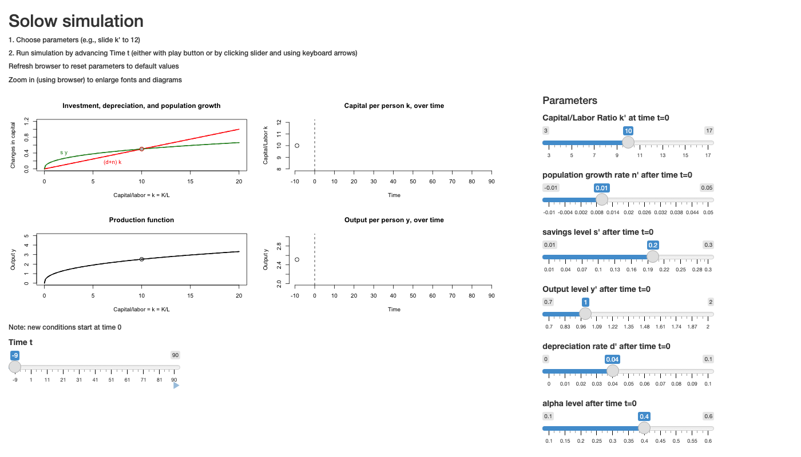

# Capital to the Rescue? The Solow Model and Inequality {#sec-solow}

```{r}
#| label: setup-ch3
#| include: false

col_y <- "black"; col_s <- "#1b9e3a"; col_req <- "#d62728"; col_grey <- "grey45"
col_cap <- "#e08a00"; col_lab <- "#1b9e3a"

## Illustrative Solow model: y = A k^alpha, saving s, population growth n,
## depreciation d. Parameter values are illustrative only.
alpha <- 1/3
f <- function(k, A = 1) A * k^alpha
k_star <- function(s, n, d, A = 1) (s * A / (n + d))^(1 / (1 - alpha))

## Simulate capital per worker year by year:  change in k = s*y - (n+d)*k
simulate_solow <- function(k0, years, s, n, d, A = 1) {
  k <- numeric(years + 1); k[1] <- k0
  for (t in 1:years) k[t + 1] <- k[t] + s * f(k[t], A[min(t, length(A))]) -
                                  (n + d) * k[t]
  k
}

## A two-curve Solow diagram: production function, saving, investment requirement
solow_axes <- function(kmax, ymax, ...) {
  plot(NA, xlim = c(0, kmax), ylim = c(0, ymax), xaxs = "i", yaxs = "i",
       xaxt = "n", yaxt = "n", bty = "l",
       xlab = "Capital per worker, k", ylab = "Output per worker, y", ...)
}
```

::: {.callout-warning appearance="simple"}
## Draft: provenance notes (for review)
Margin tags mark material that is **not in the course slides or lab**.
[Added · from readings]{.tag-reading} comes from the assigned readings (Dornbusch and Fischer; Piketty and Saez).
[Added · new]{.tag-new} is from outside the course materials (my framing, general knowledge, or my own analysis) and needs the closest check.
Untagged material follows the 2025 slides (07–08) and Lab 3.
:::

::: {.callout-note appearance="minimal"}
**In this chapter.** Malthus had land and people, but no capital. What happens
if people can save, and their savings become machines? We build Robert Solow's
neoclassical growth model, use it to ask what faster population growth does to
income per person, and see why technology, not saving, is the key to long-run
growth. Then we use the same model to think about inequality, following Thomas
Piketty's argument that slower growth can mean a larger share of income going to
the owners of capital.

**Readings this chapter draws on.** Dornbusch and Fischer, *Macroeconomics*,
"Growth Theory," pp. 726–737; Piketty and Saez (2014), "Inequality in the long
run," *Science* 344:838–843.
:::

## From Malthus to Solow

### Technology in Malthus, once more

Start with a review. In the Malthusian model of the last chapter, an exogenous
improvement in technology shifts the $w(N)$ curve outward. Wages rise at first. But
higher wages raise population growth, and the larger population drives wages back
down. The end result is a bigger population living at the same standard of living
as before. Can wages stay higher? Not in Malthus's world, where the gains from
technology disappear.

Two features of that world drive the result. Land is a **fixed** factor and labor
a **variable** one. And there is no capital accumulation, just land and people.
So: what happens if we add savings and productive capital? That is the question
of this chapter.

### What growth models ask

Growth models are usually framed very generally: "What determines the long-run
rate of economic growth?" Our interest is more specific: "What effect does
population change have on economic growth and on individual welfare?"

```{r}
#| label: fig-weil
#| fig-cap: "Real GDP per person in 2009 (log scale) against average annual population growth, 1975–2009, for 187 countries, with a least-squares line. Data: Weil's Economic Growth dataset (Penn World Table), which lecture code uses."
#| fig-height: 4.6
weil <- read.csv("data/weil_2011_growth_subset.csv")
weil <- weil[complete.cases(weil$gpop, weil$rgdpch2009), ]
op <- par(mar = c(4, 6, 1, 1))
plot(weil$gpop, weil$rgdpch2009, log = "y", pch = 19, cex = 0.6,
     col = adjustcolor("black", 0.55),
     xlab = "Average annual population growth, 1975–2009 (%)",
     ylab = "", yaxt = "n")
axis(2, at = c(200, 1000, 5000, 25000, 100000),
     labels = c("200", "1,000", "5,000", "25,000", "100,000"), las = 1)
abline(lm(log10(rgdpch2009) ~ gpop, data = weil), lwd = 2)
lab_c <- c("Japan", "United States", "Nigeria", "Pakistan", "Germany", "Qatar",
           "United Arab Emirates", "India", "China", "Niger", "Ukraine")
lab_pos <- c(1, 4, 1, 4, 3, 4, 2, 1, 4, 4, 4)
i <- match(lab_c, weil$Country)
text(weil$gpop[i], weil$rgdpch2009[i], sub("United Arab Emirates", "UAE", lab_c),
     cex = 0.7, pos = lab_pos, col = "grey20")
mtext("Real GDP per person, 2009 (log scale)", side = 2, line = 4.5)
r_weil <- cor(weil$gpop, log(weil$rgdpch2009))
par(op)
```

::: {.column-margin}
[Added · new]{.tag-new} The slide uses World Bank data. I've redrawn it with the
Weil dataset found in your eco175 folder (used by `solow.R`). The remarks on the
Gulf states are mine.
:::

Do high population growth rates hurt the economy? @fig-weil suggests a pattern:
countries whose populations grew fastest tend to be poorer. The correlation between
population growth and log income is about `r round(r_weil, 2)`. But **causality
could go either way**. Rapid population growth might make countries poor. Or being
poor might keep fertility high. And notice the exceptions in the upper right: rich
Gulf states such as Qatar and the United Arab Emirates, where population grew fast
because of immigration drawn by oil wealth. This chapter develops one causal theory
of how population growth could hurt income per person.

Other theories come in later lectures. Ester Boserup argued that population growth
induces technological change, and so *raises* income per person. Environmentalists
such as Paul Ehrlich argued that population growth depletes natural resources and
reduces income per person, perhaps catastrophically.

## Solow's neoclassical growth model

### Assumptions

Robert Solow's growth model (developed in the 1950s, at about the same time as
Trevor Swan's) makes four main assumptions:

- Labor and capital are fully employed.
- All savings get invested.
- Labor is a constant proportion of the population.
- Output depends only on the ratio of capital to labor. There are no natural
  resources, and the absolute amounts of capital or population don't matter.

::: {.column-margin}
[Added · from readings]{.tag-reading} Dornbusch and Fischer, p. 726.
:::

Dornbusch and Fischer state the model's goal: to explain "the determinants of
growth rates within a country and the reasons for differences in per capita incomes
across countries." And they put its central population result up front: "between
two countries with the same technology and saving rates the one that has the higher
rate of population growth will eventually have lower per capita income."

Other assumptions could be made instead, and some come up later in the course:

- The savings rate rises with population growth, because there are fewer old people
  dissaving (Modigliani).
- Technological progress is constant (easy to add).
- Technological progress depends on population size (harder; Boserup).
- Natural resources constrain growth (harder; environmentalists, Samuelson).
- Demography depends on the economy (harder).

### Notation

- Capital per person: $k = K/L$
- Output per person: $y = Y/L = f(k)$
- $s$ = the savings rate, so savings per person are $s \times y$
- $d$ = the depreciation rate (the fraction of capital that wears out each year)
- $n$ = the population growth rate (what we called $R$ in the first chapter)

::: {.column-margin}
[Added · from readings]{.tag-reading} From the calendar note on the reading:
Dornbusch and Fischer write output per head as $x$. We use $y$.
:::

(Dornbusch and Fischer write output per head as $x$ rather than $y$. Otherwise the
notation is the same.)

### The production function

Total output depends on capital and labor, $Y = F(K, L)$, with two properties:

1. **Diminishing returns** in $K$ or $L$ if the other is held constant.
2. **Constant returns to scale**: if we double both $K$ and $L$, we double $Y$.

Size doesn't matter, because there are no fixed resources. That is the big
difference from Malthus.

A common example is the **Cobb-Douglas** production function,

$$
Y = K^a L^{1-a}, \qquad 0 < a < 1.
$$

Dividing both sides by $L$ gives output per person as a function of capital per
person alone: $y = (K/L)^a = k^a$. More generally, constant returns let us write
$y = f(k)$.

::: {.column-margin}
[Added · from readings]{.tag-reading} Dornbusch and Fischer, p. 727.
:::

As Dornbusch and Fischer put it: "As capital per head increases, so that workers
use increasing amounts of machinery, output per head increases, but at a diminishing
rate."

### Savings, depreciation, and the investment needed to stay even

What happens to capital per person over time? Without new investment, two things
erode it:

- **Population growth dilutes** capital per person at rate $n$ per year. New
  workers arrive with no machines.
- **Depreciation reduces** the capital stock at rate $d$ per year.

To keep $k$ constant, then, we need to invest $(n + d) \times K$ in total, or
$(n + d) \times k$ per person. This is the **investment requirement**.

An example from lecture: suppose an economy has \$1 million of capital and 1,000
workers, so $k$ = \$1,000 per worker. Population grows 3 percent a year, and capital
depreciates 7 percent a year. Without new investment, next year capital per worker
will be about
$\$1{,}000 \times e^{-0.10} \approx$ \$`r round(1000 * exp(-0.10))`. So the economy
must buy about \$100 of capital per worker just to stay even. If a worker with
\$1,000 of capital produces \$400 of output, a savings rate of 0.25 provides exactly
that \$100.

::: {.column-margin}
[Added · from readings]{.tag-reading} The machines example is from Dornbusch and
Fischer, pp. 734–735.
:::

Dornbusch and Fischer give a similar example. With 10 machines per head, 1 percent
population growth, and 10 percent depreciation, "we require per year 11 percent times
10 machines, or 1.1 machines, just to offset population growth and depreciation."
If population growth rises to 2 percent, the requirement rises to 12 percent, or 1.2
machines per head.

### The steady state

@fig-steady puts the pieces together, following the lecture picture. The
production function $y = f(k)$ is the top curve. Savings per person, $s\,y(k)$, are
a fixed fraction of it. The gap between the two is consumption per person. The
straight line $(n + d)\,k$ is the investment requirement.

```{r}
#| label: fig-steady
#| fig-cap: "The Solow model. Output per worker y = f(k) rises with capital per worker at a diminishing rate. Saving per worker s·y(k) is a fixed fraction of output. The investment requirement (n + d)k is what must be invested just to keep k constant. The steady state k* is where saving exactly meets the requirement."
#| fig-height: 4.8
#| echo: false
s0 <- 0.3; n0 <- 0.02; d0 <- 0.06
kmax <- 35; k <- seq(0, kmax, 0.05)
ks <- k_star(s0, n0, d0); ys <- f(ks)
op <- par(mar = c(4, 4.5, 1, 6.5))
solow_axes(kmax, 3.6)
lines(k, f(k), lwd = 2.5, col = col_y)
lines(k, s0 * f(k), lwd = 2.5, col = col_s)
lines(k, (n0 + d0) * k, lwd = 2.5, col = col_req)
segments(ks, 0, ks, ys, lty = 3); segments(0, ys, ks, ys, lty = 3)
axis(1, at = ks, labels = "k*"); axis(2, at = ys, labels = "y*", las = 1)
text(kmax, f(kmax), "y = f(k)", pos = 4, xpd = NA)
text(kmax, s0 * f(kmax), "s y(k)", pos = 4, xpd = NA, col = col_s)
text(kmax, (n0 + d0) * kmax, "(n + d) k", pos = 4, xpd = NA, col = col_req)
k1 <- 21
arrows(k1, s0 * f(k1) + 0.05, k1, f(k1) - 0.05, code = 3, length = 0.06,
       col = col_grey)
text(k1, (f(k1) + (n0 + d0) * k1) / 2 + 0.05, "consumption", pos = 4, col = col_grey,
     cex = 0.8)
par(op)
```

The **steady state** is where the saving curve crosses the investment requirement,
at capital per worker $k^*$ and output per worker $y^*$. There, saving is exactly
enough to replace worn-out machines and to equip the new workers. Dornbusch and
Fischer describe it as a state in which "current saving and additions to the capital
stock would be just enough to equip new entrants into the labor force with the same
amount of capital as the average worker uses."

**Is this equilibrium stable?** Suppose $k$ starts below $k^*$. Then saving exceeds
the investment requirement, so $k$ grows. As it grows, the gap shrinks, and $k$
approaches $k^*$ more and more slowly. If $k$ starts above $k^*$, the requirement
exceeds saving, and $k$ falls back. Either way, the economy converges to the steady
state. @fig-converge simulates the path from a low starting point.

```{r}
#| label: fig-converge
#| fig-cap: "Convergence to the steady state from a low initial capital per worker, simulated with the parameters of the previous figure. Output per worker rises quickly at first and then levels off at y*."
#| fig-height: 3.2
#| echo: false
kpath <- simulate_solow(k0 = 2, years = 120, s = s0, n = n0, d = d0)
op <- par(mfrow = c(1, 2), mar = c(4, 4.2, 2, 1), mgp = c(2.4, 0.6, 0))
plot(0:120, kpath, type = "l", lwd = 2.5, ylim = c(0, ks * 1.1), yaxt = "n",
     xlab = "Years", ylab = "Capital per worker, k", main = "Capital per worker",
     font.main = 1)
abline(h = ks, lty = 3); axis(2, at = ks, labels = "k*", las = 1)
plot(0:120, f(kpath), type = "l", lwd = 2.5, ylim = c(0, ys * 1.1), yaxt = "n",
     xlab = "Years", ylab = "Output per worker, y", main = "Output per worker",
     font.main = 1)
abline(h = ys, lty = 3); axis(2, at = ys, labels = "y*", las = 1)
par(op)
```

The lecture calls this "Malthus-like dynamics in a single picture." Think of
$s\,y(k)$ as the "birth rate of capital" and $(n + d)\,k$ as its "death rate."
Where births and deaths of capital balance, capital per worker is stationary, just
as population was stationary where births and deaths balanced in Malthus.

::: {.column-margin}
[Added · from readings]{.tag-reading} Dornbusch and Fischer, p. 732.
:::

Dornbusch and Fischer draw out one striking implication: "if two countries have the
same capital stock and the same rate of population growth and have access to the
same production function, they will eventually reach the same level of income." On
this view, poor countries are poor because they start further from $k^*$, "but if
the former save at the same rate, and can get the same technology, they will
eventually catch up."

### What happens to the size of the economy?

In the steady state, output *per worker* doesn't change. But the population keeps
growing at rate $n$, so capital and total output must also grow at rate $n$. The
economy as a whole grows, just fast enough to keep everyone's share constant.

This is the first big difference from Malthus. A Malthusian economy can't
accommodate steady population growth without driving wages down. A Solow economy
can: capital grows alongside population.

## Saving, population growth, and the price of growth

### A higher saving rate

What happens if people save more? The saving curve shifts up. At the old $k^*$,
saving now exceeds the investment requirement, so capital per worker grows until it
reaches a new, higher steady state. Capital per worker and output per worker are
both higher. What about consumption, and the long-run growth rate?

::: {.column-margin}
[Added · from readings]{.tag-reading} Dornbusch and Fischer, pp. 732–733 and
their Figure 19-5.
:::

Dornbusch and Fischer pose the puzzle directly: "If people save 10 percent of their
income, as opposed to 5 percent, should we not expect this to make a difference in
the growth rate of output?" Their answer: "In the short run, it raises the growth
rate of output. It does not affect the long-run growth rate of output, but it raises
the long-run level of capital and output per head." @fig-saving shows the two
effects over time, following their Figure 19-5.

```{r}
#| label: fig-saving
#| fig-cap: "A permanent rise in the saving rate at year 20 (after Dornbusch and Fischer, Figure 19-5). Left: output per worker rises to a new, higher steady-state level. Right: the growth rate of total output rises temporarily, then falls back to the population growth rate n."
#| fig-height: 3.4
#| echo: false
yrs <- 0:150; t0 <- 20
s_path <- ifelse(yrs < t0, s0, 0.4)
kk <- numeric(length(yrs)); kk[1] <- k_star(s0, n0, d0)
for (t in 2:length(yrs)) kk[t] <- kk[t - 1] + s_path[t - 1] * f(kk[t - 1]) -
                                   (n0 + d0) * kk[t - 1]
yy <- f(kk)
gY <- c(NA, 100 * (diff(log(yy)) + n0))
op <- par(mfrow = c(1, 2), mar = c(4, 4.2, 2, 1), mgp = c(2.4, 0.6, 0))
plot(yrs, yy, type = "l", lwd = 2.5, yaxt = "n", xlab = "Years",
     ylab = "Output per worker, y", main = "Level", font.main = 1)
abline(v = t0, lty = 3, col = col_grey)
plot(yrs, gY, type = "l", lwd = 2.5, ylim = c(0, max(gY, na.rm = TRUE) * 1.15),
     xlab = "Years", ylab = "Growth of total output (%/yr)", main = "Growth rate",
     font.main = 1)
abline(h = 100 * n0, lty = 3); abline(v = t0, lty = 3, col = col_grey)
text(150, 100 * n0, "n", pos = 3)
par(op)
```

The growth rate rises only during the transition, while capital per worker is being
built up. Once the new steady state is reached, total output again grows at the rate
of population growth.

Consumption is a subtler question. Saving more means consuming a larger share of a
bigger pie. Whether the pie grows enough to raise consumption depends on how much
more is saved. In lecture we'll look at what happens to the *level* of consumption.

::: {.column-margin}
[Added · from readings]{.tag-reading} Dornbusch and Fischer, p. 726.
:::

How much *should* a society save? Saving more now means more for future generations
and less for the present one. Dornbusch and Fischer note that the people who will
consume in the future "are not here to vote because they have not yet been born,"
and they quote the economist Joan Robinson's question: "What did posterity ever do
for us?" Ultimately, they conclude, "the policy decisions that affect growth are
settled politically."

### Try it: the Solow app

::: {.column-margin}
[Added · new]{.tag-new} The app is the course's own Solow app
(`ShinyApps/solow` in the 2025 course repo), exported with Shinylive so it runs in the
browser, in its own tab. The three questions are mine; they use only the saving rate and the capital share, to stay clear of the Lab 3 graded questions (a technology shift in the app, slower or negative population growth, and immigrants who change capital per worker).
:::

The app simulates the Solow model. The top-left panel shows saving, sy, and the investment needed to stay even, (d + n)k; the bottom-left shows the production function; and the right-hand panels trace capital and output per person over time. New conditions take effect at time 0; press the "play" triangle under the time slider to run the simulation. It opens in a new tab, so you can make it full screen and keep this page open
alongside it. (The first load can take a few seconds while R starts up in your browser.)

[{width="85%" fig-alt="Screenshot of the Solow simulation Shiny app: four panels showing the saving and break-even investment curves, the production function, and capital and output per person over time, with parameter sliders on the right."}](apps/solow/index.html){target="_blank" rel="noopener"}

[Open the Solow app in a new tab ↗](apps/solow/index.html){.btn .btn-primary target="_blank" rel="noopener"}

Before you move each slider, write down what you expect to happen. Then check.

1. **Save more.** Raise "savings level s'" from 0.20 to 0.25 and press play. Before you
   do: will output per person grow faster forever, or rise to a new, higher level and stop?
2. **Watch the gap close.** In the same run, how does the speed of growth change as capital
   per person approaches its new steady state? Why does growth slow down even though people
   keep saving 25 percent of their income?
3. **A bigger capital share.** Return s to 0.20 and raise "alpha" from 0.4 to 0.5. Predict
   whether the steady-state capital and output per person will be higher or lower. Why does
   a larger capital share make capital accumulation matter more?

Lab 3 asks you to use the app to follow an economy through a technological change.

### Faster population growth

Now the central question for economic demography. What happens if population growth
rises from $n$ to $n'$? Faster growth means more new workers to equip, so the
investment requirement line rotates upward, from $(n + d)k$ to $(n' + d)k$
(@fig-popgrowth, left).

```{r}
#| label: fig-popgrowth
#| fig-cap: "Faster population growth (left) rotates the investment requirement upward, lowering steady-state capital per worker (k*′) and output per worker (y*′). Right: saving more (dotted s′y(k)) could restore the old capital per worker, but at the cost of consumption."
#| fig-height: 4.2
#| echo: false
n1 <- 0.035; kz <- 16; kzz <- seq(0, kz, 0.02)
ks1 <- k_star(s0, n1, d0); ys1 <- f(ks1)
s1 <- s0 * (n1 + d0) / (n0 + d0)        # saving rate that restores old k*
op <- par(mfrow = c(1, 2), mar = c(4, 3.5, 2, 4.5), mgp = c(2.2, 0.5, 0))
for (panel in 1:2) {
  solow_axes(kz, 2.8, main = c("Faster population growth", "With higher saving")[panel],
             font.main = 1, cex.main = 0.95)
  lines(kzz, f(kzz), lwd = 2.5)
  lines(kzz, s0 * f(kzz), lwd = 2.5, col = col_s)
  lines(kzz, (n0 + d0) * kzz, lwd = 1.5, col = col_req, lty = 2)
  lines(kzz, (n1 + d0) * kzz, lwd = 2.5, col = col_req)
  text(kz, s0 * f(kz) - 0.05, "s y", pos = 4, xpd = NA, col = col_s, cex = 0.85)
  text(kz, (n1 + d0) * kz + 0.04, "(n′+d)k", pos = 4, xpd = NA,
       col = col_req, cex = 0.85)
  text(kz, (n0 + d0) * kz - 0.04, "(n+d)k", pos = 4, xpd = NA, col = col_req,
       cex = 0.85)
  if (panel == 1) {
    segments(c(ks, ks1), 0, c(ks, ks1), c(ys, ys1), lty = 3)
    axis(1, at = ks1, labels = "k*′", cex.axis = 0.85, hadj = 1)
    axis(1, at = ks, labels = "k*", cex.axis = 0.85, hadj = 0)
    axis(2, at = c(ys1, ys), labels = c("y*′", "y*"), las = 1, cex.axis = 0.85)
    segments(0, c(ys, ys1), c(ks, ks1), c(ys, ys1), lty = 3)
    arrows(ks - 0.1, 0.15, ks1 + 0.1, 0.15, length = 0.06, col = "#2166ac", lwd = 2)
  } else {
    lines(kzz, s1 * f(kzz), lwd = 2, col = col_s, lty = 3)
    text(kz, s1 * f(kz) + 0.06, "s′ y", pos = 4, xpd = NA, col = col_s, cex = 0.85)
    segments(ks, 0, ks, ys, lty = 3)
    axis(1, at = ks, labels = "k*", cex.axis = 0.85)
  }
}
par(op)
```

If saving stays the same, capital doesn't grow fast enough to keep up with the new
workers. Capital per worker falls until it reaches a new, lower steady state $k^{*\prime}$,
and output per worker falls to $y^{*\prime}$. Dornbusch and Fischer:

::: {.callout-tip appearance="simple"}
## In their own words
"The decline in output per head as a consequence of increased population growth
points up the problem faced by many developing countries. Fast growth in population,
given the saving rate, means low levels of income per head. … With high population
growth, saving will typically be too small to allow capital to rise relative to labor
and thus to build up the capital-labor ratio to achieve a satisfactory level of income
per head." (Dornbusch and Fischer, pp. 735–736)
:::

Is there anything we could do to keep the old level of output per person? Yes: save
more and consume less (@fig-popgrowth, right). A higher saving rate $s'$ can restore
the old capital per worker. So population growth has a **price**:

- If we compensate for faster growth by saving more, consumption falls.
- If we don't save more, the new steady state has lower capital and output per
  worker, and consumption is still hurt.

## Technology: the Solow ratchet

### Can technology save us?

Let's include a factor $A$ for technology: $Y = A\,F(K, L)$. With constant returns
to scale, output per worker is $y = A\,f(k)$, so $y$ rises with $A$. A new technology
lets us produce more output at every capital-labor ratio (@fig-tech).

```{r}
#| label: fig-tech
#| fig-cap: "A technological improvement raises output at every capital-labor ratio, from A f(k) to A′f(k). Saving rises with output, so the steady state moves from k* to k*′: technology raises output directly and then through capital deepening."
#| fig-height: 4.6
#| echo: false
A1 <- 1.3
ksA <- k_star(s0, n0, d0, A1)
op <- par(mar = c(4, 4.5, 1, 6.5))
solow_axes(kmax, 4.6)
kx <- seq(0, kmax, 0.05)
lines(kx, f(kx), lwd = 2.5); lines(kx, f(kx, A1), lwd = 2.5, lty = 2)
lines(kx, s0 * f(kx), lwd = 2.5, col = col_s)
lines(kx, s0 * f(kx, A1), lwd = 2.5, col = col_s, lty = 2)
lines(kx, (n0 + d0) * kx, lwd = 2.5, col = col_req)
xr <- kmax
text(xr, f(xr), "A f(k)", pos = 4, xpd = NA)
text(xr, f(xr, A1), "A′ f(k)", pos = 4, xpd = NA)
text(xr, s0 * f(xr), "savings", pos = 4, xpd = NA, col = col_s, cex = 0.85)
text(xr, s0 * f(xr, A1) + 0.12, "savings′", pos = 4, xpd = NA, col = col_s,
     cex = 0.85)
text(xr, (n0 + d0) * xr, "(n+d)k", pos = 4, xpd = NA,
     col = col_req, cex = 0.85)
segments(c(ks, ksA), 0, c(ks, ksA), c(f(ks), f(ksA, A1)), lty = 3)
axis(1, at = c(ks, ksA), labels = c("k*", "k*′"))
par(op)
```

Technology works in two steps:

1. **Higher productivity with the original capital.** At the old $k^*$, output jumps
   from $y(k^*)$ to $y'(k^*)$.
2. **Capital deepening.** Because output is higher, so is saving. Capital per worker
   grows from $k^*$ to a new steady state $k^{*\prime}$, raising output further.

You can watch both steps with the "Solow" app in the lab.

### Ratchet, not hamster wheel

Do we stay at the new, higher steady state? Or do we slip back, as in Malthus? In
Solow's model, we stay. Each improvement in technology gives a new equilibrium, not
just a temporary gain. If technology keeps improving, $A(t) = A_0 e^{gt}$, then:

- population $N$ grows at rate $n$;
- the economy $Y$ grows at rate $n + g$;
- output per person $y$ grows at rate $g$.

The lecture calls this the difference between a **Solow ratchet** and a **Malthusian
hamster in a wheel**. In Malthus, population growth eats away any technological
improvement. In Solow, the economy needs more capital to keep up, but it can support
that capital with its higher output.

::: {.column-margin}
[Added · from readings]{.tag-reading} Dornbusch and Fischer, p. 736.
:::

Dornbusch and Fischer list three reasons growth per person could continue in the
steady state. The "most important is technical progress, which empirical work has
identified as the prime source of growth." The others are increasing returns to
scale and investment in human capital as well as physical capital. They add a
hopeful caveat: "There can be little doubt that human ingenuity will produce
technical progress that will allow growth to continue if that same human ingenuity
can maintain peace and political stability."

### Malthus and Solow compared

```{r}
#| label: tbl-malthus-solow
#| tbl-cap: "Malthus and Solow compared (from lecture)."
#| echo: false
knitr::kable(data.frame(
  ` ` = c("Fixed factors", "Variable factors", "Exogenous", "Endogenous",
          "Steady population growth?", "Growth in standard of living?",
          "Effect of better technology", "What determines the outcome"),
  Malthus = c("Resources (land)", "Labor supply", "Technology", "Labor supply",
              "No: explains why population stayed constant", "No",
              "Gains disappear", "Demographic behavior: b(w) and d(w)"),
  Solow = c("None", "Labor supply, capital", "Technology, labor supply", "Capital",
            "Yes: can support steady population growth",
            "Not without technological change",
            "Gains are preserved (a ratchet)", "The production function: y(k)"),
  check.names = FALSE))
```

To sum up: the Solow model retells the Malthusian story with a different steady
state.

- **Good news.** It can accommodate constant population growth without lowering
  wages, which is impossible in Malthus. And technological change brings permanent
  improvement, not the temporary gain of Malthus.
- **Bad news.** Faster population growth means lower income, unless people give up
  consumption and keep saving up. More capital alone, such as a one-time foreign
  investment or aid, won't change steady-state output. The key to long-term growth
  in income per person is **technology, not savings**.

What does Solow leave unexplained? The model takes technology, population growth,
and the saving rate as given from outside (exogenous). The great take-off of
population and income per person since about 1800 (shown in lecture with Maddison's
data for the United Kingdom) is driven by exactly the things the model doesn't
explain.

::: {.column-margin}
[Added · from readings]{.tag-reading} Dornbusch and Fischer, p. 737 and their
Box 19-2. "Limits to growth" is the reading's own box. Slide 07-10 mentions the
environmentalists as a coming topic.
:::

Writing in the late 1980s, Dornbusch and Fischer added two further notes. Newer
growth theories, which let investment in research and human capital affect the
long-run growth rate, "do not predict a convergence of income levels among countries
that start from different initial capital stocks." And they flagged, in a box titled
"Limits to Growth," the worry that "growing populations put pressure on resources and
cause environmental degradation," mentioning tropical forests and "some evidence
that the global climate may be warming."

## Growth and inequality: Piketty's argument

### A stylized fact: inequality's fall and rise

::: {.column-margin}
[Added · from readings]{.tag-reading} Figures and quotes in this section are from
Piketty and Saez (2014), pp. 838–842. The slide shows their Figure 1.
:::

Thomas Piketty and Emmanuel Saez (an economist at Berkeley) assembled a century of
tax records to measure the share of income going to the richest tenth of the
population. Their first fact is a "great inequality reversal" between Europe and
the United States. On the eve of World War I, the top tenth received 45 to 50 percent
of total income in most European countries, and slightly above 40 percent in the
United States. In Europe, the share then fell sharply, to about 30 percent by the
1950s and 1960s, and it is now close to 35 percent. In the United States, it fell to
30 to 35 percent in the 1950s and 1960s, then "rose at an unprecedented pace since
the 1970s–1980s, and is now close to 50%."

Wealth is far more unequal than income. The richest tenth typically owns 60 to 90
percent of all wealth, but receives 30 to 50 percent of income. The bottom half of
the population owns less than 5 percent of wealth, but earns 20 to 30 percent of
income. "The bottom half of the population hardly owns any wealth, but it does earn
appreciable income." In pre-WWI Europe, the top tenth owned close to 90 percent of
all wealth, so that "there was basically no wealth middle class."

### The Solow model as a tool for studying inequality

The Solow model can help us think about inequality in two ways:

1. We can decompose income into the share that goes to **capital** and the share that
   goes to **labor**.
2. We can see how this division changes with capital intensity, $k$.

Some accounting. Total income is labor income plus capital income: $Y = Y_\ell + Y_k$.
In perfectly competitive markets, each factor is paid its marginal product. So
capital income per worker is $y_k = MP(k) \times k$, and labor gets the rest:
$y_\ell = y - y_k$. In our model, the marginal product of capital is just the slope
of the production function (@fig-shares).

```{r}
#| label: fig-shares
#| fig-cap: "Splitting output between capital and labor at capital per worker k. The tangent to the production function has slope MP(k), the return on capital. Capital's income per worker is k × MP(k) (orange); labor's is the rest, y − k × MP(k) (green), which is where the tangent meets the vertical axis."
#| fig-height: 4.4
#| echo: false
k0 <- 14; y0 <- f(k0); mp0 <- alpha * k0^(alpha - 1)
icpt <- y0 - mp0 * k0
op <- par(mar = c(4, 4.5, 1, 7))
solow_axes(kmax, 3.6)
lines(k, f(k), lwd = 2.5)
abline(icpt, mp0, lty = 2, col = col_grey)
segments(k0, 0, k0, y0, lty = 3); segments(0, y0, k0, y0, lty = 3)
segments(0.15, 0, 0.15, icpt, lwd = 6, col = col_lab, lend = 1)
segments(0.15, icpt, 0.15, y0, lwd = 6, col = col_cap, lend = 1)
axis(1, at = k0, labels = "k"); axis(2, at = y0, labels = "y", las = 1)
text(kmax, f(kmax), "y = f(k)", pos = 4, xpd = NA)
text(1.2, icpt / 2, "to labor:\ny − k × MP(k)", pos = 4, col = col_lab, cex = 0.85)
text(0.6, y0 + 0.2, "to capital: k × MP(k)", pos = 4,
     col = col_cap, cex = 0.85)
text(k0 + 13, icpt + mp0 * (k0 + 13) + 0.08, "slope = MP(k)", pos = 3, col = col_grey,
     cex = 0.85)
par(op)
```

### Does slower population growth increase inequality?

We know from the Solow model that a smaller $n$ raises $k^*$ and $y^*$. Who gets the
increase in income: the owners of capital, or the workers? The proportion going to
capital is

$$
\text{capital share} = \frac{k \times MP(k)}{y(k)}.
$$

But the answer isn't obvious. If we increase $k$, there are offsetting effects. Does
more capital per person increase capital's share of income? **Yes**, because there is
more capital. **No**, because the rate of return on capital falls as capital becomes
more plentiful. Which effect is stronger depends on how quickly the marginal product
declines.

1. **Cobb-Douglas: the two effects cancel.** With $y = k^a$, the marginal product is
   $MP(k) = a\,k^{a-1}$, and the capital share is $(a\,k^{a-1}) \times k / k^a = a$, a
   constant. Capital intensification is exactly balanced by diminishing returns.
2. **If $MP(k)$ declines more slowly**, we still have diminishing returns, but an
   increase in capital is no longer fully offset by the fall in its return. The result
   is an *increasing* share of national income going to capital owners. This is what
   Piketty highlights as possible. He thinks it might get worse, because new
   technologies like robots and automation may have slowly declining marginal products.

::: {.column-margin}
[Added · from readings]{.tag-reading} Piketty and Saez, p. 842.
:::

Piketty and Saez put the technical point in terms of the "elasticity of substitution"
between capital and labor. If it equals 1 (the Cobb-Douglas case), "the capital share
… is a technological constant." But in rich countries in recent decades, both the
amount of capital relative to income *and* capital's share of income have risen,
"which suggests that [the elasticity] is somewhat larger than 1." Intuitively, they
write, there are more and more ways to substitute capital for labor, "e.g., replacing
delivery workers by drones or self-driving trucks."

And capital income is much more unequally distributed than labor income. @tbl-gl
shows estimates of the share of labor income and of asset income received by the top
tenth under different inequality regimes.

```{r}
#| label: tbl-gl
#| tbl-cap: "Share of labor and asset income received by the top decile in different inequality regimes, and the effect of a unit increase in the capital/income ratio β on the top decile's share of total income. Source: Goldstein and Lee (2014), using Piketty's estimates (as shown in lecture)."
#| echo: false
knitr::kable(data.frame(
  ` ` = c("Labor income", "Asset income", "Total income", "Effect of a unit increase in β"),
  `Low inequality (Scandinavia, 1970s)` = c("20%", "50%", "25%", "1.50%"),
  `Medium inequality (Europe, 2010)` = c("25%", "60%", "35%", "1.75%"),
  `High inequality (US 2010, Europe 1910)` = c("35%", "70%", "50%", "1.75%"),
  `Very high inequality (US 2030?)` = c("45%", "90%", "60%", "2.25%"),
  check.names = FALSE))
```

### Piketty's argument in three steps

Put together, Piketty's argument goes like this:

1. **Slower growth → more capital per person.** This is the neoclassical Solow
   result.
2. **More capital per person increases capital's share of the economy.** This is an
   empirical claim.
3. **Capital income is more unequally distributed than labor income.** Also an
   empirical claim.

Therefore: **slower growth increases income inequality.**

### "Capital is back because low growth is back"

::: {.column-margin}
[Added · from readings]{.tag-reading} Piketty and Saez, pp. 840–841. The calendar
note asks students to look for "the Solow equilibrium on page 840 and the role of
population growth."
:::

Piketty and Saez make step 1 concrete with what they call the Harrod-Domar-Solow
formula. In the long run, the ratio of wealth to income, $\beta = K/Y$, converges to

$$
\beta = \frac{s}{g},
$$

where $s$ is the saving rate and $g$ is the growth rate of total income. And
"the growth rate $g$ is the sum of the population growth rate (including
immigration) and the productivity growth rate." With a saving rate of 10 percent and
growth of 3 percent, $\beta \approx 300\%$: wealth equals about three years of
income. "But if the growth rate drops to $g$ = 1.5%, then $\beta \approx 600\%$. In
short: Capital is back because low growth is back."

::: {.column-margin}
[Added · new]{.tag-new} Connecting $\beta = s/g$ to the Solow steady state ($s\,y = (n+d)k$)
is my explanation. It follows from the model, but neither the slides nor the
reading spell it out this way.
:::

Where does this come from? It's the Solow steady state seen from another angle. In
steady state, capital must grow as fast as income, so each year's saving, $s\,Y$, must
add $g \times K$ to the stock. Setting $s\,Y = g\,K$ gives $K/Y = s/g$. Slow growth
means each year's saving piles up relative to income. "In the extreme case of a society
with zero population and productivity growth," Piketty and Saez write, "the
wealth-income ratio … would rise indefinitely." And capital accumulation is slow: "With
a saving rate of 10% per year, it takes 50 years to accumulate the equivalent of 5
years of income."

```{r}
#| label: fig-beta
#| fig-cap: "The long-run wealth-to-income ratio β = s/g for a saving rate of 10%, as total growth g varies. Shaded bands show Piketty and Saez's ranges for total growth in Europe and Japan (about 1–1.5% a year, with population growth near zero) and in the United States (at least 2–2.5%, with population growth above 1% thanks to immigration)."
#| fig-height: 4
#| echo: false
g <- seq(0.5, 4, 0.01)
op <- par(mar = c(4, 4.5, 1, 1))
plot(g, 10 / g, type = "n", ylim = c(0, 20), xlim = c(0.5, 4),
     xlab = "Total growth rate g = population growth + productivity growth (%/yr)",
     ylab = "Wealth / income (years)")
rect(1, 0, 1.5, 20, col = adjustcolor("#2166ac", 0.12), border = NA)
rect(2, 0, 3, 20, col = adjustcolor(col_cap, 0.15), border = NA)
lines(g, 10 / g, lwd = 2.5)
text(1.25, 18.5, "Europe,\nJapan", cex = 0.85)
text(2.5, 18.5, "United States", cex = 0.85)
points(c(3, 1.5), c(10 / 3, 10 / 1.5), pch = 19)
text(3, 10 / 3, "g = 3%: β ≈ 3", pos = 3, cex = 0.85)
text(1.5, 10 / 1.5, "g = 1.5%: β ≈ 6", pos = 4, cex = 0.85)
par(op)
```

This logic, they argue, explains why the United States holds less capital relative to
its income than Europe and Japan. "U.S. population growth rates exceed 1% per year,
thanks to large immigration flows," so total U.S. growth is at least 2 to 2.5 percent
a year. In Europe and Japan, population growth is now close to zero, so total growth is
about 1 to 1.5 percent. Historically, European wealth was worth about 6 to 7 years of
national income before World War I, fell to 2 to 3 years in the 1950s, and is back to 5
to 6 years today. U.S. wealth has generally equalled about 4 to 5 years of income.

### r > g

The final piece concerns how wealth is distributed. Piketty and Saez model individual
fortunes as growing at the rate of return on wealth, $r$, while the economy grows at $g$.
The larger the gap $r - g$, the more unequal wealth becomes. This is the "dramatic
reading" from lecture:

::: {.callout-tip appearance="simple"}
## In their own words
"Intuitively, a higher r – g tends to amplify initial wealth inequalities: It implies
that past wealth is capitalized at a faster pace, and that it is less likely to be
overtaken by the general growth of the economy." (Piketty and Saez, p. 841)
:::

History, they argue, mostly had a large gap. Before the industrial revolution, growth
was "much less than 1% per year," while land typically earned rents of about 4 to 5
percent of its value. "This large gap between r and g explains why wealth concentration
was so large until World War I and why wealth concentration was smaller in the United
States, where population growth was faster." In the twentieth century, growth was
exceptionally high, "in particular due to very high population growth, which even
today represents about half of global gross domestic product growth." Meanwhile, wars,
depression, and taxation cut the return on capital. If population growth slows in the
twenty-first century, $r - g$ is likely to widen again.

Notice how central population is to the whole argument. Population growth is half of
$g$, so a demographic slowdown pushes up both the wealth-income ratio and the gap
$r - g$.

### Is it destiny?

Piketty and Saez end on a note of caution, not determinism. High capital intensity is
"not bad in itself. After all, it would be good to have an infinite quantity of robots
producing most of the output, so that we can devote more time to leisure activities.
The problem is twofold: Can we all find jobs as a robot designer (or in leisure-related
activities), and who owns the robots?" And their final judgment: "Inequality does not
follow a deterministic process. In a sense, both Marx and Kuznets were wrong. There
are powerful forces pushing alternately in the direction of rising or shrinking
inequality. Which one dominates depends on the institutions and policies that societies
choose to adopt."

::: {.callout-important}
## In the lab
In Lab 3 you calculate the investment an economy needs to stay even, derive the steady
state for a Cobb-Douglas economy (including one with a shrinking population), use the
"Solow" app to watch an economy respond to a technological change, and calculate
capital's share of income under different production functions to see when capital
intensification does, and doesn't, raise capital's share. The lab ends by asking you to
think through what one-time waves of immigrants would do to income per person.
:::

## Key ideas

- In the Solow model, capital per worker is in **steady state** when saving exactly
  covers the **investment requirement**: $s\,y(k) = (n + d)\,k$.
- In steady state, output per worker is constant, and capital and total output grow at
  the rate of population growth. Unlike Malthus, the economy can **support steady
  population growth** without lowering incomes.
- A higher **saving rate** raises the *level* of output per worker but only temporarily
  raises its *growth rate*.
- **Faster population growth** lowers steady-state capital and output per worker,
  unless people give up consumption to save more.
- **Technology** is the key to long-run growth in income per person. Its gains are
  preserved (a **ratchet**), not eaten away as in Malthus.
- Piketty's argument: slower growth raises capital per person (Solow), which may raise
  capital's share of income, and capital income is very unequally distributed. So slower
  growth can increase inequality. The wealth-income ratio tends toward $\beta = s/g$, and
  population growth is a large part of $g$.

## Check your understanding

::: {.column-margin}
[Added · new]{.tag-new} Questions 1 and 4 adapt the slides (07-23, 08-23). The rest
are new and avoid the Lab 3 graded questions.
:::

1. **More saving.** Explain, using the steady-state diagram, what a higher saving rate
   does to (a) capital per worker, (b) output per worker, and (c) the long-run growth
   rate of total output.

2. **Machines to stay even.** An economy has 20 machines per worker. Depreciation is 5
   percent a year. How many machines per worker must it buy each year just to stay even
   if population grows at 1 percent? At 3 percent?

3. **Hamster or ratchet?** In Malthus, the gains from a better technology disappear; in
   Solow, they are preserved. Which assumption about factors of production makes the
   difference? Explain in two or three sentences.

4. **Which effect wins?** As capital per worker rises, capital earns a lower return but
   there is more of it. Explain why, with a Cobb-Douglas production function, capital's
   share of income stays the same.

5. **β = s/g.** A country saves 12 percent of its income. Its population grows at 1
   percent a year and productivity at 1 percent. What is its long-run wealth-to-income
   ratio? What happens if population growth falls to zero?

6. **Immigration and capital.** Piketty and Saez argue that the United States has a lower
   wealth-to-income ratio than Europe partly because of immigration. Explain the logic in
   one or two sentences.

7. **Reading the scatter plot.** @fig-weil shows a negative relationship between
   population growth and income per person. Give one reason the relationship might run
   from income to population growth rather than the reverse.

8. **Wealth versus income.** According to Piketty and Saez, why does wealth inequality
   always exceed income inequality? What share of wealth does the bottom half of the
   population own?

## Further reading

- Dornbusch, Rudiger, and Stanley Fischer. *Macroeconomics.* "Growth Theory," pp.
  726–737. *A textbook presentation of the Solow model, using population growth rates as
  part of the motivation. As you read: compare their Figures 19-3, 19-4, and 19-6 with
  the diagrams in this chapter. Note that they write output per head as $x$.*
- Piketty, Thomas, and Emmanuel Saez. 2014. "Inequality in the long run." *Science*
  344(6186): 838–843. *An overview of the history of inequality and Piketty's model of
  r > g. As you read: find the Solow equilibrium on page 840 and the role of population
  growth. Ask yourself what role population growth might have played in their Figures 1
  through 4.*
