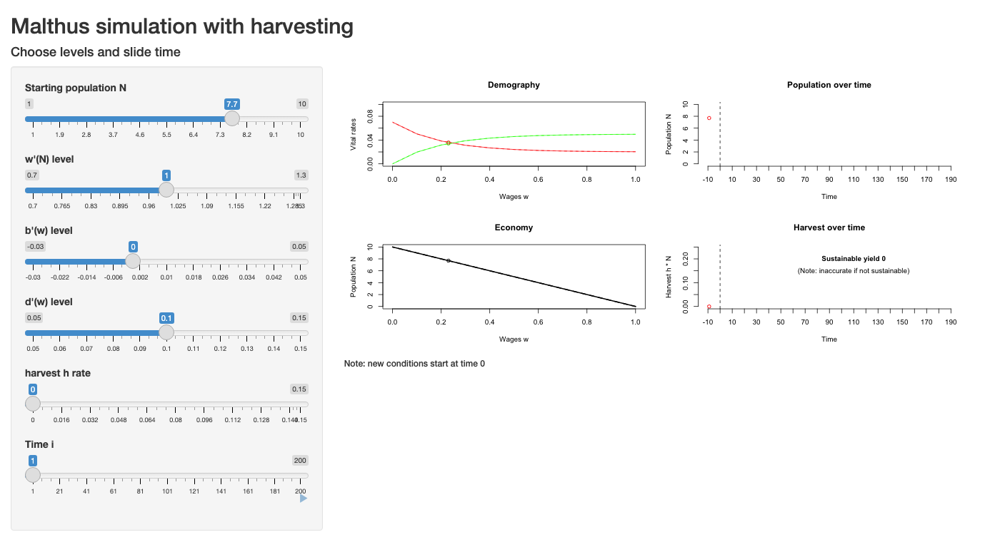

# Are We Doomed? Resources, Prices, and the Commons {#sec-resources}

```{r}
#| label: setup-ch6
#| include: false
col_b <- "#1b9e3a"; col_d <- "#d62728"; col_grey <- "grey45"
col_ag <- "#2ca7c0"; col_h <- "#e08a00"

## Real commodity prices, 1900 = 100 (David Jacks's data, as used in Lab 4)
commod <- read.table("data/Real_commodity_prices_1900_2015.csv", sep = ",",
                     header = TRUE, comment.char = "#")
commod$year <- as.numeric(rownames(commod))

## ---- An illustrative Malthusian fish population ------------------------
## Functional forms are mine, chosen only to have the shapes in the lecture
## diagrams: births rise and level off with food per fish (w); deaths fall
## with w; food per fish falls with the number of fish (N).
b_fish <- function(w) 0.05 * (1 - exp(-0.8 * w))
d_fish <- function(w) 0.012 + 0.05 * exp(-0.8 * w)
N_of_w <- function(w) (1 / w)^2
## Equilibrium with harvest rate h: b(w) = d(w) + h
w_star_h <- function(h) {
  e <- (0.038 - h) / 0.1            # solves b(w) = d(w) + h for exp(-0.8 w)
  ifelse(e > 0, -log(e) / 0.8, Inf)
}
N_star_h <- function(h) ifelse(is.finite(w_star_h(h)), N_of_w(w_star_h(h)), 0)
h_extinct <- 0.038
```

::: {.callout-warning appearance="simple"}
## Draft: provenance notes (for review)
Margin tags mark material that is **not in the course slides or lab**.
[Added · from readings]{.tag-reading} comes from the assigned readings (Lam, Becker, Hardin, Nordhaus).
[Added · new]{.tag-new} is from outside the course materials (my framing, general knowledge, or my own analysis) and needs the closest check.
Untagged material follows the 2025 slides (10 Doomed, 11 and 12) and Labs 4 and 5.
:::

::: {.callout-note appearance="minimal"}
**In this chapter.** With a world population that doubled in forty years, are we
doomed? We weigh David Lam's optimistic answer against Stan Becker's critique, and
replay Julian Simon's famous bet on resource prices. Then we turn to the goods that
prices fail to protect: using the Malthusian model from @sec-malthus, we find the
harvest of a fish population that can be sustained forever, and Garrett Hardin's
"tragedy of the commons" explains why individuals left to themselves will harvest
too much.

**Readings this chapter draws on.** Lam (2011), "How the World Survived the
Population Bomb"; Becker (2013), "Has the 'World' Really Survived the Population
Bomb?"; Lam (2013), "Reply to Stan Becker"; Hardin (1968), "The Tragedy of the
Commons"; Nordhaus (2018), "Climate Change: The Ultimate Challenge for Economics"
(pp. 440–442, on public goods).
:::

::: {.column-margin}
[Added · new]{.tag-new} Bridge text written for the chapter split.
:::

@sec-boserup showed how, over the long run of history, population growth could
call forth new technology. This chapter asks whether the same optimism holds for the
last half century, when population grew faster than ever before. Lam's answer rests on
markets and prices, so the second half of the chapter looks at what happens when
prices fail, as they do for shared resources like fisheries. @sec-climate applies the
same logic to the largest commons of all, the atmosphere.

## Are we doomed?

### Doubling times

This chapter turns from the distant past (@sec-boserup) to the last half
century. @tbl-doubling shows how long it took the world's population to double.

```{r}
#| label: tbl-doubling
#| tbl-cap: "Doubling times of world population (lecture)."
#| echo: false
dbl <- data.frame(Population = c("200 million", "400 million", "791 million",
                                 "1.6 billion", "3.0 billion", "6.1 billion"),
                  Year = c("1", "1000", "1750", "1900", "1960", "2000"),
                  `Years to double from previous row` = c("", "999", "750",
                                                          "150", "60", "40"),
                  check.names = FALSE)
knitr::kable(dbl)
```

::: {.column-margin}
[Added · new]{.tag-new} The slide gives 250 years for the 1750–1900 doubling. The
dates imply 150, which is also Lam's figure.
:::

What comes next in the sequence 999, 750, 150, 60, 40? Take a guess before
reading on.

::: {.column-margin}
[Added · from readings]{.tag-reading} Lam (2011), pp. 1232–1235.
:::

David Lam, in his 2011 presidential address to the Population Association of
America, reports that when he asks his students this question, most choose 20 or
30 years. "The correct answer is almost surely more than 100 years." It is even
plausible that the world will never reach 12 billion. World population growth
peaked at just over 2 percent per year in the 1960s (about 2.2 percent by the
Census Bureau's estimates), shortly before Paul Ehrlich published *The Population
Bomb* in 1968. Growth then fell rapidly. The UN's 2010 medium projection, which
Lam used, put the world at 9.3 billion in 2050 and 10.1 billion in 2100, with a
2050 growth rate of 0.38 percent, a doubling time of about 175 years. "It is
virtually certain that world population will never again double in 40 years, making
the 1960–2000 experience absolutely unique in human history."

### What would it mean to be "doomed"?

Before asking whether we are doomed, we should be clear about the question. Pair
a condition with an outcome:

| Condition | Outcome |
|---|---|
| If population grows quickly | humans go extinct |
| If forecasts are true | we will be worse off in the future |
| Even if growth stops | progress will slow |
| If population shrinks | progress will continue |
| | progress will accelerate |

Different combinations are very different claims. "If population keeps growing
quickly, humans will go extinct" is a long way from "even if growth stops, progress
will slow."

### Can prices save us?

The economist Julian Simon argued that "the only meaningful measure of scarcity in
peacetime is the cost of the good in question." If a resource is really running
out, its price should rise.

::: {.column-margin}
[Added · from readings]{.tag-reading} Lam (2011), pp. 1241–1243.
:::

Lam explains the economist's reasoning: "it's hard to develop a model in which a
resource that is about to be depleted has a price that is declining, especially a
resource owned by private individuals or governments." Simon, whose 1981 book was
titled *The Ultimate Resource* (meaning human ingenuity), was "the poster child for
optimism."

In 1980, Simon offered to bet that the price of any mineral would fall. The
ecologist Paul Ehrlich and colleagues took him up on it. They chose five metals and
bought $200 worth of each (on paper). If the inflation-adjusted cost of the bundle
was lower in 1990, Simon won.

```{r}
#| label: tbl-bet
#| tbl-cap: "The Simon–Ehrlich bet: value of $200 of each metal bought in 1980, in 1990 (inflation-adjusted, 1980 dollars). Source: lecture; Lam (2011)."
#| echo: false
bet <- data.frame(Metal = c("Chromium", "Copper", "Nickel", "Tin", "Tungsten", "Total"),
                  `1980` = c(200, 200, 200, 200, 200, 1000),
                  `1990` = c(120, 163, 193, 56, 86, 618), check.names = FALSE)
knitr::kable(bet)
```

Every metal fell in real price. The bundle's cost fell 38 percent, and Ehrlich
wrote Simon a check. Meanwhile, world population grew by 28 percent, or 830
million people, over the decade of the bet. Lam adds an important caveat: the
longer record is more complicated. These metals' prices rose in the 1960s and
1970s, fell in the 1980s and 1990s, and rose sharply again in the 2000s. Simon
would have lost if the bet had ended in 2007, and won if it had ended in 2009.
"The big picture," Lam concludes, "is that these important nonrenewable resources
cost about the same today as they did 50 years ago, despite the addition of 4
billion people."

::: {.callout-important}
## In the lab
In Lab 4 you replay the bet using a century of commodity prices compiled by the
economic historian David Jacks. You ask how much the timing mattered, and whether
different kinds of commodities behave differently.
:::

### Kinds of resources, and substitution

Resources come in two kinds. Some are **exhaustible**: copper, coal, "virgin
forest." Others are **renewable**: topsoil, fisheries, forests, water. For both,
**substitutability** is an important issue.

Consider whale oil, which was burned in lamps. What people want is the *service*,
lighting. As overfishing made whale oil more expensive, people switched to
petroleum and, later, light bulbs. The outcome was not so good for whales, but fine
for the service of lighting for humans. The very long-run price of lighting in the
UK fell steeply from the 1800s onward, as new sources replaced old ones (a chart
from Fouquet and Pearson, in lecture).

Food is a renewable resource. @fig-grains shows real prices of three grains
since 1900, from the same data used in Lab 4.

```{r}
#| label: fig-grains
#| fig-cap: "Real (inflation-adjusted) prices of wheat, corn, and rice, 1900–2015, indexed to 1900 = 100, on a log scale. Source: David Jacks's commodity price data, as used in Lab 4."
#| fig-height: 4
op <- par(mar = c(4, 4.5, 1, 1))
grains <- c("Wheat", "Corn", "Rice"); gcols <- c("#b35806", "#e08a00", col_ag)
plot(commod$year, commod$Wheat, type = "n", log = "y", ylim = c(10, 300),
     xlab = "Year", ylab = "Real price (1900 = 100, log scale)")
abline(h = 100, lty = 3, col = col_grey)
for (i in 1:3) lines(commod$year, commod[[grains[i]]], col = gcols[i], lwd = 1.8)
legend("bottomleft", grains, col = gcols, lwd = 2, bty = "n")
par(op)
```

Real grain prices were volatile, with large spikes, including in the 1970s and
around 2008. But the long-run trend is down, by roughly two-thirds or
more since 1900, during a century in which world population roughly quadrupled.
In the 1970s, as lecture notes, fears of scarcity were not soothed by the data,
because grain prices had just spiked. Since then, prices have mostly fallen.

What, then, has gotten more expensive over the last century? Any consumer goods?
Any commodities? Anything at all? It's a good question to think about.

## Lam's argument: how the world survived

### An argument from the extreme case

Lam's argument works by looking at an extreme case. The last fifty years saw the
fastest population growth in human history. If things got better for people even
then, that tells us something. He looks at three kinds of indicators: human
well-being (poverty), a renewable resource (food), and exhaustible resources
(metals and other commodities, discussed above).

::: {.column-margin}
[Added · from readings]{.tag-reading} Figures in this table and the next
subsections are from Lam (2011), pp. 1238–1245.
:::

```{r}
#| label: tbl-lam
#| tbl-cap: "Lam's scorecard for 1961–2009 (poverty: 1981–2005, at $1.25 a day). Source: Lam (2011)."
#| echo: false
knitr::kable(data.frame(
  Indicator = c("World food production", "World population",
                "World food production per person", "India: food per person",
                "Sub-Saharan Africa: food production",
                "Sub-Saharan Africa: population",
                "Sub-Saharan Africa: food per person",
                "Poverty rate, low- and middle-income countries",
                "Poverty rate, China", "Poverty rate, sub-Saharan Africa"),
  Change = c("× 3.1", "× 2.2", "+41%", "+37%", "× 3.4", "× 3.6", "about −7%",
             "52% → 25%", "84% → 16%", "53% → 51%")))
```

**Food.** "The battle to feed humanity is already lost," Ehrlich wrote in 1968,
predicting large-scale famines within a decade. Instead, world food production
grew faster than population in every decade. India, the focus of Ehrlich's direst
predictions, saw per capita food production rise 37 percent between 1961 and 2009.
Sub-Saharan Africa is the exception that proves the point: its food production grew
*faster* than the world's, but its population grew faster still.

**Poverty.** The World Bank's estimates show the share of people in poverty in
low- and middle-income countries falling by half between 1981 and 2005, and the
absolute number falling from 1.9 billion to 1.4 billion. China drives much of the
decline. In sub-Saharan Africa the poverty rate barely moved, and the number of
poor people nearly doubled.

### How did we survive?

"Arguably the biggest mistake made by the pessimists of the 1960s," Lam writes,
"was in underestimating the impact of these adaptations." He names six, three
economic and three demographic.

1. **Market responses.** When food prices rise, farmers grow more. After Vietnam
   gave farmers more incentives from 1981 on, its food production soared. By 2009
   it was 5.5 times its 1960 level, and Vietnam went from a major rice importer to
   the world's second-largest exporter.
2. **Innovation.** "What made it possible for the world to escape from … the
   Malthusian trap? The answer is simple: the creation of knowledge" (D. Gale
   Johnson). Norman Borlaug's high-yield wheat raised Indian wheat yields 60 percent
   between 1967 and 1972. Lam explicitly connects such innovations to Boserup: many
   were "arguably examples of population-induced technological progress."
3. **Globalization.** Trade grew dramatically, and some of the biggest winners were
   the very countries people worried about in the 1960s, such as India.
4. **Urbanization.** About 65 percent of the 4 billion people added since 1960 live in
   towns and cities.
5. **Fertility decline.** The world's TFR fell from 5.0 in the early 1950s to 2.5 in
   2010, which is 85 percent of the way to replacement. The falling infant mortality
   that caused the explosion also helped end it.
6. **Investment in children.** Schooling soared even as school-age populations grew
   3 to 4 percent a year. In Thailand, the share of boys completing primary school
   rose from 18 percent (1950) to 95 percent (1990). Families traded "quantity" of
   children for "quality."

### Have we really survived?

Lam did not claim everything had gone well. He singled out environmental problems
where markets fail: "In domains with ownership of resources and well-functioning
markets, as with food and most other commodities, market pressures and price
signals induce increased supply, behavioral change, and innovation extremely
well. In domains without markets and resource ownership, problems are much more
likely." He also pointed to successes when policy tackled such problems: U.S.
sulfur dioxide emissions fell by more than half after 1970, and the 1987 Montreal
Protocol cut ozone-destroying CFCs.

His closing image is worth remembering:

> "Imagine someone writing in 1961 that in 50 years we would be worrying about how
> fast per capita consumption is growing in India and China, rather than worrying
> about mass starvation in those countries." (Lam 2011)

### The "reasonable" economist

Lam's position is what lecture calls the "reasonable" economist's view: with
functioning markets, increasing population will not cause environmental disaster,
but rather adaptation and substitution. **But**, as MacKellar and Horlacher put it,
"When markets are structurally flawed, or when poverty inhibits the operation of
market forces, population size and rate of growth usually magnify the adverse
impact on natural resources and the environment."

Sam Preston, reviewing Simon's *The Ultimate Resource*, drew a careful conclusion
from the historical record: "All we can conclude from a concurrence of accelerated
economic growth and population growth is that population growth is not so
overwhelmingly negative a factor for economic advance as to swamp the impact of all
other influences."

## Becker's critique, and Lam's reply

::: {.column-margin}
[Added · from readings]{.tag-reading} This section summarizes Becker (2013) and
Lam (2013). Neither is on the slides beyond the reading list.
:::

### Becker: what about the rest of the world?

Stan Becker, a demographer at Johns Hopkins, did not dispute Lam's data. His
complaint was about the word "world." "95 % of the article focuses on Homo sapiens,"
he wrote. "Although Homo sapiens has done well, as Lam described, the rest of 'the
world' has suffered from the success of our species." He pointed to two problems.

**Unsustainable use of resources.** The growth in food production required
fertilizer made from natural gas and phosphorus, and massive irrigation. Global
groundwater overdraft is about 160 billion cubic meters a year, about twice the
annual flow of the Nile. Water tables in parts of India have been falling a meter
or more a year. Rivers such as the Colorado barely reach the sea.

**Damage to the planetary ecosystem.** Forests are being cleared at about 13 million
hectares a year, an area the size of New York State. Extinction rates are estimated
at 100 to 1,000 times their natural background level. Among the large primates,
every species except our own is endangered. "Unfortunately, when a species is gone,
it is gone forever."

Becker proposed the framework of ecological economics: the economy is embedded in
nature, development should meet "the needs of the present without compromising the
ability of future generations to meet their own needs," and ecosystems can respond
to stress in sudden, nonlinear ways. He ended with a question: "Will birth cohorts
of 2040–2050 look back and wish our generation had done more to preserve the world
that was bequeathed to us? I do believe so."

### Lam: externalities, not numbers

Lam's reply opens with a nickname an online commenter had given him: "Professor
Happy Talk." He concedes that his "world" was the human world, though he notes that
a 1960 forecaster who predicted the main worry of 2013 would be the effect of
human success on *other* species would have been considered wildly optimistic. He
agrees with Becker about aquifers, which suffer from the same lack of property
rights as air pollution and overfishing. He is much less worried about running out
of oil or other resources with clear property rights and active markets. The
urgent problem, he argues, is not running out but cutting carbon emissions, which
markets alone will not do.

Lam's central point is about cause and cure:

::: {.callout-tip appearance="simple"}
## In his own words
"Stopping population growth is unlikely to end aquifer depletion or deforestation,
as long as the fundamental externality issues have not been solved." (Lam 2013)
:::

On deforestation, for example, he cites evidence that illegal logging in Indonesia
depends on how political jurisdictions are organized. "The point is that it will
take institutional change, not simply the end of population growth, to solve the
problem." Lam also pushes back on Becker's definition of sustainable development,
asking what practical guidance it really provides. Read his reply to see how he
makes the case.

## Lam's conclusion, and ours?

Lam's conclusion: things got better for people even during the era of peak
population growth, so they should continue to get better as population growth
slows.

But following Preston, we might add two cautions. The last fifty years were also a
time of enormous economic growth. Perhaps economic growth will slow down faster
than population growth. And even Lam's own timing illustrates how volatile the
evidence can be. As he was writing in 2011, food prices were spiking, and he asked
himself what he would bet. In lecture we look at the FAO food price index: had
Lam bet on falling food prices in 2011, he would have "won."

Finally, there is **risk aversion**. There is a lot of uncertainty about major
issues such as global warming and species extinction. If change is basically for
the better, we don't need to be afraid. If we're not so certain, then perhaps we
should be careful, even if we are not strict conservationists. Or, as lecture puts
it: "How fast should we drive in the dark?"

## When prices fail

Markets coordinate an enormous amount of behavior through prices. When something
becomes scarce, its price rises, people use less of it, and producers make more.
Earlier in this chapter, the resources that "survived the population bomb" were mostly
ones bought and sold in markets. But some goods are badly priced, or not priced at
all. Lecture lists four kinds of pricing problem:

- **The tragedy of the commons.** Someone exploiting a shared resource gets all of
  the benefit but pays only a tiny fraction of the cost. Examples: ocean fisheries,
  tropical forests, and the library book returned to the easiest shelf rather than
  its proper place.
- **Public goods.** Someone can use the good without taking it away from anyone
  else, as with clean air or knowledge. The problem is that individuals have little
  incentive to improve it or invest in it.
- **Externalities.** Costs, such as pollution, that are not reflected in prices.
- **Poverty.** People with no alternatives cannot respond to the price signals that
  tell them a resource is getting scarce.

::: {.column-margin}
[Added · from readings]{.tag-reading} Nordhaus 2018, pp. 440–442.
:::

William Nordhaus, who shared the 2018 Nobel Prize in economics for his work on
climate change, puts the problem in the language of public goods. A public good has
two key features. The cost of extending it to one more person is zero
("nonrivalry"), and it is impossible to keep anyone from enjoying it
("nonexcludability"). Climate change is the mirror image, a "public bad." Greenhouse
gas emissions spread their harm around the whole planet, and no one can be shielded
from it. What makes climate change "particularly thorny," Nordhaus writes, is that
the externality is *global*: "none of us acting individually can do anything to
slow the changes."

## Optimal harvesting

Start with something simpler than the climate: a population of fish. Fish, timber,
and fresh water are all *renewable* resources. A simple sustainability rule is that
a renewable resource lasts forever as long as its "renewal rate" is at least as large
as its "losses."

More formally, let

- $b$ = the birth rate, the fraction of the resource newly available each year;
- $d$ = the death rate, the fraction lost each year without harvesting;
- $h$ = the harvest rate, the fraction harvested each year.

The resource is sustainable if

$$
b \ge d + h.
$$

### A Malthusian fish population

Fish face the same constraints as Malthus's farmers. Suppose fish have birth and
death rates that depend on how much food each fish gets, and food per fish falls as
the number of fish rises. This is exactly the Malthusian diagram from @sec-malthus,
with "food per fish" in place of wages. Without any fishing, the population settles
at the equilibrium $N^*$, where births equal deaths.

Now we harvest a fraction $h$ of the fish every year, for a total harvest of
$H = h \times N$. To the fish, harvesting is just another source of death. The
death curve shifts up by $h$, from $d(w)$ to $d(w) + h$ (@fig-fish).

::: {.column-margin}
[Added · new]{.tag-new} The figures in this section are drawn from an illustrative
model I constructed (functional forms in the setup code). They reproduce the shapes
in your slides, not your app's numbers.
:::

```{r}
#| label: fig-fish
#| fig-cap: "A Malthusian fish population with and without harvesting. Harvesting at rate h raises the effective death rate from d(w) to d(w) + h (dashed). The new equilibrium has more food per fish and fewer fish: N*_h instead of N*."
#| fig-height: 6
#| echo: false
h_ex <- 0.015
w <- seq(0.35, 4.2, length.out = 300)
xl <- c(0.35, 5)
op <- par(mfrow = c(2, 1), mar = c(2.2, 6, 1.2, 1), mgp = c(3.2, 0.4, 0),
          oma = c(1.5, 0, 0, 0))
plot(w, b_fish(w), type = "n", ylim = c(0, 0.07), xlim = xl, xaxt = "n", yaxt = "n",
     xlab = "", ylab = "Births and deaths\nper fish")
lines(w, b_fish(w), col = col_b, lwd = 2.5)
lines(w, d_fish(w), col = col_d, lwd = 2.5)
lines(w, d_fish(w) + h_ex, col = col_d, lwd = 2, lty = 2)
text(4.2, b_fish(4.2), "b(w)", col = col_b, pos = 4)
text(4.2, d_fish(4.2), "d(w)", col = col_d, pos = 4)
text(4.2, d_fish(4.2) + h_ex, "d(w) + h", col = col_d, pos = 4)
w0 <- w_star_h(0); wh <- w_star_h(h_ex)
segments(c(w0, wh), 0, c(w0, wh), c(b_fish(w0), b_fish(wh)), lty = 3,
         col = c("black", col_grey))
axis(1, at = c(w0, wh), labels = c("w*", expression(w[h]^"*")))
plot(w, N_of_w(w), type = "n", ylim = c(0, 3), xlim = xl, xaxt = "n", yaxt = "n",
     xlab = "", ylab = "Number of fish")
lines(w, N_of_w(w), lwd = 2.5)
text(4.2, N_of_w(4.2), "N(w)", pos = 4)
segments(c(w0, wh), 4, c(w0, wh), N_of_w(c(w0, wh)), lty = 3,
         col = c("black", col_grey))
segments(0, N_of_w(c(w0, wh)), c(w0, wh), N_of_w(c(w0, wh)), lty = 3,
         col = c("black", col_grey))
axis(2, at = N_of_w(c(w0, wh)), labels = c("N*", expression(N[h]^"*")), las = 1)
axis(1, at = c(w0, wh), labels = c("w*", expression(w[h]^"*")))
mtext("Food per fish (w)", side = 1, outer = TRUE, line = 0.3)
par(op)
```

The harvested population settles at a new, smaller equilibrium, $N^*_h$. The
surviving fish are better fed, so their birth rate rises and their natural death rate
falls, just enough to make up for the fish we take. A population can be harvested
forever this way.

Can we fish a population to extinction? Yes: if the harvest is so large that
$d + h > b$ at every level of food per fish, deaths always exceed births, however
few fish are left and however well fed they are.

### The maximum sustainable harvest

How much should we harvest? Think about the total sustainable harvest,
$H = h \times N^*(h)$:

- If $h = 0$, we catch nothing.
- If we fish too hard, the population goes extinct, and again we catch nothing.
- In between, the harvest is positive.

So there must be a harvest rate that gives the largest sustainable catch, $H_{\max}$
(@fig-yield).

```{r}
#| label: fig-yield
#| fig-cap: "Sustainable harvest yield, H = h × N*(h), against the harvest rate h, in the illustrative model. The yield is zero with no fishing and zero at the extinction rate; it peaks at h_optimal."
#| fig-height: 3.8
#| echo: false
h <- seq(0, h_extinct, length.out = 400)
H <- h * N_star_h(h)
h_opt <- h[which.max(H)]
op <- par(mar = c(4.2, 4.5, 1, 1))
plot(h, H, type = "l", lwd = 2.5, col = col_h, xaxt = "n", yaxt = "n",
     xlim = c(0, h_extinct * 1.12), ylim = c(0, max(H) * 1.15),
     xlab = "Harvest rate (h)", ylab = "Sustainable harvest (H)")
segments(h_opt, 0, h_opt, max(H), lty = 3)
segments(0, max(H), h_opt, max(H), lty = 3)
axis(1, at = c(0, h_opt, h_extinct),
     labels = c("0", expression(h[optimal]), expression(h[extinction])))
axis(2, at = max(H), labels = expression(H[max]), las = 1)
par(op)
```

Harvesting faster than $h_{\text{optimal}}$ is **overexploitation**. It leads to a
smaller sustainable harvest. But a higher harvest rate can *temporarily* raise the
catch, because it takes time for the fish population to shrink to its new, lower
equilibrium. That temporary gain is the trap. Each individual fisher has an incentive
to fish harder, but if everyone does, the result is a smaller, more expensive
harvest for all. This is the tragedy of the commons.

### Try it: the harvest app

::: {.column-margin}
[Added · new]{.tag-new} The app is the course's own harvest app
(`ShinyApps/harvest` in the 2025 course repo), exported with Shinylive so it runs in the
browser, in its own tab. The three questions are mine; they leave the harvest rate at zero, because all of the Lab 5 graded questions on this app are about the harvest rate and the yield it produces.
:::

The app simulates a Malthusian fish population, like the one in @fig-fish. The top-left panel shows birth and death rates against food per fish (the "wage"), the bottom-left shows the number of fish against food per fish, and the right-hand panels trace the fish population and the harvest over time. The "harvest h rate" slider sets the share of fish caught each period. It opens in a new tab, so you can make it full screen and keep this page open
alongside it. (The first load can take a few seconds while R starts up in your browser.)

[{width="85%" fig-alt="Screenshot of the harvesting Shiny app: sliders for starting population, wage level, birth level, death level, harvest rate, and time on the left; four panels showing the demography and economy diagrams, population over time, and harvest over time."}](apps/harvest/index.html){target="_blank" rel="noopener"}

[Open the harvest app in a new tab ↗](apps/harvest/index.html){.btn .btn-primary target="_blank" rel="noopener"}

Before you move each slider, write down what you expect to happen. Then check.

1. **Find the resting point.** With no harvest, press play. Before you do: the population
   starts at 7.7. Will it grow, shrink, or stay where it is? Where does it settle?
2. **A predator arrives.** Raise "d'(w) level" from 0.10 to 0.12, leaving the harvest at
   zero, and press play. Predict the long-run fish population and food per fish. Why are
   the surviving fish better fed?
3. **Harvest versus predator.** Look at how the app treats the harvest rate: it adds to the
   death rate, just as a predator does. What is different about a harvest from the point of
   view of the people doing the fishing?

Lab 5 asks you to use the app to find the harvest rate that gives the largest sustainable yield.

## Hardin's tragedy

The phrase "the tragedy of the commons" comes from a 1968 article in *Science* by the
biologist Garrett Hardin. Hardin's real target was population growth, but his
argument applies to any shared resource.

::: {.column-margin}
[Added · from readings]{.tag-reading} The rest of this section draws on Hardin
1968, throughout. Your slides quote only "Mutual coercion, mutually agreed upon."
:::

### Problems with no technical solution

Hardin begins with a category: problems that have "no technical solution." A
technical solution, he says, is "one that requires a change only in the techniques of
the natural sciences, demanding little or nothing in the way of change in human
values or ideas of morality." His example is the game of tick-tack-toe. You cannot
guarantee a win against an opponent who understands the game. You can "win" only by
changing the meaning of winning: "I can hit my opponent over the head; or I can drug
him; or I can falsify the records." Hardin argued that the population problem was of
this kind. People hoped that "farming the seas or developing new strains of wheat
will solve the problem," and in his view they were wrong.

### The herdsman's calculation

Hardin borrowed the core idea from an 1833 pamphlet by William Forster Lloyd.

::: {.callout-tip appearance="simple"}
## In his own words
"Picture a pasture open to all. It is to be expected that each herdsman will try to
keep as many cattle as possible on the commons. … As a rational being, each herdsman
seeks to maximize his gain. Explicitly or implicitly, more or less consciously, he
asks, 'What is the utility to me of adding one more animal to my herd?'" (Hardin 1968)
:::

The answer has two parts. The herdsman gets all the proceeds from selling the extra
animal, so the gain to him is nearly +1. The cost is the extra overgrazing, but
"since, however, the effects of overgrazing are shared by all the herdsmen, the
negative utility for any particular decision-making herdsman is only a fraction of
−1." So he adds another animal, "and another; and another…. But this is the
conclusion reached by each and every rational herdsman sharing a commons. Therein is
the tragedy." Hardin's summary: "Freedom in a commons brings ruin to all."

Why "tragedy"? Hardin uses the word in the philosopher Alfred North Whitehead's
sense: "The essence of dramatic tragedy is not unhappiness. It resides in the
solemnity of the remorseless working of things." No one in the story is wicked or
stupid. Each herdsman does what is sensible for him, and that is exactly what makes
the outcome inevitable.

Hardin's examples range widely:

- **Fisheries.** Maritime nations, "professing to believe in 'the inexhaustible
  resources of the oceans,' … bring species after species of fish and whales closer to
  extinction."
- **National parks.** The parks are open to all, "there is only one Yosemite Valley,"
  and crowding erodes the very thing visitors come for. Hardin lists the options: sell
  the parks off as private property, or keep them public and ration entry by auction,
  by merit, by lottery, or by first-come, first-served queues. "They are all
  objectionable. But we must choose."
- **Parking.** One Christmas season in Leominster, Massachusetts, the city covered its
  parking meters with bags reading "Free parking courtesy of the mayor and city
  council." Facing more demand for already scarce space, Hardin noted dryly, "the city
  fathers reinstituted the system of the commons."

### Pollution: the commons in reverse

Pollution is the same tragedy run backwards. Instead of taking something out of the
commons, we put something in: sewage into rivers, fumes into the air. "The rational man
finds that his share of the cost of the wastes he discharges into the commons is less
than the cost of purifying his wastes before releasing them." A pasture can be fenced
and turned into private property. "But the air and waters surrounding us cannot
readily be fenced." So, Hardin argued, pollution must be controlled "by coercive laws
or taxing devices that make it cheaper for the polluter to treat his pollutants than to
discharge them untreated."

Hardin makes the link to population explicit. "It did not much matter how a lonely
American frontiersman disposed of his waste," because there were few people around.
This leads to what he calls a principle of morality: "the morality of an act is a
function of the state of the system at the time it is performed." A plainsman of 150
years earlier could kill a bison, eat only the tongue, and leave the rest without being
"in any important sense … wasteful." With only a few thousand bison left, the same act
would appall us.

### Mutual coercion, mutually agreed upon

What can be done? Hardin rejects appeals to conscience, for two reasons. First, he
argues, conscience is self-eliminating. If restraint is voluntary, those who ignore the
appeal gain at the expense of those who heed it. Second, a voluntary appeal sends a
contradictory message, which Hardin calls a "double bind." Officially it says you are
irresponsible if you don't restrain yourself, while unofficially it says you are "a
simpleton who can be shamed into standing aside while the rest of us exploit the
commons."

His alternative is the phrase on the lecture slide: **"mutual coercion, mutually agreed
upon."** Taxes are his main example. "Who enjoys taxes? We all grumble about them. But
we accept compulsory taxes because we recognize that voluntary taxes would favor the
conscienceless." So are parking meters. "We need not actually forbid a citizen to park
as long as he wants to; we need merely make it increasingly expensive for him to do
so." Hardin insists on calling this coercion, not persuasion: "The only kind of
coercion I recommend is mutual coercion, mutually agreed upon by the majority of the
people affected."

Two more of his points are worth keeping. First, the alternative to a commons does not
have to be perfect. Hardin admits that private property with inheritance is unjust, but
"the alternative of the commons is too horrifying to contemplate. Injustice is
preferable to total ruin." Second, doing nothing is not neutral: "we can never do
nothing. That which we have done for thousands of years is also action. It also
produces evils."

::: {.column-margin}
[Added · new]{.tag-new} This paragraph's assessment of Hardin is mine.
:::

Hardin's own conclusion was that "freedom to breed is intolerable," and he called for
abandoning "the commons in breeding." That conclusion, along with passages in which he
speculates that the "biologically more fit" should inherit more property, has made the
article controversial. You can accept his analysis of the commons without accepting his
prescriptions for population. Indeed, his logic applies most clearly where the costs of
an action really are shared by everyone, such as emissions into the atmosphere.

### A classroom fishing game

In lecture we play a "massively multiplayer offline game" based on the fish model.
Each of you chooses a harvest rate $h_i$: abstemious (0 percent), moderate (5 percent),
or rapacious (10 percent). The class's average harvest rate, $h_{\text{ave}}$,
determines the sustainable number of fish, $N^*(h_{\text{ave}})$, from a table like
@tbl-fish. Your own catch is your own harvest rate times that number:

$$
H_i = h_i \times N^*(h_{\text{ave}}).
$$

```{r}
#| label: tbl-fish
#| tbl-cap: "Sustainable fish population at each average harvest rate (from the lecture slides)."
#| echo: false
fish <- data.frame(h = 0:10,
                   N = c(2000, 1700, 1400, 1100, 900, 600, 400, 300, 100, 0, 0))
knitr::kable(setNames(fish, c("Average harvest rate (%)", "Sustainable fish population")))
```

Notice the structure. The fish population depends on *everyone's* choices, but your
harvest depends *mostly* on your own choice. (Why "mostly"?) We play several rounds and
then compare with a round in which an "enlightened ruler" regulates fishing so that the
average is about 4 percent. The lesson, which the second lecture spells out, is that
the "invisible hand," everyone acting in their own interest, fails in a commons. In our
example, even the greediest fisher is better off when no one is allowed to be selfish.

Why not solve the problem the way we solved the problem of the pasture, by
privatization? Ask yourself why that is not practical for fish in the ocean.

## Key ideas

- World population doubled from 3 to 6 billion in just 39 years, but growth peaked in
  the 1960s and will almost surely never double that fast again.
- Lam argues the world **survived the population bomb**, with more food per person,
  falling poverty, and stable resource prices, thanks to market responses,
  innovation, globalization, urbanization, fertility decline, and investment in
  children.
- Becker counters that the environment and other species paid a heavy price. Lam
  replies that the root problem is **externalities and missing property rights**,
  not population numbers as such.
- Some goods are badly priced: **commons**, **public goods**, **externalities**, and
  resources used by people too poor to respond to prices.
- A renewable resource is sustainable if renewal is at least as large as losses,
  $b \ge d + h$. In a Malthusian fish population, the sustainable harvest is zero with no
  fishing and zero at extinction, so there is an **optimal harvest rate** in between.
- In Hardin's **tragedy of the commons**, each user gets nearly all of the benefit of
  using more but pays only a fraction of the cost, so everyone overuses. Hardin's remedy
  is "mutual coercion, mutually agreed upon," such as taxes and meters.

## Check your understanding

::: {.column-margin}
[Added · new]{.tag-new} Questions 1–3 are new and avoid the Lab 4 graded
questions. Question 4 comes from your slide 11-16; questions 4–6 avoid the Lab 5 graded
questions.
:::

1. **Doubling times.** Lam reports a 2011 world growth rate of 1.1 percent and a
   projected 2050 rate of 0.38 percent. Use the rule of 70 to compute the doubling time
   implied by each.

2. **Arguing from the extreme case.** Explain the logic of Lam's argument that the
   period of fastest population growth is the right test of whether population growth
   dooms us. What does Preston's conclusion add?

3. **Who owns it?** For each problem Becker raises (aquifer depletion, oil depletion,
   deforestation, species extinction), say whether you think clear property rights and
   markets exist, and what that implies, in Lam's view, for whether slower population
   growth would solve it.

4. **The optimal harvest rate.** Using @tbl-fish, compute the total sustainable harvest,
   $H = h \times N^*(h)$, for each harvest rate. Which rate gives the largest sustainable
   harvest? Compare it with the rate the "enlightened ruler" chose in class.

5. **Why not privatize?** Hardin says the tragedy of the commons "as a food basket" is
   averted by private property. Explain why this solution works for a pasture but is hard
   to apply to an ocean fishery, and why it is harder still for the atmosphere.

6. **Rationing a commons.** Hardin lists five ways to ration entry to a national park:
   private sale, auction, merit, lottery, and first come, first served. Pick two, and
   explain who gains and who loses under each.

## Further reading

- Lam, David. 2011. "How the World Survived the Population Bomb: Lessons from 50 Years
  of Extraordinary Demographic History." *Demography* 48(4): 1231–1262. *The
  "reasonable" economic discussion of population growth and resources. As you read:
  Which of Lam's six factors are responses to population growth, and which would have
  happened anyway?*
- Becker, Stan. 2013. "Has the 'World' Really Survived the Population Bomb?"
  *Demography* 50(6): 2173–2181. *A brief criticism.*
- Lam, David. 2013. "Reply to Stan Becker." *Demography* 50(6): 2183–2186. *A briefer
  reply. As you read: Where do Lam and Becker actually agree?*
- Hardin, Garrett. 1968. "The Tragedy of the Commons." *Science* 162(3859): 1243–1248.
  *A classic article arguing that coercion is justified when markets fail. As you read:
  What does Hardin mean by a problem with "no technical solution"? Why does he think
  appeals to conscience will fail? Which of his examples is closest to climate change?*
