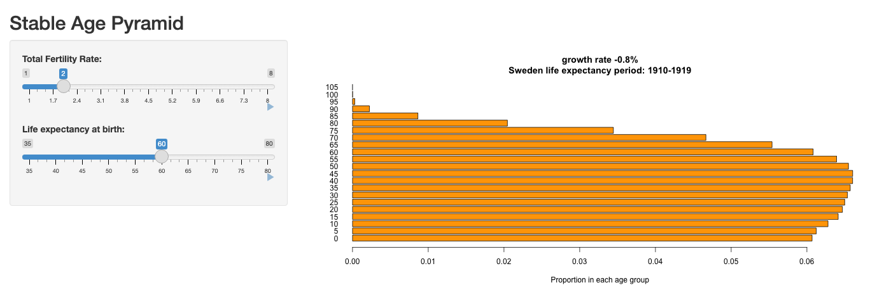

# Are Too Few Children a Problem? Age Structure and Optimal Fertility {#sec-aging}

```{r}
#| label: setup-ch9
#| include: false
col_grow <- "#e08a00"; col_zero <- "black"; col_shrink <- "#1f5fa8"

## Japan, 2009 survival (Human Mortality Database), the year used by Lee et al.
## HMD version from the 2025 course repo (the file Lab 6 uses)
jp <- read.table("data/japan_lx_2009_hmd_2025repo.txt", header = TRUE)
lx <- jp$lx / 1e5
x <- jp$age                                   # 0..110

## Japan National Transfer Accounts age schedules (the Lab file), yen -> dollars
nta <- read.table("data/japan_nta_schedules.txt", header = TRUE)
cx <- nta$cx / 150
yx <- nta$yx / 150

## stable age distribution for growth rate r
stable_nx <- function(r) { n <- exp(-r * x) * lx; n / sum(n) }
## growth rate implied by a TFR (survival to 30 of 0.99, as in the lab)
r_of_tfr <- function(tfr) log(tfr * 0.4886 * 0.99) / 30
```

::: {.callout-warning appearance="simple"}
## Draft: provenance notes (for review)
Margin tags mark material that is **not in the course slides or lab**.
[Added · from readings]{.tag-reading} comes from the assigned readings (Lee et al. 2014).
[Added · new]{.tag-new} is from outside the course materials (my framing, general knowledge, or my own analysis) and needs the closest check.
Untagged material follows the 2025 slides (13–14) and the aging lab.
:::

::: {.callout-note appearance="minimal"}
**In this chapter.** How to read a population pyramid as history; why a population
with fixed birth and death rates ends up with a *stable* age structure; and Ronald
Lee and coauthors' surprising answer to the question "What fertility rate is best
for the standard of living?"

**Readings this chapter draws on.** Lee et al. (2014), "Is low fertility really a
problem? Population aging, dependency, and consumption," *Science*.
:::

::: {.column-margin}
[Added · new]{.tag-new} Bridge text written for the chapter split.
:::

@sec-socsec showed that a pay-as-you-go pension system works better when each
generation is larger than the one before, so low fertility makes pensions harder to
pay for. Should we therefore want more children? To answer, this chapter first looks
at how birth and death rates shape a population's age structure, and then weighs the
costs of children, of the elderly, and of capital together.

## The population pyramid as history

### Reading a pyramid

The size of each age group today depends on how many babies were born in each past
year and how many of them survived. A population pyramid is therefore a record of
history. A pyramid of France on January 1, 1999 shows the marks of the twentieth
century: the deficit of births during the 1914–1918 war, the echo when those small
"hollow classes" reached childbearing age, the deficit of births during the
1939–1945 war, the baby boom, and fertility's fall below two children per woman.
(How can you tell the men from the women, besides reading French?)

How to "read" an age pyramid:

1. **First, look at the shape** to get the growth rate.
2. **Then look for variations in rates.** These can come from wars, famines, or
   changes in fertility, such as China's one-child policy, the U.S. baby boom, or the
   fertility transition.
3. **Lastly, look for immigration.** The telltale signs are one-sided dents and
   bulges, where one sex is much more numerous than the other at certain ages.

### Stable populations

What determines the shape? Assume a closed population and focus on one sex. Let
$B(t)$ be the number of births in year $t$ and $\ell(x)$ the proportion of a birth
cohort surviving to age $x$. People aged $x$ today are the surviving babies of $x$
years ago:

$$
P(x, t) = B(t - x)\, \ell(x).
$$

A **stable population** is one in which age-specific birth and death rates have
been fixed long enough that there are no more echoes or "instability." A
mathematical result is that a stable population grows exponentially in every age
group, at a rate $r$ called the **intrinsic growth rate**. Then there were
$B(t)e^{-rx}$ births $x$ years ago, so $P(x,t) = B(t)\,e^{-rx}\,\ell(x)$. In
proportions,

$$
p(x) = b \, e^{-rx} \, \ell(x),
$$

where $b$ is the birth rate. The age structure is the product of two things:
survival, $\ell(x)$, and the history of growth, $e^{-rx}$. When the population is
growing ($r > 0$), each older cohort was born into a smaller population, so the
pyramid narrows quickly with age. When $r < 0$, older cohorts are *larger* at birth
than younger ones, and the pyramid bulges at older ages.

@fig-stable shows the stable age structures implied by Japan's 2009 survival with
growth rates of −1, 0, and +1 percent per year.

```{r}
#| label: fig-stable
#| fig-cap: "Stable age structures with Japan's 2009 survival schedule and three growth rates. Bars show the percentage of the population at each age. Source: Human Mortality Database; computation as in the lab."
#| fig-height: 4
op <- par(mfrow = c(1, 3), mar = c(4, 3.5, 2.5, 0.5), mgp = c(2.2, 0.6, 0))
rs <- c(-0.01, 0, 0.01)
cols <- c(col_shrink, col_zero, col_grow)
titles <- c("r = −1% (shrinking)", "r = 0 (stationary)", "r = +1% (growing)")
for (i in 1:3) {
  n <- 100 * stable_nx(rs[i])
  plot(n, x, type = "n", xlim = c(0, 2), ylim = c(0, 105),
       xlab = "Percent at each age", ylab = if (i == 1) "Age" else "",
       main = titles[i], font.main = 1, cex.main = 1)
  segments(0, x, n, x, col = cols[i], lwd = 1.2)
}
par(op)
```

There are only three stable cases. A growing population has a classic pyramid.
A stationary population has a beehive, nearly straight-sided until old age. A
shrinking population has an inverted shape, narrowest at the bottom.

### Try it: the stable age pyramid app

::: {.column-margin}
[Added · new]{.tag-new} This app comes from earlier years of the course (the 2016
transition lecture, the 2021 and 2023 age-pyramid lectures, and the 2018–2021
population-projection labs); it isn't in the 2025 course repo. I copied it into
`course_apps_extra/stable` and exported it with Shinylive. It uses Swedish life tables
rather than Japan's. The questions are mine; they use only the fertility slider, to
stay clear of the Lab 6 graded questions on survival and optimal fertility.
:::

The app draws the stable age structure, $p(x) = b\,e^{-rx}\,\ell(x)$, for any total
fertility rate and life expectancy. It turns the life expectancy into a Swedish
historical life table with about that life expectancy, computes the long-run growth
rate $r$ implied by the TFR, and shows the resulting proportion of the population in
each five-year age group. It opens in a new tab, so you can make it full screen and
keep this page open alongside it. (The first load can take a few seconds while R
starts up in your browser.)

[{width="85%" fig-alt="Screenshot of the stable age pyramid Shiny app: sliders for the total fertility rate and life expectancy on the left, and a bar chart of the proportion of the population in each age group on the right."}](apps/stable/index.html){target="_blank" rel="noopener"}

[Open the stable age pyramid app in a new tab ↗](apps/stable/index.html){.btn .btn-primary target="_blank" rel="noopener"}

Before you move each slider, write down what you expect to happen. Then check.

1. **Two children is not always replacement.** At the starting values (TFR = 2, life
   expectancy = 60), the app reports a negative growth rate. Before you look, can you
   say why? Then find, roughly, the TFR that gives zero growth with this life
   expectancy.
2. **High fertility.** Raise the TFR to 6, a pre-transition level. Predict the shape of
   the pyramid and the share of the population under age 15 before you move the
   slider.
3. **Very low fertility.** Lower the TFR to 1.3, about where Japan and much of Southern
   Europe have been. Which age group is now the largest? Roughly what share of the
   population is 65 or older, compared with the TFR = 2 case?

## Optimal fertility

### Three sides of the story

Now the big question. What rate of population growth, and so what fertility, is
best for the standard of living? Three forces pull in different directions:

1. **Population growth is good** because it means more workers per elderly person.
   This is the PAYGO lesson.
2. **Population growth is bad** because it means more children per worker.
3. **Population growth is bad** because of capital dilution: every new worker has to
   be equipped with capital. This is the Solow lesson.

### The question, and its limits

::: {.column-margin}
[Added · from readings]{.tag-reading} This subsection and the next three draw on
Lee et al. 2014 (text and Box 1).
:::

Ronald Lee and his coauthors begin by noting a "remarkable reversal." For decades,
people worried about high fertility. Now 48 percent of the world's people live in
countries with below-replacement fertility. In 2013, "governments in 102 countries
reported that population aging was a 'major concern' and 54 countries had enacted
policies intended to raise fertility."

They are candid that the full question can't be answered:

::: {.callout-tip appearance="simple"}
## In their own words
"Identifying an optimal population policy is likely to be impossible for several
reasons. First, children yield direct satisfaction and impose costs on parents that
are difficult or impossible to measure. Second, the environmental consequences of
continuing population growth are exceedingly complex and difficult to value or weigh
against other costs and benefits of low fertility. Third, assessing the welfare
consequences of differences in fertility requires comparing the welfare of those not
yet born to those who will never be born." (Lee et al. 2014)
:::

So their goal is "more modest": to ask how fertility and population aging affect
the *material* standard of living.

### Two support ratios

Lee and coauthors use the NTA age profiles to build two measures of how age
structure affects the economy:

- The **fiscal support ratio** is "the ratio of tax payers to beneficiaries." Each
  age group is weighted by the taxes it pays and the public benefits it receives.
  It measures the effect of age structure on government budgets.
- The **support ratio** is "the ratio of earners to consumers." Each age group is
  weighted by its labor income and its consumption, public and private combined:

$$
\text{support ratio} = \frac{\sum_x n(x)\, y(x)}{\sum_x n(x)\, c(x)},
$$

where $n(x)$ is the share of the population at age $x$, $y(x)$ is labor income, and
$c(x)$ is consumption at age $x$. A higher support ratio means more resources per
person.

The two ratios give different answers because public and private transfers go to
different ages. Since public transfers in rich countries go mostly to the elderly
and private transfers mostly to children, "the age structure that favors public
finances is much younger than the age structure that favors the combined finances of
the public and private sectors."

There is an elegant way to see which way a change in growth pushes the support
ratio. Compare the **average age at which people consume** in the population with
the **average age at which people earn**. If consumption happens later in life, on
average, than earning, then a younger population, one that is growing faster, adds
more earners than consumers, and the support ratio rises. If consumption happens
earlier, a younger population lowers it. At the growth rate that maximizes the
support ratio, the two average ages are equal.

@fig-sr computes the support ratio for Japan at each fertility level, using the
stable age structures from @fig-stable and the NTA profiles from @fig-nta.

```{r}
#| label: fig-sr
#| fig-cap: "The support ratio for Japan's stable population at each total fertility rate, using Japan's NTA age profiles and 2009 survival (age-structure effects only; no capital). Computation as in the lab."
#| fig-height: 4
tfr <- seq(1, 4, 0.01)
sr <- sapply(tfr, function(f) { n <- stable_nx(r_of_tfr(f)); sum(n * yx) / sum(n * cx) })
op <- par(mar = c(4, 4.5, 1, 1))
plot(tfr, sr, type = "l", lwd = 2.5, ylim = c(0.52, 0.70),
     xlab = "Total fertility rate", ylab = "Support ratio")
f_opt <- tfr[which.max(sr)]
abline(v = f_opt, lty = 3)
text(f_opt, 0.535, paste("Maximum at TFR =", f_opt), pos = 4, cex = 0.9)
par(op)
```

Taking only age structure into account, the support ratio for Japan peaks at a TFR
of about `r f_opt`, above replacement. But notice how flat the curve is. Over a wide
range of fertility, from about 1.5 to 3.5 children per woman, the support ratio
is never more than about 6 percent below its maximum. Higher fertility means more children and fewer elderly. Lower
fertility means fewer children and more elderly. The two kinds of dependency largely
cancel out.

### Adding capital

The support ratio leaves out the third force. Faster population growth requires
more saving and investment just to equip each new generation of workers with
capital, and that saving can't be consumed. Lee and coauthors call this the "capital
cost" of higher fertility. Because it depends on how households, firms, and
governments respond, they consider two cases:

- a **low capital cost** case, in which the ratio of capital to output stays constant
  at about 3, the value observed in many rich countries between 1980 and 2004, and
- a **high capital cost** case based on the neoclassical (Solow) growth model, with
  saving at the "golden rule" rate that maximizes consumption per person. Here
  "capital per worker rises when fertility falls as has been true in Japan."

### The results

@tbl-lee shows the fertility rates that maximize each objective, averaged over the
countries in each income group.

```{r}
#| label: tbl-lee
#| tbl-cap: "Total fertility rates that maximize each objective, by income group. Source: Lee et al. (2014), Table 1 (the lecture slide shows the first four columns)."
#| echo: false
knitr::kable(data.frame(
  `Income group` = c("Lower income", "Upper-middle income", "High income"),
  `Fiscal support ratio` = c(1.08, 2.96, 2.94),
  `Support ratio` = c(1.75, 2.01, 2.27),
  `Consumption, low capital cost` = c(1.21, 1.51, 1.78),
  `Consumption, high capital cost` = c(0.91, 1.20, 1.48),
  `Actual TFR, 2005–10` = c(4.03, 2.09, 1.65),
  check.names = FALSE))
```

Read the high-income row from left to right. Government budgets alone would be best
served by about 2.9 children per woman, well above replacement, because children
grow up to be taxpayers who pay for the elderly. Counting private family support for
children as well, the best fertility falls to about 2.3, because children are
expensive for families. Counting the cost of capital, it falls to 1.8 or even 1.5.
The striking result is that **below-replacement fertility can be "optimal"** for the
material standard of living.

Lee and coauthors draw the conclusion carefully:

::: {.callout-tip appearance="simple"}
## In their own words
"Fiscal pressures on public programs due to population aging are real and
important. ... In a number of countries, particularly those with very low fertility,
standards of living would be moderately higher if fertility increased. Fertility as
low as 1.6 births per woman and possibly even lower should not in itself be a matter
of concern. Fertility below replacement and modest population decline favor higher
material standards of living." (Lee et al. 2014)
:::

::: {.column-margin}
[Added · from readings]{.tag-reading} The −2% and Japan figures are from Lee et al.
2014. The quotation on immigration is one Lee et al. take from a 2009
handbook chapter by Goldstein.
:::

Very low fertility is another matter. With the age profiles of high-income
countries, a population shrinking at 2 percent a year (a TFR of about 1.1) would
have consumption per person about 4 percent lower than at replacement, and 7.6
percent lower with Japan's very low mortality. Japan, the world's oldest population,
shows both sides. Its support ratio fell 0.6 percent a year in the 2000s and its
fiscal support ratio 0.9 percent, and public debt is very high. Yet because slower
labor force growth reduced the cost of equipping new workers, consumption per
person "also rose at more than 2% annually." Could immigration help? Only for a
while: as the authors quote, "a steady stream of migrants almost always makes a
population younger in the short-term but older in the long-term."

### Conclusions and caveats

So low fertility might be something to aim for, not be scared of. Why?

- Both kids and the elderly are expensive. In a stable population, an increase in
  one is largely cancelled out by a decrease in the other.
- Capital deepening, the Solow effect, makes slow population growth attractive.

But there are important caveats:

- The age schedules of production and consumption are treated as exogenous and
  fixed.
- There is no endogenous technological growth of the kind Romer or Boserup
  emphasize, in which more people means more ideas or more innovation.

::: {.callout-important}
## In the lab
In Lab 6 you reproduce Lee and coauthors' calculations for Japan: from fertility
to growth rates, from growth rates to stable age structures, and from age structures
to support ratios, first without and then with capital. Then you ask how the answer
changes with a different survival schedule.
:::

## Key ideas

- A population pyramid records history. In a **stable population**,
  $p(x) = b\,e^{-rx}\,\ell(x)$.
- Lee et al. (2014): fertility well above replacement is best for government budgets,
  near replacement for the support ratio, and **below replacement** for consumption
  once capital costs are counted.

## Check your understanding

::: {.column-margin}
[Added · new]{.tag-new} These questions are new and avoid the lab's graded
questions.
:::

1. **Reading a pyramid.** In a country's pyramid, the men's side bulges well beyond the
   women's between ages 25 and 40, but the two sides match at younger and older ages.
   What is the most likely explanation?

2. **Average ages.** In your own words, explain why a population in which people
   consume, on average, at older ages than they earn would have a higher support ratio
   if it grew faster.

3. **Two support ratios.** Lee and coauthors find that the fiscal support ratio is
   maximized at a higher fertility rate than the support ratio. Explain why, using the
   direction of public and private transfers.

## Further reading

- Lee, Ronald, Andrew Mason, and members of the NTA Network. 2014. "Is low fertility
  really a problem? Population aging, dependency, and consumption." *Science*
  346(6206): 229–234.
  *A harder reading. As you read: What is the difference between the fiscal support
  ratio and the support ratio? What is the "capital cost" of higher fertility? Which
  countries have fertility that is too low by every measure?*
