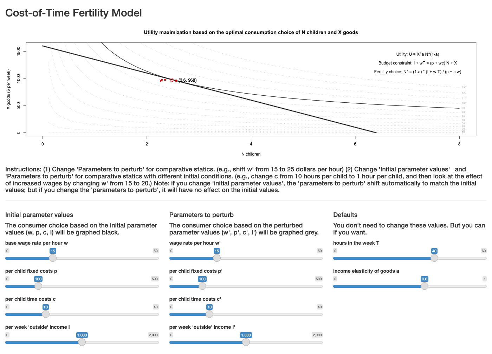

# How Do Economists Think We Decide How Many Children to Have? {#sec-fertility}

```{r}
#| label: setup-ch7
#| include: false

col_kids <- "#d62728"; col_goods <- "#1b9e3a"; col_old <- "#1b9e3a"
col_new <- "#d62728"; col_grey <- "grey45"

## ---- Cost-of-time model --------------------------------------------------
## Budget: X + (p + c w) N = w T + I ; utility U = X^a N^(1 - a)
## Optimum (Cobb-Douglas): N* = (1 - a)(I + wT)/(p + cw), X* = a (I + wT)
full_income <- function(w, T, I) w * T + I
full_price  <- function(p, c, w) p + c * w
N_star <- function(w, T, I, p, c, a) (1 - a) * full_income(w, T, I) / full_price(p, c, w)
X_star <- function(w, T, I, p, c, a) a * full_income(w, T, I)
util   <- function(X, N, a) X^a * N^(1 - a)
## X on an indifference curve with utility U
X_on_U <- function(U, N, a) (U / N^(1 - a))^(1 / a)
## Point on indifference curve U where the slope equals a given price of N
tangent_on_U <- function(U, P, a) {
  U <- unname(U)
  k <- (a / (1 - a)) * P               # X/N ratio at tangency
  N <- U / k^a
  c(N = N, X = k * N)
}

## ---- Becker quantity-quality model ---------------------------------------
## Budget: p_n n + p_c q n = S ; CES utility over n and q (sigma < 1)
U_nq <- function(n, q, alpha = 0.5, rho = -0.5) (alpha * n^rho + (1 - alpha) * q^rho)^(1 / rho)
q_budget <- function(n, S, pn, pc = 1) (S - pn * n) / (pc * n)
opt_nq <- function(S, pn, pc = 1, ...) {
  f <- function(n) { q <- q_budget(n, S, pn, pc); if (q <= 0) -Inf else U_nq(n, q, ...) }
  o <- optimize(f, c(0.05, S / pn - 0.01), maximum = TRUE)
  c(n = o$maximum, q = q_budget(o$maximum, S, pn, pc), U = o$objective)
}
## q on an indifference curve of CES utility with level U
q_on_U <- function(U, n, alpha = 0.5, rho = -0.5) {
  inner <- (U^rho - alpha * n^rho) / (1 - alpha)
  ifelse(inner > 0, inner^(1 / rho), NA)
}
```

::: {.callout-warning appearance="simple"}
## Draft: provenance notes (for review)
Margin tags mark material that is **not in the course slides or lab**.
[Added · from readings]{.tag-reading} comes from the assigned readings (Becker 1991, ch. 5; the Wikipedia "Consumer choice" entry the calendar recommends).
[Added · new]{.tag-new} is from outside the course materials (my framing, general knowledge, or my own analysis) and needs the closest check.
Untagged material follows the 2025 slides (15–16) and the fertility lab.
:::

::: {.callout-note appearance="minimal"}
**In this chapter.** If children are a "normal" good, something people want more
of as they get richer, why has fertility fallen as incomes have risen? We build
two economic models of fertility choice. The first, the **cost-of-time** model,
treats the parents' time as part of the price of a child. The second, Gary Becker's
**quantity–quality** model, adds the idea that parents care about how much they
invest in each child, not just how many children they have.

**Readings this chapter draws on.** Income and substitution effects, from whatever
microeconomics text you used (the calendar suggests the Wikipedia entry "Consumer
choice," especially its section on labor and leisure); Becker (1991), "The Demand
for Children," Chapter 5 of *A Treatise on the Family*, pp. 135–154.
:::

## The big questions

### A puzzle for economics, and for biology

Economists usually assume that when people get richer, they buy more of most
things. Goods like that are called **normal goods**. If children were a normal good,
richer people and richer societies would have more children. Over the last century
and a half, the opposite has happened. In the United States, the total fertility rate
fell from about 7 in 1800 to around 2 today, with one big interruption, the baby
boom after World War II, even as incomes rose enormously.

The same puzzle troubles biology. Natural selection rewards whatever leaves more
descendants. So why doesn't social and economic success translate into more
offspring?

::: {.column-margin}
[Added · from readings]{.tag-reading} Darwin, Malthus, and the Italian village
example are from Becker 1991, pp. 136–137.
:::

Becker opens his chapter with exactly this tension. Malthus assumed that
populations grow rapidly unless held back by limited food. Darwin, who wrote that
reading Malthus gave him "a theory by which to work," extended the logic: the
children of fertile parents make up a larger share of the next generation, so
"populations tend to become dominated by the highly fertile." But, Becker points out,
"most families have controlled their fertility and have had fewer children than their
capacities permit." Seventeenth-century Italian village women who married at
twenty-five averaged only six children, when their biological capacity "probably
exceeded eight." Neither Malthus nor Darwin can explain why Western fertility fell so
far in the last century as family incomes "rose dramatically."

### Two kinds of evidence

There are two kinds of questions here.

- **Over time.** Why did fertility fall during the demographic transition, and why
  does it keep falling?
- **Across people and places.** Within a society, who has more children and who has
  fewer? Between societies, why is fertility high in some and low in others?

On differences across people: in Zimbabwe in 1999, the TFR was 4.0 for women as a
whole, but more than 5 for women with no education and under 2 for women with
higher education. (The TFR is a "period" measure, with some caveats.) Across the
states of India in 2010–13, the TFR ranged from below 1.65 in some states to above 3
in others. And we would like to know what will happen in the future.

This chapter covers two economic models. The first, the **opportunity cost of
childbearing**, gives children a price that includes the parents' time. The
second, Becker's **quantity–quality tradeoff**, lets parents choose how much to
invest in each child as well as how many children to have.

## Consumer choice: a quick review

We all make choices between goods all the time: rent or food, books or movies, more
leisure or more income. The economist's model of these choices has three
ingredients:

1. We choose a **bundle** of goods together, $(X_1, X_2)$, not one at a time.
2. Our total spending is limited by a **budget constraint**:
   $p_1 X_1 + p_2 X_2 \le$ the available budget.
3. Among all the bundles we can afford, we choose the one that maximizes our
   **utility**, $U(X_1, X_2)$.

::: {.column-margin}
[Added · from readings]{.tag-reading} The definitions in the next two paragraphs
follow the Wikipedia entry "Consumer choice," recommended in the course calendar.
:::

We picture preferences with **indifference curves**. Each curve connects bundles
that make the person equally happy, and curves farther from the origin are better.
They are usually bowed toward the origin, because people are willing to give up less
and less of one good to get more of another as they have more of it. The best
affordable bundle is where the highest reachable indifference curve just touches the
budget line.

When a price changes, the effect on what people buy can be split into two parts.
The **substitution effect** is the change in demand "resulting from a price change
that alters the slope of the budget constraint but leaves the consumer on the same
indifference curve": people switch toward whatever has become relatively cheaper. The
**income effect** is the change in demand from the change in purchasing power. The
Wikipedia entry ends with the case that matters most for us, the trade-off between
**labor and leisure**. A person has a fixed endowment of time, and every hour not
spent working is an hour of earnings given up. Time has a price, and that price is
the wage.

## The cost-of-time model

### Setting up the model

Our first model of fertility puts these pieces together.

1. Utility depends on goods and children: $U(X, N)$, where $X$ is consumer goods and
   $N$ is the number of children.
2. The budget constraint: a family can spend only what it earns.
3. Earnings depend on the wage, the hours worked, and "other income."
4. Time is spent either working or taking care of children. For simplicity, we
   leave out leisure.

The key idea is that the model counts the **opportunity cost of time**. For
convenience, we measure goods in dollars, so the price of $X$ is 1.

**The time constraint.** If $T$ is the total hours available, $L$ is hours in the
labor force, and each child takes $c$ hours of care, then

$$
T = L + cN.
$$

**The money budget.** Spending on goods $X$ plus spending on children, at $p$
dollars per child (food, clothes, and so on), must equal earnings plus other income
$I$:

$$
X + pN = wL + I = w(T - cN) + I.
$$

Moving the time cost of children to the left side gives

$$
X + (p + wc)N = wT + I.
$$

This reframes the problem. The right side, $wT + I$, is **full income**: what the
family would have if every available hour were spent working. The left side counts
all expenses, *including opportunity costs*. The full price of a child is
$p + wc$: the money cost plus the earnings given up to care for the child.

### A worked example

Take the example from lecture: a wage of $w = \$20$ an hour, $T = 40$ hours a week,
other income $I = \$1{,}000$ a week, money costs of $p = \$200$ per child per week,
and time costs of $c = 5$ hours per child per week. Full income is
$20 \times 40 + 1000 = \$1{,}800$ a week, and the full price of a child is
$200 + 20 \times 5 = \$300$. So the family can afford \$1,800 of goods and no
children, or 6 children and no goods, or anything on the line between:
$X = 1800 - 300N$.

To find the best bundle, we need preferences. Lecture uses the **Cobb–Douglas**
utility function $U(X, N) = X^{0.7} N^{0.3}$. @fig-cost-of-time shows the budget
line, a few indifference curves, and utility along the budget line.

```{r}
#| label: fig-cost-of-time
#| fig-cap: "The cost-of-time model with the lecture example (w = $20, T = 40, I = $1,000, p = $200, c = 5, U = X^0.7 N^0.3). Left: the budget line and indifference curves; the best bundle is where an indifference curve just touches the line. Right: utility along the budget line, a slice through the 'utility mountain.'"
#| fig-height: 4
w <- 20; T <- 40; I <- 1000; p <- 200; c <- 5; a <- 0.7
Ns <- N_star(w, T, I, p, c, a); Xs <- X_star(w, T, I, p, c, a)
Us <- util(Xs, Ns, a)
N <- seq(0.01, 6, 0.01)
op <- par(mfrow = c(1, 2), mar = c(4, 4.5, 1, 1))
plot(N, 1800 - 300 * N, type = "n", ylim = c(0, 2000), xlim = c(0, 6.2),
     xlab = "Number of children (N)", ylab = "Goods (X, $ per week)")
for (Ui in Us * c(0.75, 1, 1.25))
  lines(N, X_on_U(Ui, N, a), lty = 3, col = col_grey)
segments(0, 1800, 6, 0, col = col_goods, lwd = 2.5)
points(Ns, Xs, pch = 19)
arrows(1.75, 520, Ns, Xs - 50, length = 0.07)
text(1.75, 520, sprintf("best bundle:\nN = %.1f, X = $%.0f", Ns, Xs), pos = 1, cex = 0.8)
text(4.1, 600, "budget line", col = col_goods, pos = 4, cex = 0.85)
Ub <- util(1800 - 300 * N, N, a)
plot(N, Ub, type = "l", lwd = 2.5, ylim = c(0, max(Ub) * 1.1),
     xlab = "Number of children (N)", ylab = "Utility along the budget line")
abline(v = Ns, lty = 3)
par(op)
```

The family's best choice here is about `r round(Ns, 1)` children, and
\$`r format(round(Xs), big.mark = ",")` a week of goods. (Children come in whole
numbers, of course. Think of $N$ as an average across many families.) In one sentence:
**given the budget constraint, we pick the combination of goods and children that
maximizes utility.**

::: {.callout-note collapse="true"}
## For those who like formulas
With Cobb–Douglas utility $U = X^a N^{1-a}$, the best choice can be found exactly
(the lab shows the derivation):

$$
N^* = (1 - a)\,\frac{I + wT}{p + cw}, \qquad X^* = a\,(I + wT).
$$

The family spends a fixed share $1 - a$ of full income on children. In the example,
$N^* = 0.3 \times 1800 / 300 = 1.8$. You don't need to memorize this.
:::

## Effects of income and wage changes

### More non-wage income

Suppose non-wage income $I$ rises, perhaps because of an inheritance or, in a family
where only the mother cares for children, a raise for the father. The budget line
shifts out parallel to itself: its slope, $-(p + wc)$, doesn't change. The family can
afford more of both goods and children, and if both are normal goods, it buys more of
both. **More non-wage income raises fertility.**

### Higher wages: two effects pulling in opposite directions

A higher wage is different, because the wage appears on *both* sides of the budget.
It raises full income, $wT + I$, and it raises the price of a child, $p + wc$. So the
budget line becomes steeper as well as shifting out.

- The **income effect** of a higher wage could raise fertility: more income to spend,
  including on the fixed money costs of childbearing.
- The **substitution effect** could lower fertility: each hour spent with a child
  now costs more in lost earnings, so the family substitutes toward goods.

The effect on the number of children is **ambiguous**. It depends on which effect is
bigger. @fig-wage-effects shows both possibilities. Following lecture, we split the
move from the old choice A to the new choice C into two steps. A → B is the **income
effect**: we hold prices (the slope) fixed and move to the new level of utility.
B → C is the **substitution effect**: we change the price and move *along* the new
indifference curve.

::: {.column-margin}
[Added · new]{.tag-new} The parameter values in this figure are my choices, picked
to show each case clearly.
:::

```{r}
#| label: fig-wage-effects
#| fig-cap: "A doubling of the wage (from $20 to $40) under two sets of circumstances. Green: old budget line; red: new budget line; dashed green: a line with the old slope tangent to the new indifference curve. A → B is the income effect and B → C the substitution effect. Left: the substitution effect dominates and the family has fewer children. Right: the income effect dominates and it has more."
#| fig-height: 4.3
decomp_plot <- function(T, I, p, c, a, w0, w1, main) {
  P0 <- full_price(p, c, w0); P1 <- full_price(p, c, w1)
  F0 <- full_income(w0, T, I); F1 <- full_income(w1, T, I)
  A <- c(N = N_star(w0, T, I, p, c, a), X = X_star(w0, T, I, p, c, a))
  C <- c(N = N_star(w1, T, I, p, c, a), X = X_star(w1, T, I, p, c, a))
  UA <- unname(util(A["X"], A["N"], a)); UC <- unname(util(C["X"], C["N"], a))
  B <- tangent_on_U(UC, P0, a)                      # new utility, old prices
  nmax <- max(F0 / P0, F1 / P1, B["N"] * 1.6)
  N <- seq(0.02, nmax, length.out = 400)
  plot(N, N, type = "n", xlim = c(0, nmax), ylim = c(0, F1 * 1.05),
       xlab = "Number of children (N)", ylab = "Goods (X)", main = main,
       font.main = 1, cex.main = 0.95)
  lines(N, X_on_U(UA, N, a), lty = 3, col = col_grey)
  lines(N, X_on_U(UC, N, a), lty = 3, col = col_grey)
  segments(0, F0, F0 / P0, 0, col = col_old, lwd = 2.5)
  segments(0, F1, F1 / P1, 0, col = col_new, lwd = 2.5)
  FB <- B["X"] + P0 * B["N"]                        # income needed at old prices
  segments(0, FB, FB / P0, 0, col = col_old, lwd = 1.5, lty = 2)
  pts <- rbind(A = A, B = B, C = C)
  points(pts[, "N"], pts[, "X"], pch = 19)
  text(pts[, "N"], pts[, "X"], rownames(pts), pos = c(1, 4, 2), font = 2)
  invisible(pts)
}
op <- par(mfrow = c(1, 2), mar = c(4, 4.5, 2.5, 1))
p1 <- decomp_plot(T = 40, I = 2000, p = 50, c = 10, a = 0.7, w0 = 20, w1 = 40,
                  main = "Substitution effect dominates")
p2 <- decomp_plot(T = 40, I = 200, p = 400, c = 5, a = 0.7, w0 = 20, w1 = 40,
                  main = "Income effect dominates")
par(op)
```

In the left panel, the wage rise moves the family from
`r sprintf("%.1f", p1["A","N"])` to `r sprintf("%.1f", p1["C","N"])` children. In
the right panel, the same doubling of the wage moves it from
`r sprintf("%.1f", p2["A","N"])` to `r sprintf("%.1f", p2["C","N"])`. In both cases
the income effect (A → B) is toward more children and the substitution effect
(B → C) is toward fewer. What differs is their relative size. Roughly, the
substitution effect wins when the time cost of children is large compared with their
money cost, and when much of the family's income does not depend on the wage.

### Try it: the cost-of-time app

::: {.column-margin}
[Added · new]{.tag-new} The app is the course's own cost-of-time app
(`ShinyApps/cost-of-time` in the 2025 course repo), exported with Shinylive so it
runs in the browser, in its own tab. The three questions are mine; they use only the
"Defaults" sliders, to stay clear of the Lab 7 graded questions.
:::

The app is the one used in Lab 7. It opens in a new tab, so you can make it full
screen and keep this page open alongside it. (The first load can take a few seconds
while R starts up in your browser.) The **black** choice uses the "initial" values
on the left; the **grey** choice uses the "perturbed" values in the middle column, so
you can compare two situations side by side.

[{width="85%" fig-alt="Screenshot of the cost-of-time Shiny app: an indifference-curve plot of children versus goods above three columns of sliders."}](apps/cost-of-time/index.html){target="_blank" rel="noopener"}

[Open the cost-of-time app in a new tab ↗](apps/cost-of-time/index.html){.btn .btn-primary target="_blank" rel="noopener"}

A few things to try, using only the "Defaults" column on the right:

1. **Read the formula off the graph.** With the starting values ($w = 15$, $p = 100$,
   $c = 10$, $I = 1000$, $T = 40$, $a = 0.6$), use
   $N^* = (1-a)(I + wT)/(p + cw)$ to compute the number of children by hand. Does it
   match the black point?
2. **Change tastes.** Move $a$, the weight on goods, from 0.6 down to 0.4. What happens
   to the number of children? Why does the share of full income spent on children
   depend only on $a$?
3. **Change the time available.** Move $T$ from 40 to 50 hours. Which part of the budget
   line moves, and why does more time raise the number of children even though the
   wage and the prices of children are unchanged?

The lab asks you to use the app to explore changes in wages, income, and the money and
time costs of children.

### Is the model great, or terrible?

The effect of a wage increase can go either way. That is bad for prediction, though
good for explaining things after the fact. But the model makes much **stronger
predictions** about other changes:

- A higher money price of children, $p$, **lowers** fertility. (Would cheaper schools
  raise fertility?)
- More non-wage income, $I$, **raises** fertility. (What if "male" income rises?)
- A higher time cost per child, $c$, **lowers** fertility. (What about labor-saving
  devices for child care, like washing machines for children's clothes?)
- A higher wage, $w$, is **ambiguous**.

So the idea that rising wages reduce fertility is based on empirical research, not
theoretical necessity.

What does the evidence say about income and fertility? A recent study of the United
States (Hauer and Schmertmann 2020) estimated the TFR by household income from
2010–2018. Fertility falls as household income rises, up to a point, and then turns
back up among the highest-income households, for both white and nonwhite women: a
U-turn. Ask yourself: in what income range does the substitution effect seem to
dominate, and in what range the income effect?

### Who bears the cost of time?

The cost of children's time falls disproportionately on women. That gives the model
a sharper prediction. Higher wages for men work mostly through the income effect and
should raise fertility. Higher wages for women bring a substitution effect as well,
and should lower fertility, or at least raise it less than men's wages do. A number
of older studies have found this pattern. One study of Sweden (Schultz 1985) compared
the price of butter, whose production was largely women's work, with the price of
grain, largely men's. Another, by Butz and Ward (1979), was titled "The emergence of
countercyclical U.S. fertility." When women's wages are an important part of family
income, a recession, which lowers the opportunity cost of time, could actually raise
fertility.

::: {.column-margin}
[Added · from readings]{.tag-reading} The two-thirds figure, the household survey
evidence, and Becker's caution about causation are from Becker 1991, p. 140.
:::

Becker makes the same argument. "The cost of the mother's time is a major part of
the total cost of producing and rearing children," he writes. In the United States it
contributes "about two-thirds of the total cost." "I believe that the growth in the
earning power of women during the last hundred years in developed countries is a
major cause of both the large increase in labor force participation of married women
and the large decline in fertility." Because fathers have spent relatively little time
on children, their rising earnings have not much affected the cost of children.
Household surveys bear this out. The number of children is "strongly negatively
related to the wage rate or other measures of the value of time of wives, and is more
often positively rather than negatively related to the wage rate or earnings of
husbands." Becker adds a caution about causation. Part of the relationship runs from
children to wages, "because women invest less in market skills and more in household
skills and men do the reverse when families have more children."

More recent evidence complicates the story. Across 15 industrialized countries,
fertility used to *rise* when unemployment rose, in the late 1950s and 1960s. Since
the mid-1970s, it has *fallen* when unemployment rises (Örsal and Goldstein 2018).
Fertility has become "pro-cyclical" again.

### What the cost-of-time model helps explain

- **Kuwait versus Switzerland.** Both are rich, but one has high fertility and the
  other low.
- **Women's share of income.** Why, as an increasing share of family income comes
  from women, fertility might decline.
- **Female education.** Why increasing female education might decrease fertility.

::: {.column-margin}
[Added · new]{.tag-new} The interpretation of Kuwait and Switzerland in terms of the
model is my addition. Your slide lists the comparison without explanation.
:::

In the language of the model, the difference between Kuwait and Switzerland is about
*where income comes from*. Much of Kuwait's wealth comes from oil, which, from a
family's point of view, behaves like non-wage income $I$: it raises income without
raising the price of anyone's time. Switzerland's wealth comes largely from the
earnings of skilled workers, women included, so getting richer there also means a
higher opportunity cost of time spent with children.

## The quantity–quality model

### Two puzzles

The cost-of-time model leaves two problems.

1. **An empirical problem.** Very large fertility declines have happened with fairly
   small economic changes (@tbl-becker-declines). Children have no close substitutes,
   so we would not expect demand for them to swing so much.
2. **A theoretical problem.** In the cost-of-time model, the cost per child is fixed.
   But we know the cost of raising a child has risen enormously.

```{r}
#| label: tbl-becker-declines
#| tbl-cap: "Some rapid fertility declines. Source: Becker (1991), Table 5.1 (shown in lecture)."
#| echo: false
knitr::kable(data.frame(
  `Country and period` = c("United States, 1920–1930", "United States, 1960–1972",
                           "Japan, 1950–1960", "Taiwan, 1960–1975",
                           "England and Wales, 1871–1901"),
  `Change in birth rate (%)` = c(-24, -38, -45, -51, -26), check.names = FALSE))
```

::: {.column-margin}
[Added · from readings]{.tag-reading} Becker 1991, pp. 135, 148, and 149 (footnote 12).
:::

Becker himself had been stuck on the first problem. In his first paper on fertility,
in 1960, he wrote that economic theory had "little to say about the quantitative
relationship between price and quantity. There are no good substitutes for children,
but there may be many poor ones." By 1991 he saw the way out: the "interaction between
quantity and quality of children," which he called "probably the major contribution of
the economic analysis of fertility."

### Adding quality

Becker's idea is that parents get utility not only from the *number* of children, $n$,
but also from their **quality**, $q$: how much is spent on each child's schooling,
health, and so on. Utility becomes $U(X, n, q)$. (Following lecture, we use Becker's
notation $n$ for the number of children and $p_c$ for the cost of one unit of quality
for one child, but keep $X$ for goods, which Becker calls $Z$.)

Assume that every child in a family gets the same quality, and every unit of quality
costs the same $p_c$. Then spending on children is $p_c q n$, and the budget
constraint goes from

$$
X + p n = \text{income} \quad\text{to}\quad X + p_c q n = \text{income}.
$$

There are now three choices instead of two. Holding total income $I$ and spending on
goods $X$ fixed, quality and quantity must satisfy

$$
q = \frac{I - X}{p_c\, n}.
$$

The budget constraint is no longer a straight line. It is a curved **hyperbola**,
like $y = c/x$. Doubling the number of children halves the quality you can afford for
each.

::: {.column-margin}
[Added · from readings]{.tag-reading} The car comparison is from Becker 1991, p. 148.
:::

Why should children be different from other goods in this way? Becker's answer: "a
rich person might well plan to own both expensive and inexpensive cars, but is
unlikely to plan on having both expensive and inexpensive children." Every child in a
family gets roughly the same treatment. So the quality chosen for one child applies
to all of them, and multiplies with their number.

### The interaction between quantity and quality

Becker's fuller version of the budget includes three kinds of cost (p. 149):

$$
\text{total child costs} = p_n n + p_q q + p_c q n.
$$

- $p_n$ is a **price per child**, of any quality: pregnancy, other fixed costs, and
  also the cost of contraception.
- $p_q$ is a **price per unit of quality**, regardless of the number of children:
  a set of encyclopedias, faster internet, things shared by all the children in a
  household.
- $p_c$ is a price that depends on **both** $q$ and $n$: school fees, visits to the
  doctor, new shoes.

How much does it cost to add one more child? About $p_n + p_c q$: the fixed cost plus
the quality that child will receive. How much does it cost to add one unit of quality?
About $p_q + p_c n$, because the extra quality goes to every child. So the "shadow" or
"full" price of quality depends on the number of children, and the price of quantity
depends on quality.

::: {.callout-tip appearance="simple"}
## In his own words
"Since an increase in q raises the amount spent on each child, it raises the relevant
cost of each child. Similarly, an increase in n raises the cost of adding to the
quality of each child because a larger number of children would be affected." (Becker
1991, p. 145)
:::

This creates a feedback loop. Suppose something makes children a little more costly.
Families have somewhat fewer children. With fewer children, quality is cheaper, so
they invest more in each child. With more invested in each child, another child is
more expensive, so they have still fewer. And so on, until a new equilibrium is
reached.

::: {.column-margin}
[Added · from readings]{.tag-reading} Becker 1991, pp. 146–147. Your slide 16-09
shows the shape of the budget curve. The specific utility function in the figure is
my choice.
:::

A surprising implication: this feedback does *not* require that quantity and quality
be close substitutes. On the contrary, Becker shows that "equilibrium would not be
possible if they were close substitutes!" The budget curve bows in toward the origin,
so a family will choose some of both only if its indifference curves bow in even more
sharply. That is, if it doesn't consider quality and quantity easy to trade off.
Otherwise it would pile everything into one or the other. In @fig-qq the indifference
curves are more curved than the budget curve, and the family settles at $e_0$.

```{r}
#| label: fig-qq
#| fig-cap: "Becker's quantity–quality model. The budget curve (blue) is bowed toward the origin because spending on children is quality × quantity. Left: the family's best choice e0 is where an indifference curve just touches the budget curve. Right: a compensated increase in the fixed cost per child rotates the budget curve through e0 (dashed). The family moves to e1, with fewer children and more quality per child. Illustrative CES preferences."
#| fig-height: 4.3
S0 <- 100; pn0 <- 10; pn1 <- 20
e0 <- opt_nq(S0, pn0)
S1 <- unname(pn1 * e0["n"] + e0["n"] * e0["q"])  # compensated: passes through e0
e1 <- opt_nq(S1, pn1)
n <- seq(1.5, 8.5, 0.01)
op <- par(mfrow = c(1, 2), mar = c(4, 4.5, 1, 1))
for (panel in 1:2) {
  plot(n, n, type = "n", xlim = c(1.5, 8.5), ylim = c(0, 32),
       xlab = "Number of children (n)", ylab = "Quality per child (q)")
  lines(n, q_on_U(e0["U"], n), lty = 3, col = col_grey)
  qb <- q_budget(n, S0, pn0); qb[qb < 0] <- NA
  lines(n, qb, col = "#2c5fb8", lwd = 2.5)
  points(e0["n"], e0["q"], pch = 19)
  text(e0["n"], e0["q"], expression(e[0]), pos = 4)
  if (panel == 1) {
    legend("topright", c("budget curve", "indifference curve"),
           col = c("#2c5fb8", col_grey), lty = c(1, 3), lwd = c(2.5, 1),
           bty = "n", cex = 0.85)
  } else {
    qb1 <- q_budget(n, S1, pn1); qb1[qb1 < 0] <- NA
    lines(n, qb1, col = "#2c5fb8", lwd = 2, lty = 2)
    lines(n, q_on_U(e1["U"], n), lty = 3, col = col_grey)
    points(e1["n"], e1["q"], pch = 19)
    text(e1["n"], e1["q"], expression(e[1]), pos = 2)
    legend("bottomleft", c("old budget", "new budget\n(compensated)"),
           col = "#2c5fb8", lty = c(1, 2), lwd = c(2.5, 2), bty = "n", cex = 0.85)
    arrows(e0["n"] - 0.1, e0["q"] + 0.6, e1["n"] + 0.15, e1["q"] - 0.6,
           length = 0.07, col = col_kids)
  }
}
par(op)
```

In the figure, a compensated doubling of the fixed cost per child moves the family
from `r sprintf("%.1f", e0["n"])` to `r sprintf("%.1f", e1["n"])` children, a drop of
`r round(100 * (1 - e1["n"] / e0["n"]))` percent, while quality per child rises
`r round(100 * (e1["q"] / e0["q"] - 1))` percent. Becker argues that "a moderate
increase in the fixed cost of children … that raised the initial shadow price of
quantity relative to quality by only 10 to 20 percent would reduce the demand for
quantity and increase the demand for quality by significantly larger percentages."

### A close reading: why cheaper contraception raises the cost of a child

::: {.callout-tip appearance="simple"}
## In his own words
"Therefore, an increase in, say, the fixed cost of n, perhaps because of reduced
child allowances or reduced costs of contraception, would induce a substitution away
from n and toward q as well as Z … The interaction between n and q implies that the
increase in q raises π~n~ further, while the decrease in n lowers π~q~ further, which
encourages still more substitution away from n and toward q. The decrease in n and
increase in q could be sizable even if the increase in the fixed cost of n were modest
…" (Becker 1991, pp. 149–150)
:::

Reduced child allowances obviously raise the cost of a child. But how can *cheaper*
contraception do so? Think of the cost of a child as including what the family does
*not* spend on avoiding that child. If contraceptives are expensive, avoiding a child
is expensive, and having one "saves" on contraception. If contraceptives become
cheap, having a child saves less, so the net cost of a child goes up.

```{r}
#| label: setup-qq-toy
#| include: false
## Worked example: Cobb-Douglas U = a ln n + b ln q + g ln z
qa <- 0.30; qg <- 0.45; qb0 <- 0.25; qb1 <- 0.27; qI <- 100
## with interaction: c n + p n q + z = I  (c = 2, p = 1)
wi <- function(b, c = 2, p = 1) {
  n <- (qa - b) / (qa + qg) * qI / c; q <- b / (qa - b) * c / p
  z <- qg / (qa + qg) * qI
  c(amb = qa - b, n = n, q = q, cn = c * n, pnq = p * n * q, z = z,
    pin = c + p * q, piq = p * n)
}
## without interaction: c n + p q + z = I  (c = 10, p = 1)
ni <- function(b, c = 10, p = 1) {
  s <- qa + b + qg
  c(s = s, shn = qa / s, n = qa / s * qI / c, shq = b / s, q = b / s * qI / p)
}
W0 <- wi(qb0); W1 <- wi(qb1); N0 <- ni(qb0); N1 <- ni(qb1)
## interaction family facing frozen (starting) shadow prices as linear prices
FI <- W0[["pin"]] * W0[["n"]] + W0[["piq"]] * W0[["q"]] + W0[["z"]]
nfrz <- function(b) qa * FI / ((qa + b + qg) * W0[["pin"]])
pch <- function(x0, x1) 100 * (x1 / x0 - 1)
dn_wi <- pch(W0[["n"]], W1[["n"]]); dq_wi <- pch(W0[["q"]], W1[["q"]])
dn_ni <- pch(N0[["n"]], N1[["n"]]); dq_ni <- pch(N0[["q"]], N1[["q"]])
dn_frz <- pch(nfrz(qb0), nfrz(qb1))
mult <- dn_wi / dn_ni
cav <- function(amb0) 100 * 0.02 / amb0   # % fall in n for a 0.02 rise in b
f1 <- function(x) sprintf("%.1f", x); f2 <- function(x) sprintf("%.2f", x)
f3 <- function(x) sprintf("%.3f", x); f0 <- function(x) sprintf("%.0f", x)
```

To see how the feedback in Becker's passage can turn a small shock into a big change,
it helps to work through a numerical example.

::: {.column-margin}
[Added · new]{.tag-new} The worked example is my construction (Cobb-Douglas
preferences; closed-form solution), approved by Josh; the mechanism and quote are
Becker's (1991, pp. 149–150).
:::

::: {.callout-note collapse="false"}
## Worked example: how a small shock becomes a big change

Two families have **the same preferences**,
$U = a\ln n + b\ln q + g\ln z$, with $a = `r qa`$ and $g = `r qg`$. They differ only in
the budget:

- **With interaction:** $c\,n + p\,n\,q + z = I$. Quality is bought *for each child*.
- **Without interaction:** $c\,n + p\,q + z = I$. Quality is bought *once for the
  family* (think of a set of encyclopedias).

The shock: $b$ rises from `r qb0` to `r qb1`, an `r f0(pch(qb0, qb1))`% rise in how
much the family values quality.

**1. Without interaction (the benchmark).** With a linear budget, the first-order
conditions are $a/n = \lambda c$, $b/q = \lambda p$, $g/z = \lambda$. Multiply each by
its quantity and add: $a + b + g = \lambda I$. So each good gets a fixed share of income:

$$
n = \frac{a}{a+b+g}\cdot\frac{I}{c}, \qquad q = \frac{b}{a+b+g}\cdot\frac{I}{p}.
$$

With $I = `r qI`$, $c = 10$, $p = 1$:

| | $a+b+g$ | share on $n$ | $n$ | share on $q$ | $q$ |
|---|:---:|:---:|:---:|:---:|:---:|
| Before ($b = `r qb0`$) | `r f2(N0[["s"]])` | `r f3(N0[["shn"]])` | `r f2(N0[["n"]])` | `r f3(N0[["shq"]])` | `r f1(N0[["q"]])` |
| After ($b = `r qb1`$) | `r f2(N1[["s"]])` | `r f3(N1[["shn"]])` | `r f2(N1[["n"]])` | `r f3(N1[["shq"]])` | `r f1(N1[["q"]])` |
| **Change** | | | **`r f1(dn_ni)`%** | | **+`r f1(dq_ni)`%** |

Raising $b$ affects $n$ only by slightly shrinking the *share* of the budget going to
children. The prices of children and quality don't change at all.

**2. With interaction.** Now the budget has the term $p\,n\,q$, so the first-order
conditions are

$$
\frac{a}{n} = \lambda\,(c + p q), \qquad \frac{b}{q} = \lambda\,p n, \qquad \frac{g}{z} = \lambda .
$$

The terms in parentheses are the **shadow prices**: an extra child costs $c + pq$, and
an extra unit of quality costs $pn$. Solving step by step:

1. Multiply the quality condition by $q$: $b = \lambda\,p\,n\,q$.
2. Multiply the quantity condition by $n$: $a = \lambda c n + \lambda p n q = \lambda c n + b$,
   so $\lambda c n = a - b$.
3. Add up all spending: $\lambda(cn + pnq + z) = (a - b) + b + g = a + g$, so
   $\lambda = (a+g)/I$.
4. Therefore

$$
n = \frac{a-b}{a+g}\cdot\frac{I}{c}, \qquad q = \frac{b}{a-b}\cdot\frac{c}{p}.
$$

Now $b$ sits *inside* the formula for $n$, as $a - b$. With $I = `r qI`$, $c = 2$,
$p = 1$ (units chosen so that $n$ is about 3):

| | $a - b$ | $n$ | $q$ | check: $cn + pnq + z$ |
|---|:---:|:---:|:---:|:---:|
| Before ($b = `r qb0`$) | `r f2(W0[["amb"]])` | `r f2(W0[["n"]])` | `r f1(W0[["q"]])` | `r f2(W0[["cn"]])` + `r f1(W0[["pnq"]])` + `r f0(W0[["z"]])` = `r f0(W0[["cn"]] + W0[["pnq"]] + W0[["z"]])` |
| After ($b = `r qb1`$) | `r f2(W1[["amb"]])` | `r f2(W1[["n"]])` | `r f1(W1[["q"]])` | `r f2(W1[["cn"]])` + `r f1(W1[["pnq"]])` + `r f0(W1[["z"]])` = `r f0(W1[["cn"]] + W1[["pnq"]] + W1[["z"]])` |
| **Change** | | **`r f0(dn_wi)`%** | **+`r f0(dq_wi)`%** | |

An `r f0(pch(qb0, qb1))`% rise in $b$ is a `r f0(-pch(W0[["amb"]], W1[["amb"]]))`%
*fall* in $a - b$, and $n$ is proportional to $a - b$. Meanwhile $q$ is proportional to
$b/(a-b)$, which goes from `r f0(qb0 / W0[["amb"]])` to `r f0(qb1 / W1[["amb"]])`.

**3. The "`r f0(mult)`×" and where it comes from.** The fall in $n$ is
`r f0(-dn_wi)`% with interaction and `r f1(-dn_ni)`% without, a ratio of about
`r f0(mult)`. The no-interaction response is exactly what the interaction family would do
if its shadow prices were frozen. Facing its *starting* prices
($\pi_n = `r f0(W0[["pin"]])`$, $\pi_q = `r f2(W0[["piq"]])`$) as fixed market prices,
it would cut $n$ by only `r f1(-dn_frz)`%. So the decline splits into a first-round
response of about `r f0(-dn_frz)`% and a feedback effect of about
`r f0(-dn_wi + dn_frz)`% more. The feedback shows up in the shadow prices:

| | $\pi_n = c + pq$ | $\pi_q = pn$ | $\pi_n / \pi_q$ |
|---|:---:|:---:|:---:|
| Before | `r f0(W0[["pin"]])` | `r f2(W0[["piq"]])` | `r f1(W0[["pin"]] / W0[["piq"]])` |
| After | `r f0(W1[["pin"]])` | `r f2(W1[["piq"]])` | `r f1(W1[["pin"]] / W1[["piq"]])` |

The relative price of a child almost triples, although no market price changed: $c$ and
$p$ are constant. Valuing quality more raises $q$. Higher $q$ raises the cost of a child,
so $n$ falls. Lower $n$ lowers the cost of quality, so $q$ rises further, and so on.

**4. Caveat: the multiplier depends on $a - b$.** The multiplier is large here because
$a - b$ is small: the family values numbers only a little more than quality, so it is near
the edge of wanting all quality and no quantity. For the same 0.02 rise in $b$, the fall in
$n$ with interaction is `r f0(cav(0.05))`% if $a - b$ starts at 0.05, `r f0(cav(0.10))`%
if it starts at 0.10, and `r f0(cav(0.20))`% if it starts at 0.20. The no-interaction
response stays near 2% in each case. The requirement $a > b$ for an interior solution is a
version of Becker's point that quantity and quality cannot be close substitutes.
:::

This example uses a shift in $b$ rather than a change in the fixed cost $c$, as in
@fig-qq. With Cobb-Douglas preferences, a change in $c$ does not magnify the response of
$n$ (only of $q$); the CES preferences behind @fig-qq have more curvature, which is why a
compensated rise in the fixed cost there produces a larger drop in the number of children.

### "Induced demand": a small family planning program, a big decline in fertility

Becker uses the interaction to reconcile two sides of a long debate. One side held
that family planning programs were needed before fertility would fall. The other
held that the value of children had to fall first.

::: {.callout-tip appearance="simple"}
## In his own words
"Suppose that an effective family planning program could be expected to reduce births
by 10 percent because that many births are 'unwanted.' However, births would actually
fall by a much larger percent; the interaction between quantity and quality implies
that a 10-percent fall in births raises the demand for quality of children, which
raises the cost of (lowers the value of) quantity and further lowers the demand for
births. Although family planning might take credit for the whole decline in births
because it is the initiating force, the induced increase in the demand for
higher-quality children and the induced decrease in the demand for quantity of
children are responsible for more than half of the decline in births." (Becker 1991,
p. 151)
:::

To recapitulate:

1. The cost of contraception falls, so $n$ goes down, because there are fewer
   unintended births.
2. The total price of a unit of quality falls too, since there are fewer children to
   provide it to, and parents buy more $q$.
3. But as they do, the price per child rises. This *induces* a further fall in $n$.
4. That can lead to further increases in $q$ and declines in $n$, until a new
   equilibrium is reached.

### Is contraception the cause, or the response?

::: {.column-margin}
[Added · from readings]{.tag-reading} This subsection summarizes Becker 1991,
pp. 141–144. Your slides raise contraception's role in the model but don't cover this
evidence.
:::

If cheaper contraception sets off the feedback loop, is the contraceptive revolution
the real cause of falling fertility? Becker says no. He once thought so, but by 1991
he believed "that these improvements in birth control methods are mainly an induced
response to other decreases in the demand for children rather than an important cause
of the decreased demand."

He gives two kinds of evidence. First, simple methods have always been enough to cut
births substantially. Without birth control, women who married at twenty averaged
about eleven live births (the Hutterites are his example), one every 26 months or so.
Delaying marriage by three years, reducing the frequency of intercourse by 10 percent,
and breastfeeding three months longer would cut that to about 8.7 births. Using
withdrawal half the time would cut it to about 6.6. Second, societies with access to
birth control did not always use it, and societies without modern methods sometimes
had small families anyway. The ruling families of Europe averaged more than 5.5 births
from the sixteenth to the eighteenth century, though they could have had fewer with
known methods. The Greeks and Romans had small families through delayed marriage,
infanticide, abortion, and other means. The Jews of Florence and Leghorn halved their
birth rates between 1670 and 1840, while forced to live in ghettos. And fertility began
falling in the United States and Japan in the 1950s, before the pill was widely used in
the United States and while it was illegal in Japan.

Becker also notes why Malthus might have put so much weight on the age at marriage.
When women are having eleven births, a 10 percent rise in the age at marriage reduces
births by almost three times as much as a 10 percent fall in the frequency of
intercourse. Delaying marriage was simply the most effective method available.

### Bringing the evidence together

::: {.column-margin}
[Added · from readings]{.tag-reading} The figure uses Becker 1991, Tables 5.1 and 5.2.
Your slides show Table 5.1 only.
:::

If the quantity–quality interaction is important, rapid falls in the number of children
should come together with rapid rises in investment per child. @fig-becker-tables puts
Becker's two tables side by side.

```{r}
#| label: fig-becker-tables
#| fig-cap: "Rapid fertility declines (red) and the accompanying increases in schooling (green) in Becker's five episodes. Schooling measures differ by country: secondary enrollment ages 14–17 (US 1920–30), high-school completion ages 25–34 (US 1960–72, Japan, Taiwan), and male literacy (Great Britain). Source: Becker (1991), Tables 5.1 and 5.2."
#| fig-height: 4
ep <- c("US\n1920–30", "US\n1960–72", "Japan\n1950–60", "Taiwan\n1960–75",
        "England &\nWales\n1871–1901")
births <- c(-24, -38, -45, -51, -26)
school <- c(81, 33, 37, 100, 21)
op <- par(mar = c(2, 4.5, 1, 1))
bp <- barplot(rbind(births, school), beside = TRUE, names.arg = rep("", 5),
              col = c(col_kids, col_goods), border = NA, ylim = c(-85, 125),
              ylab = "Percent change", las = 1)
abline(h = 0)
text(colMeans(bp), -75, ep, cex = 0.8, xpd = NA)
text(bp, rbind(births, school) + ifelse(rbind(births, school) > 0, 5, -5),
     rbind(births, school), cex = 0.75)
legend("top", c("Birth rate", "Schooling"), fill = c(col_kids, col_goods),
       border = NA, bty = "n", horiz = TRUE, inset = -0.02)
par(op)
```

While the fertility rate in Taiwan fell by 51 percent, the fraction of people aged
25–34 with a high-school education doubled.

::: {.column-margin}
[Added · from readings]{.tag-reading} The rural–urban evidence is from Becker 1991,
pp. 138–139 and 152–153, including the Adam Smith quotation (p. 139, note 2).
:::

The model also helps explain why farm families have been larger than city families.
The evidence covers centuries. In 1427, the average household in the city of Florence
was about 20 percent smaller than in the surrounding countryside. In 1800, the rural
reproduction rate in the United States was about one and a half times the urban rate.
Part of the reason is that food and housing are cheaper on farms. But Becker believes
"farm families have had more children mainly because children have been considerably
more productive on farms than in cities." In rural India and Brazil, children begin
contributing to farm work by age five or six. Adam Smith wrote of colonial America:
"Labour is there so well rewarded that a numerous family of children, instead of being
a burthen is a source of opulence and prosperity to the parents." As agriculture
mechanized, farm children spent more time in school, and rural schooling was costly. So
the cost advantage of farm children narrowed, and rural fertility in some advanced
countries has fallen slightly below urban fertility.

### Why don't recessions bring fertility back?

We have seen fertility generally fall over time as wages rise. Why doesn't it rise
again in an economic crisis, when the opportunity cost of time falls? The
quantity–quality model offers one possible answer. Faced with a loss of income, parents
could spend less by investing less in each child, or by having fewer children. But
social norms about child quality may be irreversible. Once a family, or a society,
expects a certain level of schooling, health care, and so on for every child, the way to
save is to have fewer children.

## Putting the models together

- The quantity–quality interaction is good for explaining the **demographic
  transition**: rapid, large fertility declines.
- The cost-of-time model is good for explaining **more recent trends**, especially as
  women's wages rise.
- It is not either/or. A full treatment combines both models.

So how could fertility fall with economic growth? There are three possible answers:

1. **It doesn't**, because the income effect dominates.
2. **It does**, because the substitution effect, the cost of time, dominates.
3. **Parents get utility from quality too.** So once fertility starts falling, there is
   a big shift toward quality.

::: {.column-margin}
[Added · from readings]{.tag-reading} Becker 1991, p. 154.
:::

Becker draws a broader lesson. "Economic development can have significant negative
effects on fertility even when the 'true' income elasticity of demand for fertility is
positive and sizable." Richer families can have fewer children than poorer families,
because development also raises the returns to investing in children.

Some mysteries remain. Why don't we just have one child and invest a lot in her? Why has
fertility become more pro-cyclical in recent years? And why hasn't U.S. fertility
recovered from the recession?

::: {.callout-important}
## In the lab
In Lab 7 you experiment with a "cost of time" app to see how changes in wages,
income, and the costs of children move the best choice. Then you turn to data on 47
French-speaking provinces of Switzerland around 1888, during the historical fertility
decline. Before you look at the data, you'll write down what the models predict, and
then compare and summarize what you found.
:::

## Key ideas

- Fertility has fallen as incomes have risen, a puzzle if children are a **normal
  good**, and for biology too.
- The **cost-of-time** model gives children a full price of $p + wc$: money costs plus
  the earnings given up to care for them. Full income is $wT + I$.
- More **non-wage income** raises fertility. Higher **money or time costs** lower it. A
  higher **wage** has opposing income and substitution effects, so its effect is
  ambiguous in theory.
- Because child care falls mostly on women, higher **women's wages** tend to lower
  fertility more than men's wages do.
- In Becker's **quantity–quality** model, spending on children is quality × quantity,
  so the price of each depends on the other. This **interaction** magnifies small
  changes in costs into large swings in the number of children and investment per
  child.
- The interaction explains **"induced demand"**: an initial fall in births, from
  family planning for example, sets off a further fall.

## Check your understanding

::: {.column-margin}
[Added · new]{.tag-new} These questions are new. Q5 draws on the slide "Still many
mysteries." They avoid the lab's graded questions.
:::

1. **Full price.** In the lecture example ($w = \$20$, $c = 5$ hours, $p = \$200$),
   what is the full price of a child per week? What does it become if the wage rises to
   \$30? Which part of the price changed, and why?

2. **Butter and grain.** Schultz studied fertility in Sweden in relation to the price
   of butter, largely produced by women, and grain, largely produced by men. Using the
   cost-of-time model, predict how a rise in each price would affect fertility, and
   explain why the predictions differ.

3. **Marriage age.** Becker writes the number of births as
   $n = E/(C + S)$, the months of "exposure" divided by the average interval between
   births. With 288 months of exposure and 26-month intervals, $n \approx 11$. How
   many births would there be if marriage were delayed by five years (60 fewer months
   of exposure), with intervals unchanged?

4. **Cars and children.** Explain Becker's remark that a rich person "might well plan
   to own both expensive and inexpensive cars, but is unlikely to plan on having both
   expensive and inexpensive children." Why is this assumption essential for the
   quantity–quality interaction?

5. **Why not one child?** Becker shows that a family will choose some of both
   quantity and quality only if they are *not* close substitutes. Use this idea to
   discuss the slide's question: why don't parents just have one child and invest a
   lot in her?

6. **Cause or response?** Summarize Becker's evidence that improvements in
   contraception were mainly a response to falling demand for children, not a cause.
   Which piece of evidence do you find most convincing, and what evidence would
   persuade you otherwise?

7. **Kuwait and Switzerland.** Suppose a country's income doubles. Use the model to
   explain why it matters whether the extra income comes from oil revenues or from
   higher wages for women.

## Further reading

- Becker, Gary S. 1991. "The Demand for Children." Chapter 5 of *A Treatise on the
  Family*, enlarged edition. Harvard University Press. Pages 135–154.
  *A difficult reading. As you read: skip the equations and focus on the arguments.
  Why does Becker think the quantity–quality interaction explains rapid fertility
  declines? Why doesn't he think contraception is the main cause? Look at Tables 5.1
  and 5.2 together.*
- "Consumer choice." Wikipedia. *A refresher on budget constraints, indifference
  curves, and income and substitution effects. As you read: pay particular attention
  to the section on the labor–leisure trade-off at the end, which is the closest
  relative of the cost-of-time model.*
