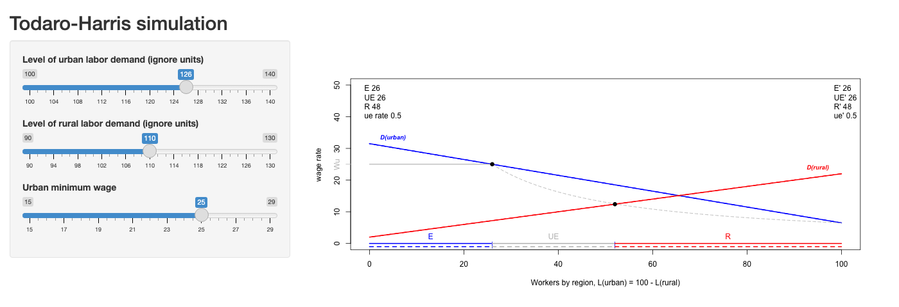

# Migrants' Gains and Immigration Enforcement {#sec-migration-gains}

```{r}
#| label: setup-ch15
#| include: false
col_poor <- "#d62728"; col_rich <- "#1f77b4"
```

::: {.callout-warning appearance="simple"}
## Draft: provenance notes (for review)
Margin tags mark material that is **not in the course slides or lab**.
[Added · from readings]{.tag-reading} comes from the assigned readings (Clemens, East et al.).
[Added · new]{.tag-new} is from outside the course materials (my framing, general knowledge, or my own analysis) and needs the closest check.
Untagged material follows the 2025 slides ("More Migration," Week 14).
:::

::: {.callout-note appearance="minimal"}
**In this chapter.** The biggest winners from migration are the migrants
themselves. We look at Michael Clemens's estimate of the "trillion-dollar bills on
the sidewalk," then at a study of immigration *enforcement*, and close the course
with some last thoughts on models and data.

**Readings this chapter draws on.** Clemens (2011), "Economics and Emigration:
Trillion-Dollar Bills on the Sidewalk?"; East et al. (2023), "The Labor Market
Effects of Immigration Enforcement."
:::

::: {.column-margin}
[Added · new]{.tag-new} Bridge text written for the chapter split.
:::

@sec-immigration found that immigration has surprisingly small effects on the wages
of native workers, and fiscal effects that depend on who the immigrants are and how
long we look. This chapter turns first to the people that analysis left out, the
migrants, and then reverses the question: what happens to native workers when
immigrants are deported?

## Trillion-dollar bills on the sidewalk?

### The biggest gains go to the migrants

So far (@sec-immigration) we have looked at immigration from the point of view of the receiving country. The economist Michael
Clemens argues that this misses the main event. Free trade and free movement of capital, he notes, would raise world
GDP by only a few percent. Opening borders to migrants could raise it by 50 to 150 percent.

::: {.callout-tip appearance="simple"}
## In their own words
"How large are the economic losses caused by barriers to emigration? Research on this question has been distinguished
by its rarity and obscurity, but the few estimates we have should make economists' jaws hit their desks. When it comes
to policies that restrict emigration, there appear to be trillion-dollar bills on the sidewalk." (Clemens 2011, pp.
83–84)
:::

A back-of-the-envelope calculation, from lecture and from Clemens, shows why. Divide the world into a rich region of 1
billion people earning $30,000 a year and a poor region of 6 billion earning $5,000. Suppose 3 billion people move.
If each migrant gained $10,000 a year, the total gain would be $30 trillion, about 50 percent of world output. Clemens
assumes a more conservative average gain of $7,500, which still gives $23 trillion, or 38 percent.

The key assumption is that wages and productivity depend not only on a worker's own characteristics but on context:
capital, economic infrastructure, and the rule of law. Higher earnings in rich countries reflect higher productivity,
and those who migrate become more productive after they move. Migrants earn more than those who stay home, but is that
selection, or the causal effect of place? Researchers have tried to measure it, for example by comparing winners and
losers of visa lotteries.

::: {.column-margin}
[Added · from readings]{.tag-reading} Clemens 2011, pp. 83, 86–87, 96–98.
:::

Clemens concludes that place matters a great deal. Wage gaps between observably identical low-skill workers in the United
States and in countries like Haiti, Nigeria, and Egypt exceed 1,000 percent. In a visa lottery for Tongans moving to New
Zealand, the gains to winners were only somewhat smaller than the simple wage difference, implying little self-selection.
He also notes the scale of unmet demand: the 2010 U.S. Diversity Visa Lottery received 13.6 million applications for 50,000
visas.

### A two-country diagram

What happens when migrants leave a poor country? With a downward-sloping demand curve for labor, fewer workers means higher
wages for those who remain, the same logic as the Malthusian model. Now put a second, rich country on the same diagram, with
its labor measured backwards from the right (@fig-two-country).

```{r}
#| label: fig-two-country
#| fig-cap: "Gains from migration in a two-country world (after Bhagwati, as drawn by Clemens). Labor in the poor country is measured from O to the right; labor in the rich country from O* to the left. Moving workers L′L from the poor to the rich country raises poor-country wages from w₀ to w₀′ and lowers rich-country wages from w₀* to w₀*′. Migrants gain a + b; poor-country workers gain c; poor-country owners lose b + c; rich-country workers lose d; rich-country owners gain d + e. The world gains a + e."
#| fig-height: 5
#| echo: false
x <- seq(0, 10, 0.02)
Dp <- function(x) 1 + 7 * exp(-0.35 * x)          # poor-country demand, from O
Dr <- function(x) 2.5 + 0.06 * exp(0.42 * x)      # rich-country demand, read from O* (right)
L <- 8.2; Lp <- 5.4                               # initial split; after migration
w0 <- Dp(L); w0p <- Dp(Lp); ws <- Dr(L); wsp <- Dr(Lp)
op <- par(mar = c(4.2, 4.6, 1, 5.2))
plot(NA, xlim = c(0, 10), ylim = c(0, 10.5), xaxt = "n", yaxt = "n", xlab = "", ylab = "", bty = "n")
xx <- seq(Lp, L, 0.02)
polygon(c(xx, rev(xx)), c(Dr(xx), Dp(rev(xx))), col = adjustcolor("grey60", 0.45), border = NA)  # a + e (shaded)
lines(x, Dp(x), col = col_poor, lwd = 2.5)
lines(x, Dr(x), col = col_rich, lwd = 2.5)
segments(0, 0, 0, 10.5, lwd = 1.5); segments(10, 0, 10, 10.5, lwd = 1.5); segments(0, 0, 10, 0, lwd = 1.5)
segments(L, 0, L, ws, lwd = 1.5); segments(Lp, 0, Lp, wsp, lty = 2, lwd = 1.5)
segments(0, w0, L, w0, lty = 3); segments(0, w0p, Lp, w0p, lty = 3)
segments(Lp, wsp, 10, wsp, lty = 3); segments(L, ws, 10, ws, lty = 3)
axis(2, at = c(w0, w0p), labels = c(expression(w[0]), expression(w[0]*"'")), las = 1)
axis(4, at = c(wsp, ws), labels = c(expression(w[0]*"*'"), expression(w[0]*"*")), las = 1)
mtext("Wage in poor country", side = 2, line = 3); mtext("Wage in rich country", side = 4, line = 3.6)
axis(1, at = c(0, Lp, L, 10), labels = c("O", "L'", "L", "O*"))
mtext("Quantity of labor", side = 1, line = 2.6)
text(1.2, Dp(1.2), "D (poor country)", pos = 4, col = col_poor, cex = 0.85)
text(9.6, Dr(9.6) + 0.2, "D* (rich\ncountry)", pos = 2, col = col_rich, cex = 0.85)
text((Lp + L) / 2 - 0.3, (wsp + Dp((Lp + L) / 2 - 0.3)) / 2, "a", font = 3, cex = 1.2)
text(Lp + 0.45, w0 + 0.28, "b", font = 3, cex = 1)
text(Lp / 2, (w0 + w0p) / 2, "c", font = 3, cex = 1.1)
text((L + 10) / 2, (ws + wsp) / 2, "d", font = 3, cex = 1.1)
text(L - 0.5, wsp + 0.45, "e", font = 3, cex = 1.1)
par(op)
```

Reading the areas:

- **Migrants** gain a + b, the difference between what they earn in the rich country and what they would have earned at home.
- **Poor-country workers** who stay gain c from higher wages; **poor-country owners** of capital and land lose b + c.
- **Rich-country workers** lose d from lower wages; **rich-country owners** gain d + e.
- **The world as a whole** gains the shaded area a + e.

If the two countries are far from equilibrium and demand curves are fairly flat, the result is big gains to migrants and small effects on everyone else: "small losers, small winners, and big winners." Closer to equilibrium, the migrants' gain a shrinks. With steeper demand curves, net gains and losses to owners and the redistribution among workers grow larger.

### Politics and prospects

Clemens was writing in 2011. He notes how much has already changed: "Through the 1980s, a Polish national attempting to emigrate to West Germany could be shot by soldiers sealing the Inner German border from the east. Today, Polish jobseekers may move freely throughout Germany. The world has summarily discarded vast systems of restrictions on the labor mobility of medieval serfs, slaves, women, South African blacks, indigenous Australians, and a long list of others."

Prospects for the future, from lecture:

- Mexico is becoming less important as a source of U.S. immigrants.
- In the short term, will it become easier to come legally? The politics are very difficult.
- In the long term, there will be strong demand for immigrant labor at both skill extremes, from India, Latin America, Africa, and beyond.
- Development in sending countries tends to speed, not slow, migration.

### Try it: the Todaro–Harris app

::: {.column-margin}
[Added · new]{.tag-new} The Todaro–Harris model and this app come from earlier years of
the course (the 2024 lectures "Migration and Mega-cities" and "Open borders"); the 2025
lectures and readings don't cover it, so cut this section if you prefer. The one-paragraph
summary follows the 2024 slides. The app is the course's own (`ShinyApps/todaro-harris` in
the 2025 course repo), exported with Shinylive. The questions are mine; they avoid the
urban-demand slider, which the 2024 slides use as an in-class question.
:::

Migration within countries raises a puzzle that Michael Todaro set out to explain for
Nairobi in the 1960s: cities with high unemployment kept attracting migrants from the
countryside. In the Todaro–Harris model, the urban wage is held above the market level (by
minimum-wage laws, unions, or government pay), so not everyone who comes to the city finds
a job. Migrants compare the rural wage with the *expected* urban wage, the urban wage times
the chance of getting a job. Migration stops when the two are equal, so in equilibrium the
share of urban job-seekers who are employed equals the ratio of the rural to the urban wage.
The app shows urban labor demand (blue, read from the left), rural labor demand (red, read
from the right), the fixed urban wage, and the resulting numbers employed in the city (E),
unemployed in the city (UE), and working in the countryside (R). It opens in a new tab.

[{width="85%" fig-alt="Screenshot of the Todaro-Harris Shiny app: sliders for urban and rural labor demand and the urban minimum wage on the left; a plot of urban and rural labor demand with employed, unemployed, and rural workers marked along the bottom on the right."}](apps/todaro-harris/index.html){target="_blank" rel="noopener"}

[Open the Todaro–Harris app in a new tab ↗](apps/todaro-harris/index.html){.btn .btn-primary target="_blank" rel="noopener"}

Before you move each slider, write down what you expect to happen. Then check.

1. **Check the equilibrium.** At the starting values, read E and UE from the legend and
   compute the share of urban job-seekers who have jobs. Compare it with the rural wage
   (where the red curve meets the black dot) divided by the urban wage of 25. Should they
   match?
2. **Rural development.** Raise "Level of rural labor demand" from 110 to 120. Predict what
   happens to urban unemployment. Why might helping the countryside reduce unemployment in
   the city?
3. **A lower urban minimum wage.** Return rural demand to 110 and lower "Urban minimum wage"
   from 25 to 20. Predict what happens to urban employment and urban unemployment. Who gains
   and who loses?

## Deporting jobs? Immigration enforcement

### A natural experiment in enforcement

::: {.column-margin}
[Added · from readings]{.tag-reading} Details in this section are from the published paper, East et al. 2023, pp. 957–990, as noted.
:::

Most studies look at what happens when immigrants arrive. A 2023 study by Chloe East and colleagues asks the reverse: what happens when immigrants are removed? Their natural experiment is **Secure Communities** (SC), a federal program that connected local police to a national database of immigration status. Before SC, when someone was arrested, local police sent their fingerprints to the FBI for a criminal background check. Under SC, the fingerprints were also sent automatically to Immigration and Customs Enforcement (ICE) and checked against its biometric database. If ICE believed the person was removable, it could ask the local jail to hold them for up to 48 hours. A conviction was not required. "As a result," the authors write, "conditional on an individual being arrested, SC substantially increased the probability of apprehension and deportation of undocumented immigrants by ICE" (p. 963). More than 454,000 people were removed under SC between 2008 and 2014.

Because the Department of Homeland Security could not set it up everywhere at once, SC was rolled out county by county between 2008 and 2013, until it covered the whole country. That gradual rollout is what makes the study possible.

Who was deported? Mostly men (96 percent) and mostly Latin Americans (92 percent). About 21 percent had no criminal conviction at all, and many had only minor ones, such as traffic offenses.

```{r}
#| label: tbl-sc-deportees
#| tbl-cap: "Most serious criminal conviction of people deported under Secure Communities, 2008–14 (East et al. 2023, Table 1, as shown in lecture)."
#| echo: false
knitr::kable(data.frame(
  `Most serious conviction` = c("None", "Any violent", "Any nonviolent", "  DUI", "  Traffic",
                               "  Immigration", "  Marijuana"),
  `Share of deportees (%)` = c(20.6, 18.5, 60.8, 10.9, 7.0, 5.5, 2.4),
  check.names = FALSE))
```

### What theory predicts

SC could affect labor markets through four channels:

1. **Lost jobs** of deported immigrants.
2. A **chilling effect** on other immigrants. In the authors' words, "in addition to deportations, SC is likely to have increased the cost of interacting with local police, commuting to work, and searching for a job for a broad swath of the immigrant community" (p. 964).
3. Effects on **native workers**: helped if they are substitutes for the deported workers, hurt if they are complements.
4. **Reduced consumer demand**, which could hurt the employment of immigrants and natives alike.

::: {.column-margin}
[Added · from readings]{.tag-reading} The job-creation argument is from East et al. 2023, pp. 960–961 and 984.
:::

The authors add a twist to channel 3. Undocumented workers are typically paid less than native workers with similar skills, partly because their legal status gives them less bargaining power. When they disappear, a firm's average labor costs rise, and it creates fewer jobs. So even native workers who compete directly with undocumented immigrants face two opposing forces: less competition for jobs, but fewer jobs. For natives who *complement* undocumented workers, such as the supervisors of construction crews, only the second force operates.

### How to read an empirical paper

The paper's "empirical strategy" uses the geographic and temporal variation in when SC arrived in each local labor market (commuting zone). In plain terms, it compares the change in employment in places that got SC earlier with the change in places that got it later. It controls for national economic shocks that hit everyone in a given year, for permanent differences between places (such as distance from the border), and for each place's own trend. The **units of observation** are commuting zones in a given year, from the American Community Survey for 2005 to 2014. The **dependent variable** ("Y") is either a group's **employment share** or its average log hourly wage. The employment share is the number of employed people in the group divided by the commuting zone's *total working-age population in 2005*. Because the denominator is fixed, the measure falls both when immigrants leave and when those who stay lose their jobs.

A key check is whether places that adopted SC earlier were already on different trends before SC arrived. If they were, the comparison would be contaminated. The authors show, using an "event study," that employment and wages followed similar trends in early- and late-adopting areas before SC, and diverged afterward. They also note that the very first counties were chosen partly for their large Hispanic populations and closeness to the Mexican border. As the rollout continued, though, whole groups of counties within a state were often switched on the same day, so the timing became close to random.

### Results

::: {.column-margin}
[Added · from readings]{.tag-reading} The numbers in the text are from the "baseline" columns shown on your slides (Tables 3 and 4, panel A). The paper's preferred specification adds controls for local economic conditions (panel B), and gives very similar numbers: −5.7 percent (−7.8 for men) for likely undocumented immigrants and −0.5 percent for U.S.-born workers. The decomposition is from p. 960 and Table 5.
:::

For likely undocumented immigrants, which the authors measure as low-educated foreign-born (LEFB) workers aged 20–64, SC reduced the employment share by about 6 percent, and by 8 percent for men. Deportations alone can't explain this. The group's share of the local population fell by only about 1.2 percent, and the employment rate of those who *stayed* fell by about 1.3 percent. That fits a chilling effect, a drop in demand for workers at risk of deportation, or both. Effects on their hourly wages were small and not statistically significant.

For U.S.-born workers, SC did **not** raise employment, as the substitution story would predict. It *reduced* the employment share, by about 0.6 percent, and reduced hourly wages by about 0.6 percent. The authors' cautious conclusion:

> "The results further indicate that SC did not improve the overall employment or wages of US-born workers. In fact, we find that SC reduced the overall employment share and wages of US-born workers." (East et al. 2023, p. 990)

Put another way, every 1 percent drop in the employment share of likely undocumented immigrants went along with about a 0.1 percent *drop* in the employment and wages of U.S.-born workers (p. 960).

The results by education are only somewhat consistent with theory. U.S.-born workers with a high school education or less, the closest substitutes, saw no significant change in employment but a 1.2 percent fall in wages. Those with more education saw employment fall by about 0.6 percent. Looking within occupations helps. At the very bottom of the occupational ladder, where undocumented immigrants are concentrated (cooks, construction laborers, farm workers, janitors), low-educated U.S.-born workers gained a little employment. Higher up, among supervisors and managers of those same industries, they lost employment. That pattern fits less competition at the bottom and fewer jobs created higher up.

The last result tests the demand channel. If removing immigrants reduced local spending, the effect should be strongest in **nontradable** industries, whose customers are local (construction, retail, restaurants, haircuts). It should be weakest in **tradable** industries such as agriculture and manufacturing, which sell to the wider world. That is what the authors find. The employment share of U.S.-born workers fell by about 1 percent in nontradable industries and did not fall in tradable ones. The authors are careful to say that their method "cannot distinguish" how much each mechanism matters (p. 990). They also note that running SC cost roughly $1 billion a year, and that their results point to additional costs on top of that.

## Big-picture conclusions

- The biggest effect of immigration is on the immigrants themselves.
- Theories have many competing effects. More people increase demand, but may dilute capital. More workers help complements and may hurt substitutes.
- Sorting these out requires both theory and empirical data analysis.

### One very last chapter: models, data, and you

::: {.column-margin}
This closing section follows your 2024 Week 14 slides ("One very last chapter: Some thoughts on theory and data," slides 27–33). I found no 2025 version.
:::

This course has combined theory with computing and working with data. Why do both?

**Models** allow precise communication of our assumptions and our thinking: Malthus's prose became Lee's graphs; income and substitution effects; the effect, and non-effect, of immigrants on native wages. Formal models clarify thinking, whether they turn out right or wrong. They can surprise us, as with the Malthusian trap or optimal matching in marriage. And if you disagree with a conclusion, a model lets you point to precisely where (does the labor demand curve really have little slope?). With pencil, paper, and a brain, models are a very efficient way to produce new ideas. But they carry dangers: they may be too different from the real world, and they can take over our thinking ("econ-101-ism").

**Data** give us the stylized facts that tell us which questions are worth asking, and a reality check on theories. But it is often very hard to draw conclusions about the world from data, and evidence can be contradictory.

We can end where we began, with Malthus. Malthusian theory told us what to look for, and the data told us when it broke down. Or did it? Finally, beyond models and data, there is **you**, and whether you believe it. Some skepticism about intuition and feelings is healthy, but don't ignore them completely. If you feel something is wrong, it is often worth paying attention. Good economic demography is a three-way conversation among theory, data, and your own judgment.

## Key ideas

- The largest gains from migration go to **migrants themselves**; Clemens estimates that lowering barriers could raise world output by tens of percent.
- Removing immigrants through enforcement did **not** raise native employment in one major study; it lowered it.

## Check your understanding

::: {.column-margin}
[Added · new]{.tag-new} These questions are new.
:::

1. **Selection versus place.** Migrants earn more than people who stay home. Give one reason this could be selection and one reason it could be the effect of place. How do visa lotteries help tell them apart?

2. **Two-country diagram.** In @fig-two-country, suppose both demand curves were flat, but at different levels. What would happen to the wages of non-migrant workers in each country? Who would gain from migration?

3. **Enforcement.** East et al. find that deporting immigrants reduced native employment. Which of the four theoretical channels could produce this? What evidence would help you distinguish between them?

## Further reading

- Clemens, Michael A. 2011. "Economics and Emigration: Trillion-Dollar Bills on the Sidewalk?" *Journal of Economic Perspectives* 25(3): 83–106. *The gain to migrants themselves.*
- East, Chloe N., Annie L. Hines, Philip Luck, Hani Mansour, and Andrea Velásquez. 2023. "The Labor Market Effects of Immigration Enforcement." *Journal of Labor Economics* 41(4): 957–996. *Technical; skim before class.*
