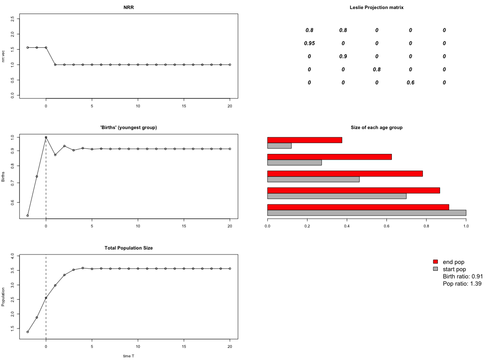
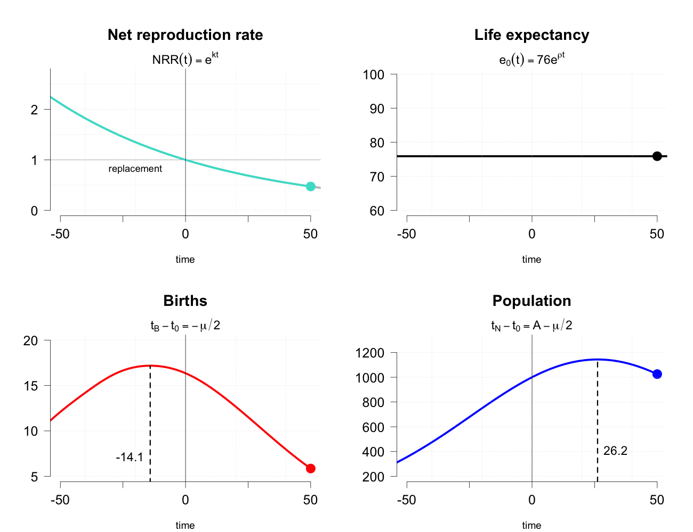

# Population Projection, Age Pyramids, and "Our Shrinking Future?" {#sec-projection}

```{r}
#| label: setup-ch12
#| include: false

col_c <- "#d62728"; col_y <- "#1f5fa8"; col_grey <- "grey45"
col_grow <- "#e08a00"; col_zero <- "black"; col_shrink <- "#1f5fa8"
col_nrr <- "#17a2a2"   # turquoise, as in the peak-population app

## World Population Prospects 2022 and 2024 (medium variant), 1950-2100:
## NRR, births and population (thousands), e0, mean age of childbearing.
## Extracted from the bundled data of Goldstein's peakpop teaching package.
wpp <- read.csv("data/wpp_peakpop_indicators_2022_2024.csv")
wpp_get <- function(cc, w = 2024) {
  x <- wpp[wpp$country == cc & wpp$wpp == w & wpp$Time <= 2100, ]
  x[order(x$Time), ]
}
## year the NRR last crosses 1 from above (linear interpolation)
t0_of <- function(x) {
  i <- max(which(x$NRR > 1))
  approx(x$NRR[i:(i + 1)], x$Time[i:(i + 1)], xout = 1)$y
}

## U.S. period total fertility rate (World Bank WDI), 1960-2024
us_tfr <- read.csv("data/us_tfr_worldbank_1960_2024.csv", comment.char = "#")
```

::: {.callout-warning appearance="simple"}
## Draft: provenance notes (for review)
Optional chapter, based on the 2023 version of this topic (the age-pyramid lecture and
its in-class projection "not-a-lab"), plus the 2024 plan for the "Our Shrinking Future?"
week (readings on the Census, Social Security, CBO and UN forecasts).
Margin tags mark material that is **not in the course slides or lab**.
[Added · from readings]{.tag-reading} comes from the forecast readings listed in the 2024
calendar (UN *World Population Prospects*, Vollset et al. 2020, the Census Bureau's 2023
projections, CBO 2023, and the Social Security actuaries' 2023 assumptions).
[Added · new]{.tag-new} is from outside the course materials (my framing, general knowledge,
my own analysis, or Goldstein and Cassidy 2024) and needs the closest check.
Untagged material follows the 2023 slides ("The Population Pyramid as History") and the
2023 in-class projection lab. The "Our Shrinking Future?" lectures were never given as
slides; only their topic list survives in the calendars, so nearly everything in the
second half of the chapter is tagged.
:::

::: {.callout-note appearance="minimal"}
**In this chapter.** How demographers project a population forward in time, one age
group at a time, using a *projection matrix*; why constant birth and death rates always
lead to a *stable* age structure; why a young population keeps growing long after
fertility falls (*momentum*); and when the world's population is likely to stop growing.
Then we look at the forecasts themselves: what the United Nations, the U.S. Census Bureau,
the Social Security actuaries and the Congressional Budget Office assume about fertility,
longevity and migration, and why their answers differ.

**Readings this chapter draws on.** The age-pyramid lecture had no assigned reading. For
the forecasts: United Nations (2022), *World Population Prospects 2022: Summary of
Results* (with the 2024 edition as an update); Vollset et al. (2020), "Fertility,
mortality, migration, and population scenarios for 195 countries and territories from
2017 to 2100," *The Lancet*; U.S. Census Bureau (2023), press release on the 2023
National Population Projections; Congressional Budget Office (2023), *The Demographic
Outlook: 2023 to 2053*; Social Security Administration, Office of the Chief Actuary
(2023), *The Long-Range Demographic Assumptions for the 2023 Trustees Report*.
:::

## A shrinking future?

::: {.column-margin}
[Added · from readings]{.tag-reading} UN, *WPP 2024*, Key messages, p. VII, and
pp. 3, 16; Census Bureau press release CB23-189 (Nov. 9, 2023).
:::

For most of the twentieth century, the population question was how to slow growth down.
The newest forecasts have changed the question. In 2024 the United Nations Population
Division, which has published official world population estimates and projections since
1951, put it this way:

::: {.callout-tip appearance="simple"}
## In their own words
"The world's population is expected to continue growing over the coming 50 or 60
years, reaching a peak of around 10.3 billion people in the mid-2080s, up from 8.2
billion in 2024. After peaking, the global population is projected to start declining
gradually, falling to 10.2 billion people by the end of the century. ... This
represents a major change compared to projections published by the United Nations in
2013, when the estimated probability that global population growth would end during the
twenty-first century was around 30 per cent." (UN, *World Population Prospects 2024*,
Key messages, p. VII)
:::

The UN now puts that probability at 80 percent. China, it projects, will lose 204 million
people between 2024 and 2054, and by 2100 will be back to roughly the size it was in the
late 1950s. Even the United States, one of the few rich countries still expected to grow,
has a peak in sight: in 2023 the Census Bureau projected that the U.S. population would
reach "a high of nearly 370 million in 2080 before edging downward to 366 million in
2100."

Where do numbers like these come from, and how much should we trust them? This chapter
starts with the machinery, the *projection matrix*, which you can work out by hand. Then
we use it to ask when a population stops growing, and finally look at the assumptions
behind the official forecasts.

## Pyramids in motion

A population pyramid is a snapshot. To see how age structures *change*, it helps to watch
them move. In lecture we play the U.S. Census Bureau's animated pyramids from its
International Database for three countries:

- **The United States**, to see an approach to stability: the bulge of the baby boom
  works its way up the pyramid, and the base settles down.
- **Japan**, to see aging and an approach to a *sub-replacement* stable shape: each
  new cohort is smaller than the one before, and the pyramid turns upside down.
- **Nigeria**, to see stable exponential growth: a classic wide-based pyramid that
  keeps the same shape as it grows, until fertility starts to fall near the end of the
  animation.

::: {.column-margin}
[Added · new]{.tag-new} The URL is the one in the slides; the tool is still online at
census.gov (International Database, "Population pyramid" view).
:::

You can play these yourself at the Census Bureau's International Database
(<https://www.census.gov/data-tools/demo/idb/>). @sec-aging explains how to
read a pyramid as a record of history, and why a population with fixed birth and death
rates ends up with one of only three *stable* shapes. Here we ask a more mechanical
question: if we know today's population by age and the birth and death rates, how do we
get next period's population?

## Population projection with matrices

### Who becomes whom?

Start with a population divided into three age groups, each 20 years wide: **young**
(0–19), **middle-aged** (20–39) and **old** (40–59). (In this toy model, no one lives past
60.) Now ask: twenty years from now, where will the members of each group be? Demographers
call the people at the later date the "sequent individuals" of the people at the earlier
one: each person alive in 20 years is either a survivor of someone alive today or a baby
born to someone alive today.

We can draw the possible transitions as a connected graph, with an arrow from each group
to the groups its members (or their babies) can end up in. The same information fits in a
table, with the starting group in the columns ("from") and the ending group in the rows
("to"):

```{r}
#| label: tbl-transitions
#| tbl-cap: "Possible transitions between age groups over 20 years (lecture slide). ✓ means possible, 0 means impossible."
#| echo: false
knitr::kable(data.frame(To = c("Young", "Middle-aged", "Old"),
                        `From young` = c("✓", "✓", "0"),
                        `From middle-aged` = c("✓", "0", "✓"),
                        `From old` = c("✓", "0", "0"),
                        check.names = FALSE))
```

Read down a column. People who are young today can have babies (who will be young in 20
years) and can survive into middle age. Middle-aged people can have babies and survive into
old age. Old people can have babies too, in principle, but in 20 years they are dead. The
zeros are *structural*: nobody can get younger, skip a group, or stay in the same 20-year
age group for 20 years.

### The projection matrix

Replace the check marks with numbers and we have a **projection matrix**, also called a
**Leslie matrix**:

$$
A = \begin{pmatrix} F_1 & F_2 & F_3 \\ S_1 & 0 & 0 \\ 0 & S_2 & 0 \end{pmatrix},
\qquad
P(0) = \begin{pmatrix} P_1 \\ P_2 \\ P_3 \end{pmatrix}.
$$

- $F_i$ is the **fertility** of the $i$th age group: the number of surviving babies in the
  next period per person in group $i$ today.
- $S_i$ is **survival** from the $i$th age group into the next one: the fraction of group
  $i$ still alive 20 years later.
- $P(0)$ is a column of the number of people in each group at time 0.

Projecting the population one step is matrix multiplication, $P(1) = A\,P(0)$. Multiplying
out shows that it does exactly what the transition table says:

$$
\begin{pmatrix} F_1 & F_2 & F_3 \\ S_1 & 0 & 0 \\ 0 & S_2 & 0 \end{pmatrix}
\begin{pmatrix} P_1 \\ P_2 \\ P_3 \end{pmatrix}
=
\begin{pmatrix} F_1 P_1 + F_2 P_2 + F_3 P_3 \\ S_1 P_1 \\ S_2 P_2 \end{pmatrix}.
$$

The top row adds up the babies born to each group. The second row is the survivors of
today's young, now middle-aged. The third row is the survivors of today's middle-aged, now
old. Everything else, including today's old, drops out.

::: {.column-margin}
[Added · new]{.tag-new} This example and its numbers are mine; the slides' in-class
example is left for class.
:::

**A worked example.** Suppose the young have 0.3 surviving babies each over the next 20
years, the middle-aged have 0.9 and the old 0.2; 90 percent of the young survive to middle
age and 85 percent of the middle-aged survive to old age. Start with 60 young, 25
middle-aged and 15 old (100 people in all). Then

$$
P(1) = \begin{pmatrix} 0.3 & 0.9 & 0.2 \\ 0.9 & 0 & 0 \\ 0 & 0.85 & 0 \end{pmatrix}
\begin{pmatrix} 60 \\ 25 \\ 15 \end{pmatrix}
= \begin{pmatrix} 18 + 22.5 + 3 \\ 54 \\ 21.25 \end{pmatrix}
= \begin{pmatrix} 43.5 \\ 54 \\ 21.25 \end{pmatrix}.
$$

The population grew from 100 to 118.75, and it got *older*: the share who are young fell
from 60 percent to 37 percent. That is not because anyone's behavior changed. The starting
population simply had a lot of young people, who moved up into middle age. A population
whose age structure is out of line with its birth and death rates changes shape as it is
projected. We call it **unstable**.

### Iterating: the approach to stability

What if we keep going? With a computer, we can multiply by $A$ again and again:
$P(2) = A\,P(1)$, $P(3) = A\,P(2)$, and so on. In R this is a `for` loop of one line.
@fig-iterate shows what happens with the matrix from the worked example.

```{r}
#| label: fig-iterate
#| fig-cap: "Projecting the worked example forward 12 steps (240 years) with a constant projection matrix. Left: the share of the population in each age group. Right: total population on a log scale. After a few wobbles, the shares stop changing and the log of population rises in a straight line: a stable population growing exponentially."
#| fig-height: 3.8
A <- matrix(c(0.3, 0.9, 0.2,
              0.9, 0,   0,
              0,   0.85, 0), nrow = 3, byrow = TRUE)
n_steps <- 12
P <- matrix(NA, 3, n_steps + 1)
P[, 1] <- c(60, 25, 15)
for (i in 1:n_steps) P[, i + 1] <- A %*% P[, i]
p <- sweep(P, 2, colSums(P), "/")        # proportions in each group
step <- 0:n_steps

op <- par(mfrow = c(1, 2), mar = c(4, 4.2, 1, 1), las = 1)
cols3 <- c(col_grow, col_c, col_y)
matplot(step, t(p), type = "o", pch = 19, cex = 0.6, lty = 1, lwd = 2,
        col = cols3, ylim = c(0, 0.65),
        xlab = "Projection step (20 years)", ylab = "Share of population")
text(12, p[, 13] + c(0.04, 0.04, -0.04), c("Young", "Middle-aged", "Old"),
     col = cols3, pos = 2, cex = 0.85)
plot(step, colSums(P), log = "y", type = "o", pch = 19, cex = 0.6, lwd = 2,
     xlab = "Projection step (20 years)", ylab = "Total population (log scale)")
par(op)

lambda <- Re(eigen(A)$values[1])
r_stable <- log(lambda) / 20
```

Two things happen, and they happen for *any* starting population, as long as the matrix
stays the same:

1. **The age structure settles down.** After a few steps the shares in each age group
   stop changing. This steady state is the **stable age structure**. For this matrix it
   is about `r round(100*p[1, 13])` percent young, `r round(100*p[2, 13])` percent
   middle-aged and `r round(100*p[3, 13])` percent old.
2. **Growth becomes exponential.** Once the shares are fixed, every age group, and so the
   total, grows by the same factor each step, here about `r round(lambda, 3)` per 20 years,
   or `r round(100 * r_stable, 2)` percent a year. On a log scale, that is a straight line.

If you start with the stable age structure, the very first step changes nothing but the
size: the population is already "in line" with its rates. The slides' in-class example
shows this with two starting populations, one unstable and one stable.

::: {.column-margin}
[Added · new]{.tag-new} The eigenvector remark is general knowledge (it is what
`eigen(A)` computes in the 2021 lab).
:::

For readers who know some linear algebra: the stable age structure is the leading
eigenvector of $A$, and the growth factor per step is the leading eigenvalue. But you
don't need that. Projecting forward for a while finds both.

### What the projection teaches

The slides draw three general conclusions about age structure:

- **The population growth rate largely determines the age pyramid.** A growing population
  is young and a shrinking one is old.
- **The survival curve matters, but not as much.**
- **Many real populations look like stable populations.** And we can understand the
  exceptions (wars, baby booms, migration) as departures from stability.

::: {.column-margin}
[Added · from readings]{.tag-reading} UN, *WPP 2024*, Box 4.1, p. 34; UN, *WPP 2022*,
Box II.2, p. 24, and Annex, p. 35.
:::

The official forecasts work exactly this way, just with more detail. As the UN explains,
the UN, the Wittgenstein Centre and the Institute for Health Metrics and Evaluation
(IHME) all "use the cohort component method to project future population by age and sex.
Under the cohort component method, the population by age and sex in a given year is
projected forward by applying mortality, fertility and migration patterns that differ by
age and sex." Since 2022 the UN does this by single years of age and single calendar
years, for 237 countries and areas, through 2100. The differences between forecasters lie
almost entirely in what they assume the future rates will be, not in the arithmetic.

::: {.callout-important}
## In the lab
In the 2023 in-class "not-a-lab," you define a three-group projection matrix in R, project
a starting population one step to check the multiplication, and then use a `for` loop to
project ten steps. You then look at the result three ways (animated pyramids, the shares
in each group, and the size of the youngest group on a log scale) and ask how you could
tell when the population has become stable.
:::

## Momentum: why young populations keep growing

The projection matrix explains one of the most important facts about population
forecasts. Suppose that, starting today, every woman had just enough children to replace
herself and her partner. Would population growth stop?

::: {.column-margin}
[Added · from readings]{.tag-reading} UN, *WPP 2022*, Key messages, p. i, and pp. 8–9;
UN, *WPP 2024*, p. 12 and pp. 20, 23.
:::

No. A population that has been growing has a young age structure: lots of people in or
about to enter their childbearing years, compared with the number of old people who will
die. Even at replacement fertility, those large young cohorts have more babies than the
small old cohorts leave behind in deaths, for decades. This is **population momentum**.
The UN estimated in 2022 that "two-thirds of the projected increase in global population
through 2050 will be driven by the momentum of past growth that is embedded in the
youthful age structure of the current population. Such growth would occur even if
childbearing in today's high-fertility countries were to fall immediately to around two
births per woman." The 2024 revision raised the share to 79 percent, about 1.4 billion
people.

Momentum works in reverse, too. After decades of low fertility, the number of women of
childbearing age shrinks, and births keep falling even if fertility recovers. The UN
calls this *negative* momentum, and in 2024 found it was "likely to be the main driver of
population decline in 18 countries and areas between now and 2054." For the countries
whose populations have already peaked, "even if fertility were to return instantly to the
replacement level and stay there for several decades, the population of the group would
start to decline after 2040."

### Try it: the momentum app

::: {.column-margin}
[Added · new]{.tag-new} This app (`momentum`) is from Goldstein's Shiny sandbox
(`research_to_file/sandbox_from_oldlaptop/shiny/momentum`, 2024); it is not in any C175
lab or slide. I copied `ui.R` and `server.R` into `course_apps_extra/momentum` (leaving out
an unrelated test file in the same folder) and exported it with Shinylive. Headless Chrome
hung on the live app, so the image is the app's own plot drawn with its own code at the
default settings with the time slider at its end (T = 20), not a screenshot. The
questions are mine.
:::

The app projects a five-age-group population with a Leslie matrix you control. It starts
the population in the stable state for your matrix, then, at time 0, cuts fertility
*instantly* to exactly replacement (it rescales the first row so the net reproduction rate
is 1) and projects 20 steps. Press play on the time slider, or drag it, to watch births,
total population and the age distribution respond. It opens in a new tab. (The first load
can take a few seconds while R starts up in your browser.)

[{width="85%" fig-alt="Six-panel plot from the momentum Shiny app: the net reproduction rate dropping from about 1.56 to 1 at time 0, births by time, total population rising and then leveling off, the Leslie matrix, and bars comparing the size of each of five age groups at the start and end."}](apps/momentum/index.html){target="_blank" rel="noopener"}

[Open the momentum app in a new tab ↗](apps/momentum/index.html){.btn .btn-primary target="_blank" rel="noopener"}

Before you move each slider, write down what you expect to happen. Then check.

1. **How much more growth?** At the default settings the net reproduction rate falls from
   about 1.56 to exactly 1 at time 0. Before pressing play, guess the ratio of the final
   population to the population at time 0. Is it bigger or smaller than you expected, and
   which age groups account for the growth?
2. **Faster growth, more momentum?** Raise `firstrow[1]` and `firstrow[2]` from 0.8 to
   1.2, so the population was growing faster before time 0. Predict whether the final
   "Pop ratio" will be larger or smaller than before. Why?
3. **Births versus population.** In the default run, the number of births barely changes
   after time 0, but the total population keeps rising for several steps. Explain how both
   can be true at once.

## When will population peak?

### The puzzle of the long lag

::: {.column-margin}
[Added · new]{.tag-new} The framing and the Japan example follow Goldstein and Cassidy
(2024), *Demography*, pp. 419–423, which is not on the reading list. The lecture topic is
from the calendar ("time paths of world fertility and the timing of peak population").
:::

Japan's fertility fell below replacement in the early 1970s. Its population did not start
to shrink until about 2009, some 35 years later. Italy, South Korea and China show similar
lags (@tbl-lags). Why does it take so long for low fertility to show up as decline? And can
we use the answer to predict when the world as a whole will peak?

```{r}
#| label: tbl-lags
#| tbl-cap: "Years from replacement fertility (NRR = 1) to peak population, selected countries and the world. Peak population for the world is the UN's 2024 projection. Source: UN World Population Prospects 2024 (medium variant), my calculation."
#| echo: false
lag_rows <- lapply(c("Japan", "Italy", "Republic of Korea", "China", "India", "World"),
  function(cc) {
    x <- wpp_get(cc)
    t0 <- t0_of(x)
    tN <- x$Time[which.max(x$Pop)]
    data.frame(Country = sub("Republic of Korea", "South Korea", cc),
               `NRR falls below 1` = round(t0),
               `Population peaks` = tN,
               `Lag, NRR = 1 to peak (years)` = round(tN - t0),
               check.names = FALSE)
  })
lags <- do.call(rbind, lag_rows)
lags$`Population peaks`[lags$Country %in% c("India", "World")] <-
  paste(lags$`Population peaks`[lags$Country %in% c("India", "World")], "(projected)")
lags$`NRR falls below 1`[lags$Country == "World"] <-
  paste(lags$`NRR falls below 1`[lags$Country == "World"], "(projected)")
knitr::kable(lags)
```

::: {.column-margin}
[Added · new]{.tag-new} The **net reproduction rate** (NRR) is the number of daughters a
woman would have, counting the chance she dies before or during her childbearing years.
NRR = 1 is exact replacement. It is used here instead of the TFR because replacement TFR
differs across countries (it is near 2.1 only where mortality is low).
:::

::: {.column-margin}
[Added · new]{.tag-new} The Coale results and the extensions are from Goldstein and
Cassidy (2024), pp. 421–425. The numbers are theirs (typical $\mu \approx 30$,
$A \approx 40$). Josh's peak-population app (below) lets you check them.
:::

### Coale's answer

The demographer Ansley Coale worked out what happens in a simple case: a closed population
with constant mortality whose fertility falls steadily, by the same percentage every year.
Two results come out of the projection arithmetic.

**Births peak *before* fertility reaches replacement.** This is surprising. You might
think the momentum of past growth would keep births rising even after fertility hits
replacement. But think about what replacement means: each generation exactly replaces the
one before it. So at the moment fertility reaches replacement, this year's births are
about equal to births one generation (about 30 years) earlier. If births a generation
apart are equal, and births rose and then fell in between, the peak must lie between them.
In Coale's scenario births peak about half a generation, roughly **15 years, before**
fertility reaches replacement.

**Population peaks when the biggest birth cohort reaches the average age of the
population.** Total population is the sum of all past birth cohorts that are still alive.
Roughly speaking, it keeps growing until the largest cohort has aged to the middle of the
population, about 40 years. So population peaks about 40 years after births do, or about
$40 - 15 = 25$ years **after** fertility reaches replacement.

In symbols, with $t_0$ the date the NRR reaches 1, $\mu$ the average age of childbearing
and $A$ the average age of the population,

$$
t_{\text{births peak}} \approx t_0 - \frac{\mu}{2}, \qquad
t_{\text{population peaks}} \approx t_0 - \frac{\mu}{2} + A.
$$

### Why real populations take even longer

Twenty-five years is too short. In @tbl-lags, the lags are 30 to 40 years and more. Joshua
Goldstein and Thomas Cassidy (2024) show that the extra years come from three features of
real demographic change that Coale left out:

- **Rising longevity.** If people keep living longer, the population keeps getting a bit
  bigger even after births start to fall. With life expectancy rising about 1.6 years per
  decade, the peak comes several years later.
- **Fertility decline slows down below replacement.** Real fertility doesn't fall at a
  steady rate forever; it levels off. A leveling-off makes the population take longer to
  turn down.
- **Immigration** adds to the population and to births.

With these extensions, their models "predict a typical lag between replacement-level
fertility and population decline of about 35 to 40 years, consistent with projections by
the United Nations and about 15 years longer than the lag predicted by Coale."

@fig-world-peak applies this to the world as a whole, using the UN's 2024 projection.

```{r}
#| label: fig-world-peak
#| fig-cap: "The world's net reproduction rate (top), annual births (middle) and population (bottom), estimates 1950–2023 and UN medium projection 2024–2100. The dashed vertical line marks the year the NRR reaches 1. Source: UN World Population Prospects 2024."
#| fig-height: 6.5
w <- wpp_get("World")
t0w <- t0_of(w)
tB <- w$Time[which.max(w$Births)]
tN <- w$Time[which.max(w$Pop)]
op <- par(mfrow = c(3, 1), mar = c(2.5, 4.8, 1.6, 1), las = 1, oma = c(1.5, 0, 0, 0))
shade <- function() rect(2024, -1e9, 2101, 1e9, col = "grey94", border = NA)

plot(w$Time, w$NRR, type = "n", ylim = c(0.8, 2.4), xlab = "", ylab = "NRR")
shade(); abline(h = 1, col = col_grey); abline(v = t0w, lty = 2)
lines(w$Time, w$NRR, lwd = 2.5, col = col_nrr)
text(2101, 2.25, "UN projection", pos = 2, cex = 0.9, col = col_grey)
text(t0w, 2.1, paste0("NRR = 1 in ", round(t0w)), pos = 4, cex = 0.9)
mtext("Net reproduction rate", side = 3, line = 0.2, adj = 0, cex = 0.8)

plot(w$Time, w$Births / 1000, type = "n", ylim = c(80, 160),
     xlab = "", ylab = "Millions per year")
shade(); abline(v = t0w, lty = 2)
lines(w$Time, w$Births / 1000, lwd = 2.5, col = col_c)
points(tB, max(w$Births) / 1000, pch = 19, col = col_c)
text(tB, max(w$Births) / 1000, paste("Highest year,", tB), pos = 3, cex = 0.9)
mtext("Births", side = 3, line = 0.2, adj = 0, cex = 0.8)

plot(w$Time, w$Pop / 1e6, type = "n", ylim = c(2, 11),
     xlab = "", ylab = "Billions")
shade(); abline(v = t0w, lty = 2)
lines(w$Time, w$Pop / 1e6, lwd = 2.5, col = col_y)
points(tN, max(w$Pop) / 1e6, pch = 19, col = col_y)
text(tN, max(w$Pop) / 1e6, paste("Peak,", tN), pos = 1, cex = 0.9)
mtext("Population", side = 3, line = 0.2, adj = 0, cex = 0.8)
mtext("Year", side = 1, outer = TRUE, line = 0.3, cex = 0.8)
par(op)
```

::: {.column-margin}
[Added · new]{.tag-new} My reading of the UN data. World births are fairly flat from
the late 1980s on (the UN notes they "remained stable at around 140 million since the late
1980s," *WPP 2022*, p. 13), so the exact year of the birth peak is not well defined.
:::

The world fits the pattern, with a twist. In the UN's projection, the world NRR reaches
replacement in the mid-2030s and population peaks in the mid-2080s, a lag of almost 50
years. Births have stayed between about 130 and 145 million a year since the late 1980s, so in
the data the birth "peak" is less a peak than the top of a long, flat hill. Part of the extra lag reflects
the features above: the UN assumes life expectancy keeps rising and fertility levels off
just below replacement. Part reflects the fact that the world is a mix of countries at very
different stages, so it is not one smooth Coale-style decline.

### Try it: the peak-population app

::: {.column-margin}
[Added · new]{.tag-new} This is the app Josh built for Goldstein and Cassidy (2024)
(`research/peak-population-shiny`, June 2026 version). It needs functions and data from
his `peakpop` package, so I added a `global.R` that copies the package's projection,
rescaling, analytic and plotting functions and the bundled WPP 2024 world schedules
(`world_wpp2024_Fx_Lx.csv`). Exported with Shinylive to `apps/peak_pop`. The image is the
app's own plot, drawn with its code at the default settings with the time slider moved to
50 (it starts at −50, with almost nothing drawn); headless Chrome hung on the live app.
The app's sidebar lists its own six exercises; my questions overlap with its first, third
and fourth.
:::

The app projects a population, using the world's 2024 age schedules, in which the NRR falls
by a fixed percentage $k$ each year (the Coale scenario), crossing replacement at time 0.
You can also make life expectancy rise at rate $\rho$, add "extra curvature" so that
fertility decline slows down, and show the formulas' predicted peaks next to the exact
projection. A second tab lets you draw your own NRR path. Press play on the time slider to
run the projection. It opens in a new tab.

[{width="85%" fig-alt="Four-panel plot from the peak-population Shiny app: the net reproduction rate falling through 1 at time 0; constant life expectancy of 76; births peaking at time −14.1; and population peaking at time 26.2."}](apps/peak_pop/index.html){target="_blank" rel="noopener"}

[Open the peak-population app in a new tab ↗](apps/peak_pop/index.html){.btn .btn-primary target="_blank" rel="noopener"}

Before you change each setting, write down what you expect to happen. Then check.

1. **Does the speed of decline matter?** At $k = -1.5\%$, births peak about 14 years
   before replacement and population about 26 years after. Predict what happens to each
   peak if fertility falls faster ($k = -2\%$) or more slowly ($k = -1\%$). Then try it.
2. **Longer lives.** Set $\rho$ to 0.2% (life expectancy rising about 1.5 years per decade).
   Which peak moves, births or population, and by roughly how much? Does the answer depend
   on $k$?
3. **A stall.** On the "Custom NRR" tab, make fertility level off before it reaches
   replacement (raise the anchors at $t = -30$ and $t = -15$ to about 1.1). Before you
   look, predict whether the population peak comes earlier or later than Coale's formula
   says.

## The ingredients of a forecast

Every projection needs three sets of assumptions: future fertility, future mortality and
future migration. The "Our Shrinking Future?" lectures planned one topic for each.

### Fertility: the postponement transition and period fertility

::: {.column-margin}
[Added · from readings]{.tag-reading} SSA 2023, Fertility, pp. 2–5 and Table 1.1;
CBO 2023, p. 3.
:::

The **total fertility rate** in a given year is a *period* measure: it adds up that
year's birth rates at every age, as if one woman lived through all of them. The Social
Security actuaries explain the distinction with another measure, *completed cohort
fertility*:

::: {.callout-tip appearance="simple"}
## In their own words
"The period TFR speaks to the birth rates of women at various ages in a given calendar
year and is strongly influenced by economic and other factors affecting birth rates during
that year. The completed cohort TFR answers the question: 'how many children will women
born in a given year have over their lifetime?'" (SSA, *Long-Range Demographic Assumptions
for the 2023 Trustees Report*, Fertility, p. 2)
:::

The two can tell different stories when the *timing* of births changes. If women in their
twenties start postponing births to their thirties, then for a while fewer births happen
each year, and the period TFR falls, even if each woman eventually has just as many
children. Demographers call this a **tempo effect**: "a temporary drop in the TFR due to a
delay in childbearing to older ages." When the postponement stops, the period TFR bounces
back. The long shift toward later childbearing in rich countries is sometimes called the
**postponement transition**.

::: {.column-margin}
[Added · new]{.tag-new} The 2023 and 2024 values are from the World Bank (the file is
`data/us_tfr_worldbank_1960_2024.csv`, used in ch. 7). The assumptions are from SSA 2023
(Table 1.1; the 2.0 ultimate is reached in 2056), CBO 2023 (p. 3) and, for the Census
Bureau's 2017 projections, as reported by SSA 2023 (Fertility, p. 4).
:::

Tempo matters a great deal for U.S. forecasts. The U.S. period TFR fell from 2.12 in 2007
to 1.64 in 2020, a record low. Is that a temporary postponement, or a lasting drop in
family size? The forecasters disagree (@fig-us-tfr):

- **Social Security's actuaries** assume the TFR will climb back to 2.0 by 2056, "consistent
  with an ultimate completed cohort fertility rate of 2.0." Their reasons: women's reported
  birth expectations remain "well above 2.00," which "strongly suggests that the current
  reduction in the TFR will not be permanent," and "the cultural and economic climate in
  the U.S. makes it highly unlikely that our TFR will remain below a level of 1.7 for any
  sustained period."
- **The CBO** assumes the TFR rises from 1.66 to 1.75 by 2030 and stays there, as birth
  rates for women 30 to 49 rise while those for younger women fall, "consistent with the
  trends of delayed childbearing and rising average age of mothers."
- **The Census Bureau's** 2017 projections held the TFR almost constant, at 1.83 in 2060.

```{r}
#| label: fig-us-tfr
#| fig-cap: "U.S. period total fertility rate, 1960–2024, and the long-run assumptions of three federal forecasters. Sources: World Bank (TFR); SSA 2023 intermediate assumption (Table 1.1); CBO 2023; Census Bureau 2017 projections as reported by SSA 2023."
#| fig-height: 4
ssa <- data.frame(year = c(2021:2032, 2035, 2040, 2045, 2050, 2055, 2060),
                  tfr = c(1.663, 1.686, 1.704, 1.723, 1.742, 1.763, 1.785, 1.808,
                          1.833, 1.857, 1.869, 1.881, 1.920, 1.974, 1.996, 2.000,
                          2.000, 2.000))
cbo <- data.frame(year = c(2021, 2023, 2030, 2053), tfr = c(1.66, 1.66, 1.75, 1.75))
op <- par(mar = c(4, 4.5, 1, 1), las = 1)
plot(us_tfr$year, us_tfr$tfr, type = "n", xlim = c(1960, 2078), ylim = c(1.4, 3.8),
     xlab = "Year", ylab = "Total fertility rate")
abline(h = 2.1, col = "grey80")
text(1990, 2.1, "about replacement (2.1)", pos = 3, cex = 0.8, col = col_grey)
lines(us_tfr$year, us_tfr$tfr, lwd = 2.5)
lines(ssa$year, ssa$tfr, lwd = 2.5, lty = 2, col = col_y)
lines(cbo$year, cbo$tfr, lwd = 2.5, lty = 2, col = col_c)
points(2060, 1.83, pch = 17, col = col_grow, cex = 1.3)
text(2061, 2.0, "SSA", col = col_y, pos = 4, cex = 0.85)
text(2045, 1.75, "CBO", col = col_c, pos = 1, cex = 0.85)
text(2061, 1.80, "Census (2017)", col = col_grow, pos = 4, cex = 0.8)
text(1985, 1.62, "Period TFR (data)", cex = 0.85)
par(op)
```

The most recent data have not been kind to the rebound story: the World Bank series puts
the U.S. TFR at about 1.62 in 2023 and 1.63 in 2024, below the SSA path.

::: {.column-margin}
[Added · from readings]{.tag-reading} Vollset et al. 2020, pp. 1286–1288 and
1301; UN, *WPP 2022*, Box III.1, p. 33; UN, *WPP 2024*, Box 2.1, p. 19.
:::

The same question, multiplied across the world, is the biggest source of disagreement
among global forecasters. The UN assumes that in low-fertility countries fertility will
rebound somewhat, an assumption "informed by trends from 39 countries that have
experienced declines in total fertility below 2 children per woman, followed by a
subsequent rebound," and "consistent with an expectation of continued progress towards
gender equality and women's empowerment." The IHME team led by Stein Emil Vollset, writing
in *The Lancet* in 2020, criticized this. They modeled completed cohort fertility instead
of the period TFR, precisely because cohort fertility is "much less affected by the delay
of childbearing that occurs as females become more educated, which leads the period
measure of the TFR to initially decline to low levels and then increase." Between 1965 and
2017, in countries with below-replacement fertility, the period TFR rose in 29.4 percent of
country-years, but completed cohort fertility in only 13.9 percent. Their conclusion is
blunt:

::: {.callout-tip appearance="simple"}
## In their own words
"Perhaps the most important determinant of world population in our 2100 forecasts was the
rate of fertility that countries moved towards once they reached a rate lower than the
replacement level of 2·1. Even differences in the post-transition TFR as small as 0·1
births per female for populations with a rate already lower than replacement level
translated into 528 million (95% UI 421–573) more people on the planet in 2100."
(Vollset et al. 2020, p. 1301)
:::

### Mortality: the future of longevity

::: {.column-margin}
[Added · from readings]{.tag-reading} SSA 2023, Mortality, pp. 3–7 and 11–13;
CBO 2023, p. 4; UN, *WPP 2024*, Key messages, p. VIII.
:::

How long will people live? The Social Security actuaries call mortality the assumption
"subject to uncertainty that is possibly greater than any other variable used in the
Trustees' assumptions." They describe the debate this way: "Some demographers argue that
life expectancy is potentially limitless and that rates of mortality reduction will match
or exceed historical trends indefinitely into the future. Others believe that biological
limitations make mortality improvement more difficult to achieve in the future."

On one side, the actuaries cite the argument by Jim Oeppen and James Vaupel (2002) that
life expectancy in the "best nation" has risen in a straight line and will keep doing so.
On the other, they note that the oldest verified human lived to 122, a record that "shows
no signs of extending significantly," and that the big sources of past progress
(antibiotics, clean water, access to primary care, the spread of Medicare and Medicaid)
will contribute less in the future. U.S. history shows how uneven progress has been.
Death rates at ages 65 and over fell 1.79 percent a year from 1999 to 2009 but only 0.63
percent a year from 2009 to 2019. In its intermediate scenario, Social Security assumes
death rates at ages 65 and over will fall about 0.67 percent a year from 2019 to 2097, a bit
slower than the 0.78 percent average for 1900–2019.

The CBO projects U.S. life expectancy at birth to rise from 77.8 years in 2023 to 82.3 in
2053. It also notes that for Americans aged 15 to 44, death rates have recently *risen*,
"driven primarily by deaths from suicide and drug overdoses (particularly opioids)."
Globally, the UN projects life expectancy rising from 73.3 years in 2024 to about 77.4 in
2054, and by the late 2050s more than half of all deaths will occur at age 80 or older.

For the timing of the peak, longevity is a brake on decline. In the countries whose
populations have already peaked, the UN notes that falling mortality is "the only
demographic component projected to contribute positively to population change," but it
"will compensate for only one third of the negative effect of fertility."

### Migration and the future population of the United States

::: {.column-margin}
[Added · from readings]{.tag-reading} Census Bureau press release CB23-189 (2023);
CBO 2023, p. 1; UN, *WPP 2024*, pp. 23, 43; Vollset et al. 2020, pp. 1302–1303.
:::

For a single country, migration can matter as much as fertility. The Census Bureau's 2023
projections make the point with four scenarios that differ *only* in immigration
(@tbl-census).

```{r}
#| label: tbl-census
#| tbl-cap: "U.S. Census Bureau 2023 National Population Projections: four immigration scenarios. Source: Census Bureau press release CB23-189 (November 9, 2023). The 2022 estimate is about 333 million."
#| echo: false
knitr::kable(data.frame(
  Scenario = c("Main (middle) series", "High immigration", "Low immigration",
               "Zero immigration (illustrative)"),
  `Peak` = c("about 370 million in 2080", "no peak before 2100",
             "about 346 million in 2043", "declines from 2024"),
  `Population in 2100` = c("366 million", "435 million", "319 million", "226 million"),
  `Deaths exceed births from` = c(2038, 2042, 2036, 2033),
  `Share 65+ in 2100` = c("29.1%", "27.4%", "—", "35.6%"),
  check.names = FALSE))
```

::: {.column-margin}
[Added · new]{.tag-new} The 333 million figure for 2022 is my inference from the release
(226 million in 2100 is "roughly 107 million lower than the 2022 estimate"). The release
does not give the share 65+ for the low-immigration scenario.
:::

Different levels of immigration, the Census Bureau notes, "could change the projection of
the population in that year by as much as 209 million people." In every scenario, the
country gets older: in the main series, people 65 and over outnumber children under 18
from 2029 on.

The CBO tells the same story over a shorter horizon. It projects the population (measured
as the "Social Security area population") growing from 336 million in 2023 to 373 million
in 2053, just 0.3 percent a year, "about one-third the pace experienced from 1983 to 2022."
Immigration accounts for about three-quarters of growth in the first decade, and, as deaths
come to exceed births, "accounts for all population growth beginning in 2042." The UN
reaches a similar verdict: without immigration, "the population of the United States of
America would likely peak already in the mid-2030s instead of continuing to grow until the
end of the century."

::: {.column-margin}
[Added · new]{.tag-new} Josh's calendar note for this lecture asks about "demographic
drivers (Mexico?)," i.e., falling fertility in sending countries. None of the readings
discusses it, so I have not written it up.
:::

Could immigration rescue the countries that are shrinking? The UN thinks not, in the long
run: "International migration alone, however, cannot offset population decline or
population ageing in the long term and should not be seen as a 'solution' to what is
ultimately a universal and irreversible process: the demographic transition." Vollset and
coauthors are more enthusiastic, calling "liberal immigration with effective assimilation"
the "optimal strategy for economic growth, fiscal stability, and geopolitical security" for
rich, low-fertility countries, while noting that the supply of migrants may shrink as
sending countries develop.

## Comparing the forecasters

::: {.column-margin}
[Added · from readings]{.tag-reading} UN, *WPP 2022*, Key messages and pp. 27–31;
UN, *WPP 2024*, Key messages, pp. 3, 34; Vollset et al. 2020, pp. 1285 and 1297.
:::

The world forecasts agree closely until about 2050. After that they diverge, mainly because
of what they assume about fertility (@fig-forecasts).

- **UN, 2022:** 9.7 billion in 2050 and 10.4 billion in 2100, with a peak "during the
  2080s" and about a 50 percent chance the peak comes before 2100.
- **UN, 2024:** a peak of about 10.3 billion in the mid-2080s and 10.2 billion in 2100, with
  an 80 percent chance of a peak this century. The revision is "due to several factors
  including lower-than-expected levels of fertility in recent years in some of the world's
  largest countries, particularly China."
- **IHME (Vollset et al. 2020):** a peak of 9.73 billion in 2064, falling to 8.79 billion in
  2100, with global TFR at 1.66 in 2100. India, Nigeria, China, the USA and Pakistan would be
  the five largest countries, and 23 countries, including Japan, Thailand and Spain, would
  shrink by more than half.
- **Wittgenstein Centre (2023):** 9.9 billion in 2100, now close to the UN.

```{r}
#| label: fig-forecasts
#| fig-cap: "World population, estimates and three forecasts: the UN's 2022 and 2024 medium projections (lines) and the IHME reference forecast published in 2020 (points: 2017 start, 2064 peak, 2100). Sources: UN World Population Prospects 2022 and 2024; Vollset et al. (2020)."
#| fig-height: 4
w22 <- wpp_get("World", 2022); w24 <- wpp_get("World", 2024)
op <- par(mar = c(4, 4.5, 1, 1), las = 1)
plot(w24$Time, w24$Pop / 1e6, type = "n", xlim = c(1950, 2105), ylim = c(2, 11),
     xlab = "Year", ylab = "World population (billions)")
rect(2024, 0, 2110, 12, col = "grey94", border = NA)
lines(w22$Time[w22$Time >= 2022], w22$Pop[w22$Time >= 2022] / 1e6,
      lwd = 2.5, lty = 2, col = col_grow)
lines(w24$Time, w24$Pop / 1e6, lwd = 2.5, col = col_y)
ihme <- data.frame(year = c(2017, 2064, 2100), pop = c(7.64, 9.73, 8.79))
lines(ihme$year, ihme$pop, lty = 3, col = col_c)
points(ihme$year, ihme$pop, pch = 19, col = col_c)
text(2100, 10.75, "UN 2022", col = col_grow, pos = 2, cex = 0.85)
text(2100, 9.75, "UN 2024", col = col_y, pos = 2, cex = 0.85)
text(2100, 8.79, "IHME 2020", col = col_c, pos = 1, cex = 0.85)
text(1955, 10.5, "Estimates to 2023;\nprojections shaded", pos = 4, cex = 0.8,
     col = col_grey)
par(op)
```

::: {.column-margin}
[Added · from readings]{.tag-reading} UN, *WPP 2022*, pp. 3, 31; Vollset et al. 2020,
p. 1287.
:::

The disagreement is partly about methods. The UN projects each country's fertility from
its own history and the experience of other countries, with time as the only driver; the
IHME models fertility as a function of women's education and access to contraception, so
its forecasts build in the expectation that faster schooling means faster fertility decline.
Each side has criticized the other. Vollset and coauthors call the UN's models
"sophisticated curve-fitting exercises," while the UN notes that "independent reviews have
suggested that the IHME projections may overstate the likely pace of fertility decline."

Two lessons follow. First, the near future is fairly certain. As the UN puts it, "the
size of the world population in the near future is relatively certain because the size
and age structure of the population over the next few decades are largely the result of
demographic processes that have already taken place in the recent past. In particular,
most of the women whose offspring will contribute to the population growth through 2050
are already alive." That is the projection matrix at work. Second, the long-run future
depends on a few numbers we do not know, above all the level at which fertility settles
once it falls below replacement.

## Key ideas

- A **projection matrix** (Leslie matrix) moves a population forward one step: the first
  row adds up babies born to each age group, and the subdiagonal moves survivors up one
  group. Projection is matrix multiplication, $P(t+1) = A\,P(t)$.
- With constant rates, any starting population converges to a **stable age structure**
  and grows **exponentially**. The growth rate largely determines the shape of the
  pyramid; survival matters less.
- **Momentum:** a young population keeps growing for decades after fertility falls to
  replacement, and an old one keeps shrinking after fertility recovers.
- In a steady fertility decline (the **Coale scenario**), births peak about half a
  generation *before* replacement and population peaks about 25 years *after*. Rising
  longevity and leveling fertility stretch the lag to 35–40 years.
- The **period TFR** can fall temporarily when births are postponed (a **tempo effect**).
  Whether recent low fertility is postponement or lasting decline is the key unknown in
  U.S. and world forecasts.
- Official forecasts use the same cohort-component arithmetic; they differ in their
  assumptions about fertility, longevity and migration. For the United States, immigration
  decides whether and when the population peaks.

## Check your understanding

::: {.column-margin}
[Added · new]{.tag-new} All questions are new. None reuses the slides' in-class matrix
examples, the Peru practice problem, or the 2021 lab's self-study exercise.
:::

1. **One step by hand.** A population has 40 young, 40 middle-aged and 20 old, with
   $F = (0.2, 0.8, 0.1)$, $S_1 = 0.95$ and $S_2 = 0.9$. Compute the population one step
   later. Did it get younger or older? Did it grow?

2. **Structural zeros.** Suppose we use 10-year age groups but still project 20 years at a
   time. Why would the simple projection matrix no longer work? (Hint: think about
   who becomes whom.)

3. **Predict, then check.** Before computing anything, predict whether the stable age
   structure of the worked example would be older or younger if $F_2$ fell from 0.9 to
   0.6. Explain using the conclusion that "the growth rate largely determines the age
   pyramid."

4. **Momentum in words.** The UN says two-thirds of the world's population growth to 2050
   would happen even if fertility fell immediately to replacement. Explain to a friend,
   without using matrices, why.

5. **Births before replacement.** Explain why, if fertility falls steadily, births must
   peak before the NRR reaches 1. Use the idea that at replacement, births equal births
   one generation earlier.

6. **Reading @tbl-lags.** Japan's population peaked about 35 years after its NRR fell
   below 1. What is Coale's prediction for the lag? Name two reasons the actual lag was
   longer.

7. **Tempo.** Suppose every American woman decided to have her children two years later
   than women do now, but the same number of them. What would happen to the period TFR
   during the years of the shift, and afterward? What would happen to completed cohort
   fertility?

8. **Whose assumption?** Social Security assumes an ultimate U.S. TFR of 2.0 and the CBO
   1.75. Which assumption makes Social Security's finances look better in the long run, and
   why? (Use the old-age dependency ratio from @sec-socsec.)

## Further reading

- United Nations, Department of Economic and Social Affairs, Population Division. 2022.
  *World Population Prospects 2022: Summary of Results.* Key messages and Part III
  (pp. 27–34).
  *As you read: How much of the growth to 2050 is momentum? Why does the UN think its own
  high- and low-fertility scenarios are "implausibly large" for the world as a whole?*
- United Nations. 2024. *World Population Prospects 2024: Summary of Results.* Key
  messages and Chapters I–II (pp. VII–XI, 3–23).
  *As you read: What share of the world lives in countries that have already peaked? What
  does "negative momentum" mean for policies to raise fertility?*
- Vollset, Stein Emil, et al. 2020. "Fertility, mortality, migration, and population
  scenarios for 195 countries and territories from 2017 to 2100: a forecasting analysis
  for the Global Burden of Disease Study." *The Lancet* 396: 1285–1306.
  *As you read: Why do the authors model completed cohort fertility instead of the TFR?
  Which single assumption matters most for their 2100 forecast?*
- U.S. Census Bureau. 2023. "U.S. Population Projected to Begin Declining in Second Half
  of Century." Press release CB23-189, November 9.
  *Short. As you read: How much difference does immigration make to the U.S. population in
  2100?*
- Congressional Budget Office. 2023. *The Demographic Outlook: 2023 to 2053.*
  *As you read: When do deaths exceed births in CBO's projections? Why does CBO expect
  fertility to rise among women 30 to 49?*
- Social Security Administration, Office of the Chief Actuary. 2023. *The Long-Range
  Demographic Assumptions for the 2023 Trustees Report.* Fertility (pp. 1–6) and Mortality
  (pp. 1–13).
  *As you read: What is the difference between period and cohort fertility? Why do the
  actuaries think U.S. fertility will return to 2.0?*
- Goldstein, Joshua R., and Thomas Cassidy. 2024. "The Formal Demography of Peak
  Population." *Demography* 61(2): 419–438.
  *Not on the course reading list; mathematical. As you read: Why do births peak before
  replacement? Which extensions add the most years to the lag?*
